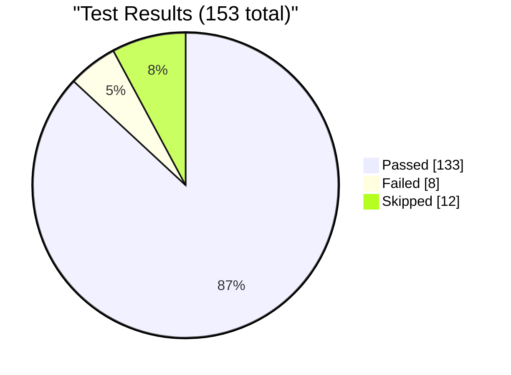
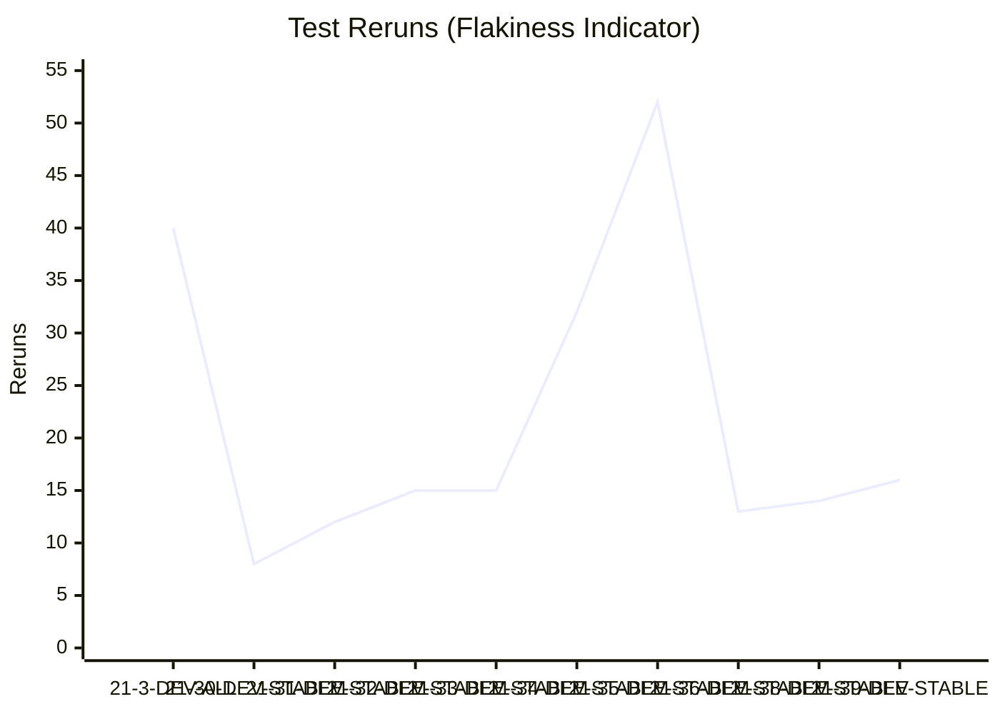
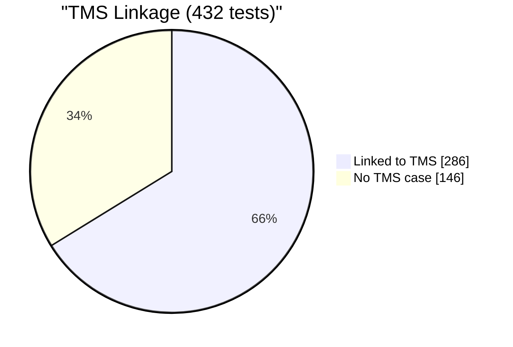

# Test Dashboard

_Generated: 2026-08-21 12:57 UTC_

## Latest Run

**RUN-ELITEA-2026-08-21-39-DEV-STABLE-ALL-FAILED**

| Metric | Value |
|--------|-------|
| Total | 153 |
| Passed | 133 |
| Failed | 8 |
| Skipped | 12 |
| Reruns | 16 |
| Pass Rate | 86.9% |

## Trend (Last 10 Runs)

```mermaid
xychart-beta
    title "Pass/Fail Trend"
    x-axis [21-3-DEV-ALL, 21-30-DEV-STABLE, 21-31-DEV-STABLE, 21-32-DEV-STABLE, 21-33-DEV-STABLE, 21-34-DEV-STABLE, 21-35-DEV-STABLE, 21-36-DEV-STABLE, 21-38-DEV-STABLE, 21-39-DEV-STABLE]
    y-axis "Tests" 0 --> 138
    bar "Passed" [95, 126, 127, 123, 123, 91, 113, 132, 133, 133]
    bar "Failed" [38, 12, 11, 15, 15, 49, 25, 6, 8, 8]
```

### Reruns Trend

## Run History

| Run | Total | Passed | Failed | Skipped | Reruns | Rate |
|-----|-------|--------|--------|---------|--------|------|
| ❌ 21-39-DEV-STABLE | 153 | 133 | 8 | 12 | 16 | 87% |
| ❌ 21-38-DEV-STABLE | 153 | 133 | 8 | 12 | 14 | 87% |
| ❌ 21-36-DEV-STABLE | 150 | 132 | 6 | 12 | 13 | 88% |
| ❌ 21-35-DEV-STABLE | 150 | 113 | 25 | 12 | 52 | 75% |
| ❌ 21-34-DEV-STABLE | 150 | 91 | 49 | 10 | 32 | 61% |
| ❌ 21-33-DEV-STABLE | 150 | 123 | 15 | 12 | 15 | 82% |
| ❌ 21-32-DEV-STABLE | 150 | 123 | 15 | 12 | 15 | 82% |
| ❌ 21-31-DEV-STABLE | 150 | 127 | 11 | 12 | 12 | 85% |
| ❌ 21-30-DEV-STABLE | 150 | 126 | 12 | 12 | 8 | 84% |
| ❌ 21-3-DEV-ALL | 134 | 95 | 38 | 1 | 40 | 71% |

---
_Source: `reports/automated/junit-RUN-*.json` (20 reports)_

---

## TMS Coverage Analysis

| Metric | Count |
|--------|-------|
| Tests in automation | 432 |
| Tests linked to TMS cases | 286 |
| Tests without TMS case | 146 |
| Orphan TMS refs (test missing) | 127 |
| **TMS Coverage** | **66.2%** |

### Tests Without TMS Case

_Tests that exist in automation but have no linked TMS case._

Show 146 unlinked tests

- `admin.test_guardrails_cleanup_only.test_cleanup_after`
- `admin.test_guardrails_cleanup_only.test_cleanup_before`
- `admin.test_guardrails_live_reload.TestBlockedToolLiveReload.test_blocked_tool_live_reload_case_insensitive`
- `admin.test_guardrails_live_reload.TestBlockedToolkitLiveReload.test_blocked_toolkit_live_reload_case_insensitive`
- `admin.test_guardrails_live_reload.TestSensitiveToolLiveReload.test_sensitive_tool_live_reload_case_insensitive`
- `agents.test_agent_character_limits.TestConversationStarterCharacterCounter.test_conversation_starter_counter_turns_red_at_limit`
- `agents.test_agent_character_limits.TestConversationStarterCharacterCounter.test_conversation_starter_counter_visible_and_updates`
- `agents.test_agent_character_limits.TestConversationStarterCharacterCounter.test_conversation_starter_fullscreen_counter_and_warning`
- `agents.test_agent_character_limits.TestConversationStarterCharacterCounter.test_conversation_starter_text_truncated_with_warning`
- `agents.test_agent_character_limits.TestConversationStarterCharacterCounter.test_multiple_conversation_starters_have_counters`
- `agents.test_agent_character_limits.TestWelcomeMessageCharacterCounter.test_welcome_message_counter_turns_red_at_limit`
- `agents.test_agent_character_limits.TestWelcomeMessageCharacterCounter.test_welcome_message_counter_visible_and_updates_realtime`
- `agents.test_agent_character_limits.TestWelcomeMessageCharacterCounter.test_welcome_message_fullscreen_counter_and_warning`
- `agents.test_agent_character_limits.TestWelcomeMessageCharacterCounter.test_welcome_message_text_truncated_with_warning`
- `agents.test_agent_management.TestAgentActions.test_delete_agent_via_api`
- `agents.test_agent_management.TestAgentActions.test_delete_agent_via_ui_menu`
- `agents.test_agent_management.TestAgentActions.test_edit_agent_description`
- `agents.test_agent_management.TestAgentActions.test_edit_agent_name`
- `agents.test_agent_management.TestAgentConfiguration.test_agent_detail_page_loads`
- `agents.test_agent_management.TestAgentConfiguration.test_agent_information_section`
- `agents.test_agent_management.TestAgentConfiguration.test_agent_instructions_field`
- `agents.test_agent_management.TestAgentConfiguration.test_agent_toolkits_section_visible`
- `agents.test_agent_management.TestAgentConfiguration.test_internal_tools_enum_usage`
- `agents.test_agent_management.TestAgentList.test_agent_search`
- `agents.test_agent_management.TestAgentList.test_agent_search_no_results`
- `agents.test_agent_management.TestAgentList.test_agents_dashboard_loads`
- `agents.test_agent_management.TestAgentList.test_view_toggle_table_and_card`
- `agents.test_agent_management.TestCreateAgent.test_create_agent_via_api_visible_in_ui`
- `agents.test_agent_management.TestCreateAgent.test_create_agent_via_ui`
- `agents.test_agent_with_github_toolkit.TestAddToolkitToAgent.test_add_toolkit_to_agent`
- `agents.test_agent_with_github_toolkit.TestChatWithAgentToolkit.test_agent_chat_with_github_toolkit`
- `agents.test_agent_with_github_toolkit.TestRemoveToolkitFromAgent.test_remove_toolkit_from_agent`
- `artifacts.test_artifacts_bucket_name_validation_invalid_formats.TestArtifactBucketNameValidationInvalidFormats.test_bucket_name_validation_rejects_invalid_format[ELITEA-1811-leading-digit]`
- `artifacts.test_artifacts_bucket_name_validation_invalid_formats.TestArtifactBucketNameValidationInvalidFormats.test_bucket_name_validation_rejects_invalid_format[ELITEA-1814-space]`
- `artifacts.test_artifacts_bucket_name_validation_invalid_formats.TestArtifactBucketNameValidationInvalidFormats.test_bucket_name_validation_rejects_invalid_format[ELITEA-1814-special-char]`
- `artifacts.test_artifacts_bucket_name_validation_invalid_formats.TestArtifactBucketNameValidationInvalidFormats.test_bucket_name_validation_rejects_invalid_format[ELITEA-1814-underscore]`
- `artifacts.test_artifacts_multi_file.TestArtifactMultiFileDownload.test_agent_creates_files_at_root_and_in_subfolder`
- `artifacts.test_bucket_permissions_api.TestBucketPermissionsAPI.test_no_access_permission_blocks_all_api_operations`
- `artifacts.test_bucket_permissions_api.TestBucketPermissionsAPI.test_read_only_permission_allows_get_blocks_write_operations`
- `chat.test_agent_with_toolkit_chat.TestAgentWithToolkitInChat.test_agent_with_toolkit_executes_in_chat`
- `chat.test_chat_folder_rename_checkmark_validation.TestChatFolderDeleteApiFallbackRegression.test_delete_folder_via_api_actually_removes_the_folder`
- `chat.test_chat_interface.TestContextAndSettings.test_edit_context_settings`
- `chat.test_chat_interface.TestConversationUIElements.test_attach_files_button_sends_file_with_message`
- `chat.test_chat_interface.TestConversationUIElements.test_internal_tools_panel_shows_all_tools`
- `chat.test_chat_interface.TestConversationUIElements.test_model_selector_opens_menu`
- `chat.test_chat_interface.TestHashSearch.test_add_participant_via_hash_search`
- `chat.test_chat_interface.TestHashSearch.test_hash_search_participants`
- `chat.test_chat_interface.TestMessageActions.test_copy_message_to_clipboard`
- `chat.test_chat_interface.TestMessageActions.test_delete_message`
- `chat.test_chat_interface.TestPageLoadAndRendering.test_chat_page_loads_with_functional_input`
- `chat.test_chat_interface.TestSearchAndErrorHandling.test_handle_message_send_failure`
- `chat.test_chat_interface.TestSearchAndErrorHandling.test_search_conversations_dialog`
- `chat.test_chat_interface.TestSendingMessages.test_cannot_send_empty_message`
- `chat.test_chat_interface.TestSendingMessages.test_send_text_message`
- `chat.test_chat_interface.TestSendingMessages.test_shift_enter_adds_new_line`
- `chat.test_chat_interface.TestSidebarNavigation.test_navigate_to_agents_from_sidebar`
- `chat.test_chat_interface.TestSidebarNavigation.test_open_close_sidebar`
- `chat.test_context_management.TestContextManagementSettings.test_context_budget_reflects_profile_max_tokens[10k_tokens]`
- `chat.test_context_management.TestContextManagementSettings.test_context_budget_reflects_profile_max_tokens[32k_tokens]`
- `chat.test_conversation_management.TestConversationActions.test_delete_conversation_cancel`
- `chat.test_conversation_management.TestConversationActions.test_delete_conversation_with_confirmation`
- `chat.test_conversation_management.TestConversationActions.test_multiple_conversations_listed`
- `chat.test_conversation_management.TestConversationActions.test_rename_conversation_via_ui`
- `chat.test_conversation_management.TestConversationIsolation.test_fixture_cleanup_cycle`
- `chat.test_conversation_management.TestConversationIsolation.test_fixture_creates_fresh_conversation`
- `chat.test_conversation_management.TestConversationList.test_click_conversation_to_open`
- `chat.test_conversation_management.TestConversationList.test_search_conversations_button`
- `chat.test_conversation_management.TestConversationNavigation.test_navigate_between_conversations`
- `chat.test_conversation_management.TestConversationNavigation.test_send_message_persists_conversation`
- `chat.test_conversation_management.TestCreateConversation.test_create_conversation_via_api`
- `chat.test_conversation_management.TestCreateConversation.test_new_conversation_default_settings`
- `chat.test_generate_mermaid_diagram_and_edit_in_canvas.TestGenerateMermaidDiagramAndEditInCanvas.test_generate_mermaid_diagram_and_edit_in_canvas`
- `chat.test_hitl_sensitive_action_authorization.TestSensitiveActionAuthorize.test_authorize_executes_toolkit_tool_directly`
- `chat.test_hitl_sensitive_action_authorization.TestSensitiveActionBlock.test_block_prevents_toolkit_tool_from_executing`
- `chat.test_hitl_sensitive_action_authorization.TestSensitiveActionBlockWithComment.test_block_with_comment_records_reason_and_blocks_action`
- `chat.test_hitl_sensitive_action_authorization.TestSensitiveActionCardDisplay.test_sensitive_action_card_displays_for_direct_toolkit_call`
- `chat.test_image_creation.TestImageCreation.test_create_image[detailed_description]`
- `chat.test_image_creation.TestImageCreation.test_create_image[minimal_prompt]`
- `chat.test_move_conversation_to_folder.TestMoveConversationToNewFolder.test_move_conversation_to_new_folder`
- `chat.test_open_existing_conversation_from_this_week_section.TestOpenExistingConversationFromThisWeekSection.test_open_existing_conversation_from_this_week_section`
- `pipelines.test_pipeline_advanced.TestActionsMenu.test_export_pipeline_if_available`
- `pipelines.test_pipeline_advanced.TestActionsMenu.test_three_dot_menu_lists_items`
- `pipelines.test_pipeline_advanced.TestDiscardChanges.test_save_discard_button_states_toggle_on_edit_and_discard`
- `pipelines.test_pipeline_advanced.TestMakeEntrypoint.test_make_node_entrypoint`
- `pipelines.test_pipeline_advanced.TestMultiNodeTopology.test_save_multi_node_pipeline`
- `pipelines.test_pipeline_advanced.TestMultiNodeTopology.test_three_node_chain`
- `pipelines.test_pipeline_advanced.TestYamlEditor.test_flow_yaml_round_trip`
- `pipelines.test_pipeline_advanced.TestYamlEditor.test_yaml_content_reflects_pipeline`
- `pipelines.test_pipeline_advanced.TestYamlEditor.test_yaml_view_toggle`
- `pipelines.test_pipeline_execution.TestExecutePipeline.test_message_count_starts_at_zero_and_grows`
- `pipelines.test_pipeline_execution.TestExecutePipeline.test_pipeline_response_is_meaningful`
- `pipelines.test_pipeline_execution.TestPipelineChatMessages.test_multiple_executions_accumulate`
- `pipelines.test_pipeline_execution.TestPipelineChatMessages.test_user_message_visible`
- `pipelines.test_pipeline_execution.TestPipelineExecutionEdgeCases.test_empty_pipeline_execution`
- `pipelines.test_pipeline_execution.TestPipelineExecutionEdgeCases.test_navigate_away_and_reexecute`
- `pipelines.test_pipeline_management.TestCreatePipeline.test_create_pipeline_required_fields_validation`
- `pipelines.test_pipeline_management.TestCreatePipeline.test_create_pipeline_via_ui`
- `pipelines.test_pipeline_management.TestDeletePipeline.test_delete_pipeline_via_api`
- `pipelines.test_pipeline_management.TestEditPipeline.test_edit_pipeline_description`
- `pipelines.test_pipeline_management.TestEditPipeline.test_edit_pipeline_name`
- `pipelines.test_pipeline_management.TestEditPipeline.test_pipeline_detail_page_loads`
- `pipelines.test_pipeline_management.TestEditPipeline.test_pipeline_has_configuration_and_history_tabs`
- `pipelines.test_pipeline_management.TestPipelineDashboard.test_pipeline_created_via_api_visible_in_dashboard`
- `pipelines.test_pipeline_management.TestPipelineDashboard.test_pipeline_dashboard_loads`
- `pipelines.test_pipeline_management.TestPipelineIsolation.test_fixture_cleanup_cycle`
- `pipelines.test_pipeline_management.TestPipelineIsolation.test_fixture_creates_fresh_pipeline`
- `pipelines.test_pipeline_management.TestSearchPipeline.test_search_pipeline_by_name`
- `pipelines.test_pipeline_management.TestSearchPipeline.test_search_pipeline_no_results`
- `pipelines.test_pipeline_nodes.TestAddNode.test_add_human_in_the_loop_node_and_connect_to_end`
- `settings.test_ai_providers_page_sections_load_without_error.TestAIProvidersPageSections.test_ai_providers_page_sections_load_without_error`
- `skills.test_skill_management.TestCreateSkill.test_create_skill_and_verify_execution`
- `smoke.test_ui_smoke.TestHomePage.test_main_content_visible`
- `smoke.test_ui_smoke.TestHomePage.test_page_loads`
- `support_assistant.test_support_assistant_smoke.TestSupportAssistantLauncher.test_widget_state_persists_after_close_reopen`
- `toolkits.test_github_toolkit.TestChatWithGitHubToolkit.test_chat_with_github_toolkit`
- `toolkits.test_github_toolkit.TestCreateGitHubCredential.test_create_github_credential`
- `toolkits.test_github_toolkit.TestCreateGitHubToolkit.test_create_github_toolkit`
- `toolkits.test_github_toolkit.TestGitHubToolkitTestSettings.test_github_toolkit_test_settings`
- `toolkits.test_toolkit_indicators_for_credentials.TestAgentCredentialIndicators.test_agent_credential_indicators_e2e`
- `toolkits.test_toolkit_indicators_for_credentials.TestPipelineCredentialIndicators.test_pipeline_credential_indicators_e2e`
- `toolkits.test_toolkit_indicators_for_credentials.TestToolkitCredentialIndicators.test_toolkit_credential_indicators_e2e`
- `toolkits.test_toolkit_parameterized.TestChatWithToolkit.test_chat_with_toolkit[bitbucket]`
- `toolkits.test_toolkit_parameterized.TestChatWithToolkit.test_chat_with_toolkit[confluence]`
- `toolkits.test_toolkit_parameterized.TestChatWithToolkit.test_chat_with_toolkit[github]`
- `toolkits.test_toolkit_parameterized.TestChatWithToolkit.test_chat_with_toolkit[gitlab]`
- `toolkits.test_toolkit_parameterized.TestChatWithToolkit.test_chat_with_toolkit[jira]`
- `toolkits.test_toolkit_parameterized.TestCreateCredential.test_create_credential[bitbucket]`
- `toolkits.test_toolkit_parameterized.TestCreateCredential.test_create_credential[confluence]`
- `toolkits.test_toolkit_parameterized.TestCreateCredential.test_create_credential[github]`
- `toolkits.test_toolkit_parameterized.TestCreateCredential.test_create_credential[gitlab]`
- `toolkits.test_toolkit_parameterized.TestCreateCredential.test_create_credential[jira]`
- `toolkits.test_toolkit_parameterized.TestCreateToolkit.test_create_toolkit[bitbucket]`
- `toolkits.test_toolkit_parameterized.TestCreateToolkit.test_create_toolkit[confluence]`
- `toolkits.test_toolkit_parameterized.TestCreateToolkit.test_create_toolkit[github]`
- `toolkits.test_toolkit_parameterized.TestCreateToolkit.test_create_toolkit[gitlab]`
- `toolkits.test_toolkit_parameterized.TestCreateToolkit.test_create_toolkit[jira]`
- `toolkits.test_toolkit_parameterized.TestToolkitTestSettings.test_toolkit_test_settings[bitbucket]`
- `toolkits.test_toolkit_parameterized.TestToolkitTestSettings.test_toolkit_test_settings[confluence]`
- `toolkits.test_toolkit_parameterized.TestToolkitTestSettings.test_toolkit_test_settings[github]`
- `toolkits.test_toolkit_parameterized.TestToolkitTestSettings.test_toolkit_test_settings[gitlab]`
- `toolkits.test_toolkit_parameterized.TestToolkitTestSettings.test_toolkit_test_settings[jira]`
- `voice.test_voice_configuration.TestVoiceConfiguration.test_speed_and_volume_controls`
- `voice.test_voice_configuration.TestVoiceConfiguration.test_voice_preview_personalization`
- `voice.test_voice_configuration.TestVoiceConfiguration.test_voice_selection_from_chat`
- `voice.test_voice_configuration.TestVoiceConfiguration.test_voice_settings_not_visible_by_default`
- `voice.test_voice_configuration.TestVoiceConfiguration.test_voice_settings_sync`

### Orphan TMS References

_TMS cases reference tests that don't exist in automation (renamed/deleted?)._

Show 127 orphan refs

- `artifacts.test_artifacts_bucket_name_validation_invalid_formats.TestArtifactBucketNameValidationInvalidFormats.test_bucket_name_validation_rejects_invalid_format` (ELITEA-1814)
- `chat.test_agent_hub_create_conversation_via_starter.TestAgentHubCreateConversationViaStarter.test_agent_hub_create_conversation_via_starter` (ELITEA-2093)
- `chat.test_attach_files_10_left_counter.TestAttachFiles10LeftCounter.test_attach_files_menuitem_shows_10_left_counter` (ELITEA-2195)
- `chat.test_attach_files_multiple_chips_display.TestAttachFilesMultipleChipsDisplay.test_attach_files_of_different_types_shows_identical_icon_and_long_filename_truncates` (ELITEA-2199)
- `chat.test_attach_files_multiple_chips_display.TestAttachFilesMultipleChipsDisplay.test_attach_files_then_remove_two_individually_sequentially` (ELITEA-2198)
- `chat.test_attach_files_multiple_chips_display.TestAttachFilesMultipleChipsDisplay.test_attach_multiple_files_displays_chips_above_composer` (ELITEA-2196)
- `chat.test_attach_files_multiple_chips_display.TestAttachFilesMultipleChipsDisplay.test_long_filename_truncates_and_overflow_indicator_click_expands` (ELITEA-2467)
- `chat.test_build_with_ai_cancel_then_generate_echo_agent.TestBuildWithAICancelThenGenerateEchoAgent.test_cancel_then_generate_creates_echo_agent_in_canvas` (ELITEA-2073)
- `chat.test_chat_agent_starters_add_remove.TestChatAddAgentWithStartersAndSendViaStarter.test_add_agent_with_starters_and_send_via_starter` (ELITEA-2465)
- `chat.test_chat_agent_starters_add_remove.TestChatAddAgentWithStartersToConversation.test_add_agent_with_starters_to_conversation` (ELITEA-2177)
- `chat.test_chat_agent_starters_add_remove.TestChatRemoveAgentClearsConversationStarters.test_remove_agent_clears_conversation_starters` (ELITEA-2178)
- `chat.test_chat_canvas_edit_agent.TestChatCanvasEditAgent.test_edit_agent_welcome_message_syncs_to_agents_section` (ELITEA-2089)
- `chat.test_chat_folder_creation_custom_name_and_cancel.TestChatFolderCreationCustomNameAndCancel.test_cancel_folder_creation_discards_folder` (ELITEA-2134)
- `chat.test_chat_folder_creation_custom_name_and_cancel.TestChatFolderCreationCustomNameAndCancel.test_create_folder_with_custom_name` (ELITEA-2457)
- `chat.test_chat_folder_rename_checkmark_validation.TestChatFolderRenameCheckmarkValidation.test_folder_rename_cancel_via_x_icon_discards_changes` (ELITEA-2122)
- `chat.test_chat_folder_rename_checkmark_validation.TestChatFolderRenameCheckmarkValidation.test_folder_rename_no_changes_close_via_x_icon` (ELITEA-2131)
- `chat.test_chat_folder_rename_checkmark_validation.TestChatFolderRenameCheckmarkValidation.test_folder_rename_via_context_menu_edit_option` (ELITEA-2121)
- `chat.test_chat_folder_rename_checkmark_validation.TestChatFolderRenameCheckmarkValidation.test_pinned_folder_rename_retains_pin_state` (ELITEA-2130)
- `chat.test_chat_folder_rename_length_boundaries.TestChatFolderRenameLengthBoundaries.test_rename_folder_length_boundary_50_chars_accepted` (ELITEA-2128)
- `chat.test_chat_folder_rename_length_boundaries.TestChatFolderRenameLengthBoundaries.test_rename_folder_type_and_paste_beyond_max_length_truncates` (ELITEA-2129)
- `chat.test_chat_interface.TestHashSearch.test_add_agent_via_hash_search_joins_participants_and_responds` (ELITEA-2469)
- `chat.test_chat_interface.TestHashSearch.test_add_pipeline_via_hash_search_joins_participants_and_responds` (ELITEA-2470)
- `chat.test_chat_interface.TestHashSearch.test_hash_search_shows_agents_and_pipelines_from_all_sources` (ELITEA-2206)
- `chat.test_chat_search_and_modules_panel.TestChatSearchAndModulesPanel.test_search_cleared_by_x_icon_restores_default_view` (ELITEA-2164)
- `chat.test_chat_search_and_modules_panel.TestChatSearchAndModulesPanel.test_search_input_cleared_by_deleting_text_updates_dynamically` (ELITEA-2165)
- `chat.test_chat_search_and_modules_panel.TestChatSearchAndModulesPanel.test_search_no_results_state` (ELITEA-2163)
- `chat.test_close_toolkit_canvas_without_saving.TestCloseToolkitCanvasWithoutSaving.test_close_toolkit_canvas_without_saving_creates_no_toolkit` (ELITEA-2081)
- `chat.test_context_auto_summarization_disabled.TestContextAutoSummarizationDisabled.test_no_summarization_when_auto_summarization_disabled` (ELITEA-2217)
- `chat.test_context_management_disabled.TestContextManagementDisabledWidgetStaysZero.test_context_management_disabled_widget_stays_at_zero` (ELITEA-2216)
- `chat.test_conversation_deletion_inside_folder.TestConversationDeletionInsideFolder.test_delete_conversation_inside_folder_preserves_folder` (ELITEA-2115)
- `chat.test_conversation_rename_basic_via_edit_option.TestConversationRenameBasicViaEditOption.test_rename_conversation_basic_via_edit_option` (ELITEA-2099)
- `chat.test_conversation_rename_cancel_discards_changes.TestConversationRenameCancelDiscardsChanges.test_rename_conversation_cancel_discards_changes` (ELITEA-2100)
- `chat.test_conversation_rename_checkmark_active_state.TestConversationRenameCheckmarkActiveState.test_rename_checkmark_activates_at_three_characters` (ELITEA-2109)
- `chat.test_conversation_rename_checkmark_active_state.TestConversationRenameCheckmarkActiveState.test_rename_checkmark_inactive_click_has_no_effect[ELITEA-2105-no-changes]` (ELITEA-2105)
- `chat.test_conversation_rename_checkmark_active_state.TestConversationRenameCheckmarkActiveState.test_rename_checkmark_inactive_click_has_no_effect[ELITEA-2106-empty-field]` (ELITEA-2106)
- `chat.test_conversation_rename_checkmark_active_state.TestConversationRenameCheckmarkActiveState.test_rename_checkmark_inactive_click_has_no_effect[ELITEA-2107-1-char]` (ELITEA-2107)
- `chat.test_conversation_rename_checkmark_active_state.TestConversationRenameCheckmarkActiveState.test_rename_checkmark_inactive_click_has_no_effect[ELITEA-2108-2-char]` (ELITEA-2108)
- `chat.test_conversation_rename_invalid_chars_and_recovery.TestConversationRenameInvalidCharsAndRecovery.test_rename_checkmark_inactive_for_invalid_input_shows_tooltip[ELITEA-2110-special-characters]` (ELITEA-2110)
- `chat.test_conversation_rename_invalid_chars_and_recovery.TestConversationRenameInvalidCharsAndRecovery.test_rename_checkmark_inactive_for_invalid_input_shows_tooltip[ELITEA-2111-dollar-percent-at-characters]` (ELITEA-2111)
- `chat.test_conversation_rename_invalid_chars_and_recovery.TestConversationRenameInvalidCharsAndRecovery.test_rename_checkmark_inactive_for_invalid_input_shows_tooltip[ELITEA-2112-leading-space]` (ELITEA-2112)
- `chat.test_conversation_rename_invalid_chars_and_recovery.TestConversationRenameInvalidCharsAndRecovery.test_rename_recovers_and_saves_after_invalid_value_replaced` (ELITEA-2113)
- `chat.test_conversation_rename_length_boundaries.TestConversationRenameLengthBoundaries.test_rename_conversation_length_boundary[ELITEA-2101-49-chars]` (ELITEA-2101)
- `chat.test_conversation_rename_length_boundaries.TestConversationRenameLengthBoundaries.test_rename_conversation_length_boundary[ELITEA-2102-50-chars]` (ELITEA-2102)
- `chat.test_conversation_rename_length_boundaries.TestConversationRenameLengthBoundaries.test_rename_conversation_paste_beyond_max_length_truncates` (ELITEA-2104)
- `chat.test_conversation_rename_length_boundaries.TestConversationRenameLengthBoundaries.test_rename_conversation_type_beyond_max_length_truncates` (ELITEA-2103)
- `chat.test_create_mcp_from_conversation_discard_changes.TestCreateMcpFromConversationDiscardChanges.test_create_mcp_from_conversation_discard_changes_creates_no_mcp` (ELITEA-2084)
- `chat.test_create_new_conversation_team_project_attachments_and_llm.TestCreateNewConversationTeamProjectAttachmentsAndLLM.test_create_conversation_team_project_attachments_and_llm` (ELITEA-2091)
- `chat.test_create_toolkit_from_conversation.TestCreateToolkitFromConversation.test_create_toolkit_from_conversation_close_canvas_and_verify_participant` (ELITEA-2083)
- `chat.test_delete_confirmation_modal_ui_validation.TestDeleteConfirmationModalUIValidation.test_delete_confirmation_modal_dismisses_via_escape_and_outside_click` (ELITEA-2116)
- `chat.test_delete_confirmation_modal_ui_validation.TestDeleteConfirmationModalUIValidation.test_delete_confirmation_modal_title_body_and_button_styling` (ELITEA-2116)
- `chat.test_drag_drop_conversation_folder.TestDragDropConversationBackToGeneralList.test_drag_drop_conversation_back_to_general_list` (ELITEA-2145)
- `chat.test_drag_drop_conversation_folder.TestDragDropConversationToFolder.test_drag_drop_conversation_to_folder` (ELITEA-2142)
- `chat.test_drag_drop_conversation_folder.TestDragDropHighlightsTargetFolderOnHover.test_drag_drop_highlights_target_folder_on_hover` (ELITEA-2143)
- `chat.test_folder_creation.TestChatFolderCreation.test_create_folder_default_name_checkmark_active` (ELITEA-2118)
- `chat.test_folder_list_scrollability_and_expand_states.TestFolderDisplaysConversationsOrEmptyState.test_folder_displays_conversations_or_empty_state` (ELITEA-2460)
- `chat.test_folder_list_scrollability_and_expand_states.TestFolderListScrollableWhenManyFoldersExist.test_folder_list_scrollable_when_many_folders_exist` (ELITEA-2146)
- `chat.test_folder_list_scrollability_and_expand_states.TestMoveToSubmenuFolderListScrollable.test_move_to_submenu_folder_list_scrollable` (ELITEA-2147)
- `chat.test_generated_echo_agent_save_close_and_starters.TestGeneratedEchoAgentSaveCloseAndStarters.test_save_close_and_use_generated_starters` (ELITEA-2074)
- `chat.test_invite_users_add_cancel_close.TestCancelAddUsersModalAfterPreselectingUsers.test_cancel_after_preselecting_two_users_adds_no_one` (ELITEA-2176)
- `chat.test_invite_users_add_cancel_close.TestRemovePreselectedUserViaChipX.test_remove_preselected_user_via_chip_x` (ELITEA-2175)
- `chat.test_last_remaining_conversation_deletion.TestLastRemainingConversationDeletion.test_delete_last_remaining_conversation_shows_welcome_state` (ELITEA-2117)
- `chat.test_move_conversation_to_folder.TestMoveConversationBackToList.test_move_conversation_back_to_list` (ELITEA-2140)
- `chat.test_move_conversation_to_folder.TestMoveConversationBetweenTwoFolders.test_move_conversation_between_two_folders` (ELITEA-2141)
- `chat.test_move_conversation_to_folder.TestMoveConversationToExistingFolder.test_move_conversation_to_new_folder` (ELITEA-2137)
- `chat.test_move_conversation_to_folder.TestMoveConversationToNewFolder.test_move_conversation_to_new_folder_with_custom_name` (ELITEA-2138)
- `chat.test_open_conversation_from_folder.TestOpenExistingConversationFromFolder.test_open_existing_conversation_from_folder` (ELITEA-2098)
- `chat.test_owner_has_no_remove_control_in_users_dropdown.TestOwnerHasNoRemoveControlInUsersDropdown.test_owner_has_no_remove_control_in_users_dropdown` (ELITEA-2192)
- `chat.test_participants_dropdown_click_name_inserts_mention.TestParticipantsDropdownClickNameInsertsMention.test_click_participant_name_inserts_mention[ELITEA-2173-single-mention]` (ELITEA-2173)
- `chat.test_participants_dropdown_click_name_inserts_mention.TestParticipantsDropdownClickNameInsertsMention.test_click_participant_name_inserts_mention[ELITEA-2174-two-mentions]` (ELITEA-2174)
- `chat.test_pin_conversation.TestChatPanelOrderingPinnedFoldersAndConversations.test_pinned_folder_and_conversation_render_above_unpinned_panel_order` (ELITEA-2461)
- `chat.test_pin_conversation.TestMultipleConversationsPinnedIndependently.test_pin_two_conversations_independently` (ELITEA-2160)
- `chat.test_pin_conversation.TestPinDisabledInFolderThenMovedAndPinned.test_pin_disabled_in_folder_then_moved_and_pinned` (ELITEA-2158)
- `chat.test_pin_conversation.TestUnpinConversationViaContextMenu.test_unpin_conversation_via_context_menu` (ELITEA-2150)
- `chat.test_pin_folder.TestMultipleFoldersPinnedIndependently.test_pin_two_folders_independently` (ELITEA-2161)
- `chat.test_pin_folder.TestPinFolderViaPinOnTop.test_pin_empty_folder_retains_empty_state` (ELITEA-2155)
- `chat.test_pin_folder.TestPinFolderViaPinOnTop.test_pin_folder_via_pin_on_top` (ELITEA-2462)
- `chat.test_pin_folder.TestPinFolderViaPinOnTop.test_pin_folder_with_multiple_conversations_retains_all` (ELITEA-2154)
- `chat.test_pin_folder.TestUnpinFolderViaContextMenu.test_unpin_empty_folder_retains_empty_state` (ELITEA-2156)
- `chat.test_pin_folder.TestUnpinFolderViaContextMenu.test_unpin_folder_via_context_menu` (ELITEA-2153)
- `chat.test_pipeline_create_save_basic_configuration.TestPipelineCreateSaveBasicConfiguration.test_create_pipeline_save_basic_configuration` (ELITEA-2077)
- `chat.test_pipeline_discard_changes_clears_canvas.TestPipelineDiscardChangesClearsCanvas.test_discard_clears_canvas_and_creates_no_pipeline` (ELITEA-2076)
- `chat.test_pipeline_flow_editor_discard_llm_node.TestPipelineFlowEditorDiscardLlmNode.test_add_llm_node_discard_changes_removes_node` (ELITEA-2078)
- `chat.test_public_conversation_green_icon.TestPublicConversationGreenIcon.test_public_conversation_shows_green_icon_in_chat_list` (ELITEA-2188)
- `chat.test_regenerate_response.TestRegenerateResponse.test_regenerate_only_on_last_and_click_triggers_new_generation` (ELITEA-2187)
- `chat.test_regenerate_response.TestRegenerateResponse.test_regenerate_replaces_response_with_new_generation` (ELITEA-2185)
- `chat.test_regenerate_response.TestRegenerateResponse.test_regenerate_visible_only_on_last_response` (ELITEA-2184)
- `chat.test_send_message_with_attachments_verify_included.TestSendMessageWithAttachmentsVerifyIncluded.test_send_message_with_attachments_verify_included` (ELITEA-2201)
- `chat.test_slash_mention_mcp_selection_and_available_tools.TestSlashMentionMcpSelectionAndAvailableTools.test_select_mcp_from_slash_mention_no_tools_shows_empty_panel` (ELITEA-2468)
- `chat.test_slash_mention_mcp_selection_and_available_tools.TestSlashMentionMcpSelectionAndAvailableTools.test_select_mcp_from_slash_mention_shows_its_tools` (ELITEA-2468)
- `chat.test_streaming_response.TestStreamingResponse.test_composer_send_button_toggles_with_empty_input_and_waveform_reappears` (ELITEA-2466)
- `help_center.test_help_center_resource_links.TestHelpCenterResourceLinks.test_resource_card_link_redirects_to_external_page[ELITEA-2220-documentation-getting-started]` (ELITEA-2220)
- `help_center.test_help_center_resource_links.TestHelpCenterResourceLinks.test_resource_card_link_redirects_to_external_page[ELITEA-2221-release-notes-latest]` (ELITEA-2221)
- `help_center.test_help_center_resource_links.TestHelpCenterResourceLinks.test_resource_card_link_redirects_to_external_page[ELITEA-2222-tutorials-how-to-create-an-agent]` (ELITEA-2222)
- `help_center.test_help_center_resource_links.TestHelpCenterResourceLinks.test_resource_card_link_redirects_to_external_page[ELITEA-2224-tutorials-more]` (ELITEA-2224)
- `help_center.test_help_center_resource_links.TestHelpCenterResourceLinks.test_video_library_more_redirects_to_external_portal` (ELITEA-2223)
- `help_center.test_help_center_sidebar_tour.TestHelpCenterSidebarTourExtras.test_sidebar_interactive_tour_back_returns_to_step_one` (ELITEA-2230)
- `help_center.test_help_center_sidebar_tour.TestHelpCenterSidebarTourExtras.test_sidebar_interactive_tour_restarts_after_completion` (ELITEA-2228)
- `help_center.test_help_center_sidebar_tour.TestHelpCenterSidebarTourExtras.test_sidebar_interactive_tour_skip_terminates` (ELITEA-2229)
- `help_center.test_help_center_sidebar_tour.TestHelpCenterSidebarTourExtras.test_sidebar_interactive_tour_starts_on_link_click` (ELITEA-2226)
- `help_center.test_help_center_version_info.TestHelpCenterVersionInfo.test_version_info_tooltip_displays_and_copies` (ELITEA-2225)
- `onboarding.test_onboarding_welcome.TestOnboardingWelcomePage.test_welcome_page_displayed_on_first_login` (ELITEA-2231)
- `settings.test_ai_providers_page_sections_load_without_error.TestAIProvidersPageSections.test_ai_providers_page_sections_load_without_error_test` (ELITEA-2392)
- `skills.test_agent_skills_validation_attribution_and_token_invalidation.TestAgentSkillsValidationAttributionAndTokenInvalidation.test_agent_skills_validation_attribution_and_token_invalidation` (ELITEA-2601)
- `skills.test_agent_with_skills_publishing_flow.TestAgentWithSkillsPublishingFlow.test_agent_with_skills_publishing_flow` (ELITEA-2600)
- `skills.test_published_agent_version_cannot_be_modified.TestPublishedAgentVersionCannotBeModified.test_published_agent_version_cannot_be_modified` (ELITEA-2614)
- `skills.test_skill_agent_interaction.TestInteractWithSkillsFromAgent.test_skill_autonomous_invocation_thought_process_and_security` (ELITEA-2607)
- `skills.test_skill_agent_interaction.TestInteractWithSkillsFromAgent.test_skill_explicit_and_autonomous_invocation_coexistence` (ELITEA-2609)
- `skills.test_skill_agent_version_selection_behavior.TestSkillAgentVersionSelectionBehavior.test_skill_version_selection_drives_agent_chat_behavior` (ELITEA-2610)
- `skills.test_skill_build_with_ai.TestSkillBuildWithAIBackToPromptFromReviewStep.test_back_to_prompt_returns_to_input_step_and_preserves_prompt_text` (ELITEA-1996)
- `skills.test_skill_build_with_ai.TestSkillBuildWithAICancelFromPromptStep.test_cancel_from_prompt_step_closes_modal_without_creating_skill` (ELITEA-1997)
- `skills.test_skill_build_with_ai.TestSkillBuildWithAICancelFromReviewStep.test_cancel_from_review_step_does_not_create_skill` (ELITEA-1998)
- `skills.test_skill_build_with_ai.TestSkillBuildWithAICreationFailureRecovery.test_creation_failure_stays_on_review_step_and_retry_succeeds` (ELITEA-2000)
- `skills.test_skill_build_with_ai.TestSkillBuildWithAIGeneratedNameNamingRules.test_generated_skill_name_adheres_to_naming_rules` (ELITEA-1992)
- `skills.test_skill_build_with_ai.TestSkillBuildWithAIReviewFormCharacterLimits.test_review_form_field_character_limit_is_enforced[ELITEA-1994-description` (ELITEA-1994)
- `skills.test_skill_build_with_ai.TestSkillBuildWithAIReviewFormCharacterLimits.test_review_form_field_character_limit_is_enforced[ELITEA-1995-instructions` (ELITEA-1995)
- `skills.test_skill_build_with_ai_role_visibility.TestSkillBuildWithAIButtonRoleVisibility.test_build_with_ai_button_visible_for_admin_role` (ELITEA-1986)
- `skills.test_skill_edit_with_ai_happy_path.TestSkillEditWithAIHappyPath.test_edit_with_ai_happy_path` (ELITEA-2611)
- `skills.test_skill_edit_with_ai_navigation_error_handling.TestSkillEditWithAINavigationErrorHandling.test_edit_with_ai_navigation_and_error_handling` (ELITEA-2612)
- `skills.test_skill_edit_with_ai_role_visibility.TestSkillEditWithAICharacterLimit.test_edit_with_ai_summary_instructions_truncates_at_character_limit` (ELITEA-2613)
- `skills.test_skill_edit_with_ai_role_visibility.TestSkillEditWithAIRoleVisibility.test_edit_with_ai_button_visible_for_admin_role` (ELITEA-2613)
- `skills.test_skill_publish_ai_validation_blockers.TestSkillPublishAiValidationBlockers.test_short_content_placeholder_and_secrets_block_publish` (ELITEA-2596)
- `skills.test_skill_publish_token_invalidation_and_ttl.TestSkillPublishTokenInvalidationAndTTL.test_publish_token_expires_after_ttl` (ELITEA-2597)
- `skills.test_skill_publish_token_invalidation_and_ttl.TestSkillPublishTokenInvalidationAndTTL.test_publish_token_invalidated_by_modification` (ELITEA-2597)
- `skills.test_skill_publish_warn_status_allows_publishing.TestSkillPublishWarnStatusAllowsPublishing.test_warn_status_does_not_block_publish` (ELITEA-2598)
- `skills.test_skill_publish_wizard_happy_path.TestSkillPublishWizardHappyPath.test_publish_skill_happy_path` (ELITEA-2595)
- `skills.test_skill_unpublish_republish_lifecycle.TestSkillUnpublishRepublishLifecycle.test_unpublish_republish_lifecycle` (ELITEA-2599)
- `skills.test_subagent_skills_isolation.TestSubagentSkillsIsolation.test_subagent_uses_only_its_own_attached_skill` (ELITEA-2608)

---
_Compared `automation/index.json` (432 tests) with `index_automated.json` (413 refs)_
