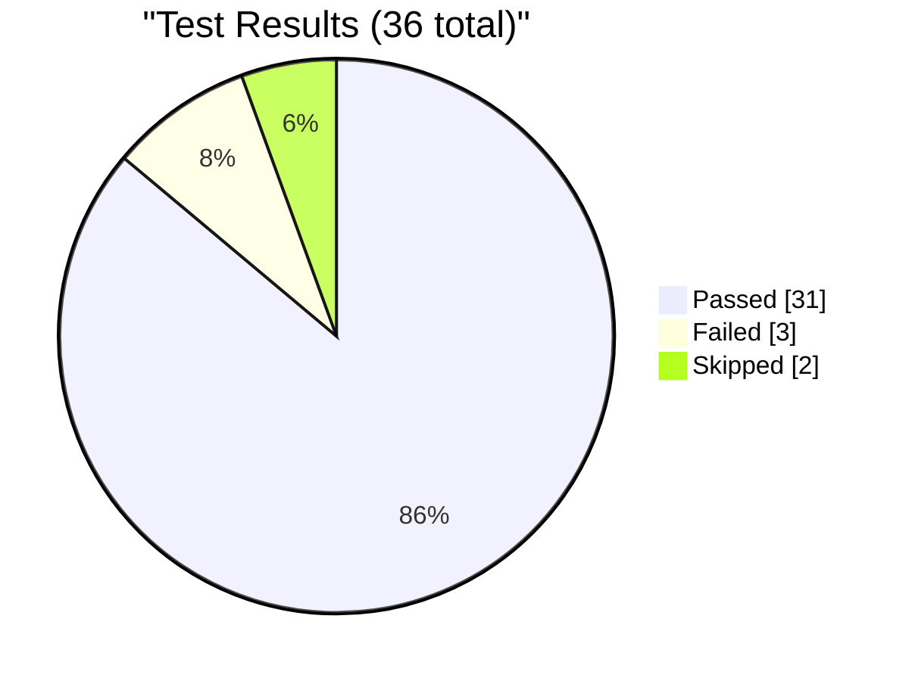
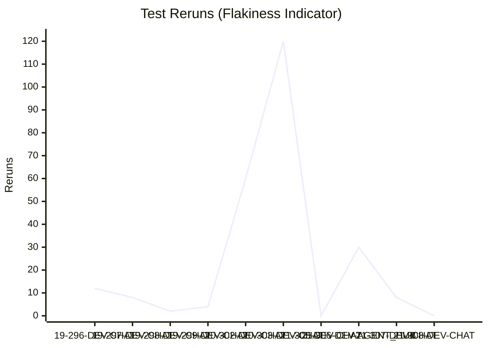
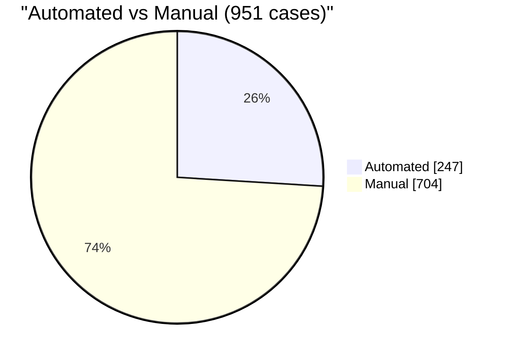
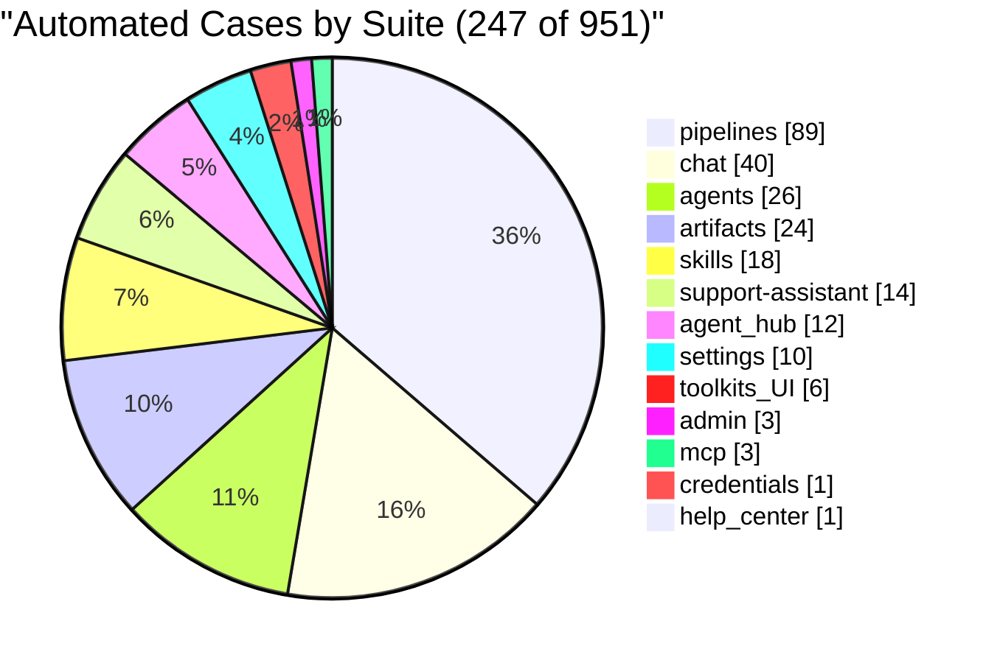

# Test Dashboard

_Generated: 2026-10-21 19:03 UTC_

## Latest Run

**RUN-ELITEA-2026-10-21-308-DEV-CHAT-FAILED**

| Metric | Value |
|--------|-------|
| Total | 36 |
| Passed | 31 |
| Failed | 3 |
| Skipped | 2 |
| Reruns | 0 |
| Pass Rate | 86.1% |

## Trend (Last 10 Runs)

```mermaid
xychart-beta
    title "Pass/Fail Trend"
    x-axis [19-296-DEV-CHAT, 19-297-DEV-CHAT, 19-298-DEV-CHAT, 19-299-DEV-CHAT, 20-302-DEV-CHAT, 20-303-DEV-CHAT, 21-305-DEV-CHAT, 21-306-DEV-AGENT_HUB, 21-307-DEV-CHAT, 21-308-DEV-CHAT]
    y-axis "Tests" 0 --> 48
    bar "Passed" [25, 26, 24, 24, 22, 43, 0, 14, 34, 31]
    bar "Failed" [2, 0, 0, 1, 22, 21, 0, 8, 3, 3]
```

### Reruns Trend

## Run History

| Run | Total | Passed | Failed | Skipped | Reruns | Rate |
|-----|-------|--------|--------|---------|--------|------|
| ❌ 21-308-DEV-CHAT | 36 | 31 | 3 | 2 | 0 | 86% |
| ❌ 21-307-DEV-CHAT | 39 | 34 | 3 | 2 | 8 | 87% |
| ❌ 21-306-DEV-AGENT_HUB | 22 | 14 | 8 | 0 | 30 | 64% |
| ✅ 21-305-DEV-CHAT | 0 | 0 | 0 | 0 | 0 | 0% |
| ❌ 20-303-DEV-CHAT | 67 | 43 | 21 | 3 | 120 | 64% |
| ❌ 20-302-DEV-CHAT | 47 | 22 | 22 | 3 | 60 | 47% |
| ❌ 19-299-DEV-CHAT | 27 | 24 | 1 | 2 | 4 | 89% |
| ✅ 19-298-DEV-CHAT | 26 | 24 | 0 | 2 | 2 | 92% |
| ✅ 19-297-DEV-CHAT | 28 | 26 | 0 | 2 | 8 | 93% |
| ❌ 19-296-DEV-CHAT | 29 | 25 | 2 | 2 | 12 | 86% |

---
_Source: `reports/automated/junit-RUN-*.json` (20 reports)_

---

## TMS Coverage Analysis

| Metric | Count |
|--------|-------|
| Tests in automation | 272 |
| Tests linked to TMS cases | 272 |
| Tests without TMS case | 0 |
| Orphan TMS refs (test missing) | 0 |
| **TMS Coverage** | **100.0%** |

### Automation Coverage by Suite

| Suite | Automated | Total |
|-------|-----------|-------|
| admin | 3 | 3 |
| agent_hub | 12 | 21 |
| agents | 26 | 61 |
| artifacts | 24 | 80 |
| chat | 40 | 240 |
| credentials | 1 | 24 |
| evaluation-run-analytics | 0 | 5 |
| help_center | 1 | 12 |
| indexing | 0 | 18 |
| mcp | 3 | 50 |
| onboarding | 0 | 11 |
| per-run-analytics | 0 | 6 |
| pipelines | 89 | 96 |
| settings | 10 | 195 |
| skills | 18 | 66 |
| social-folders | 0 | 13 |
| support-assistant | 14 | 24 |
| toolkit | 0 | 7 |
| toolkits_UI | 6 | 19 |
| **All suites** | **247** | **951** |

---
_Compared `automation/index.json` (272 tests) with `index_automated.json` (272 refs)_
