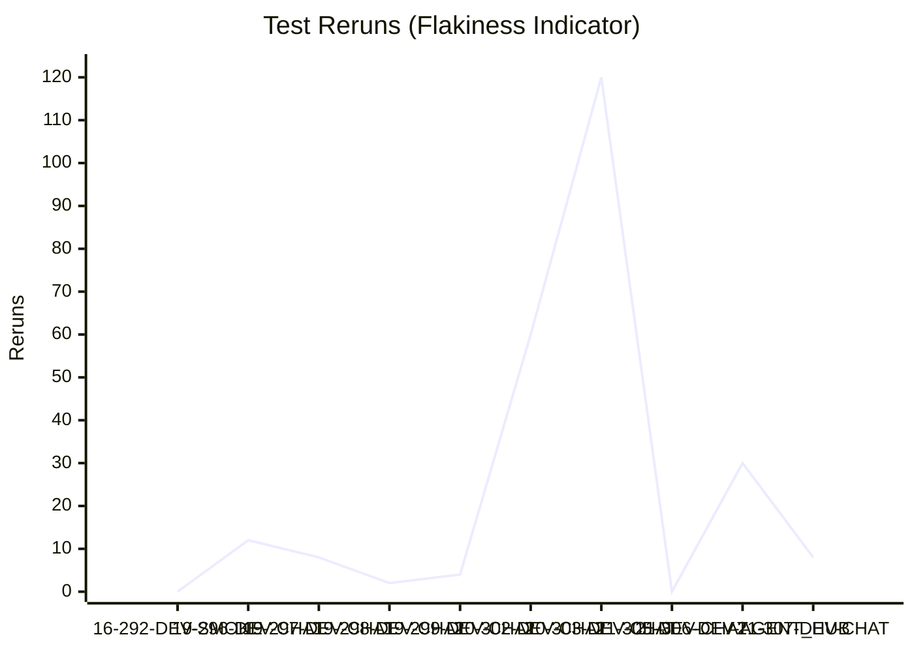
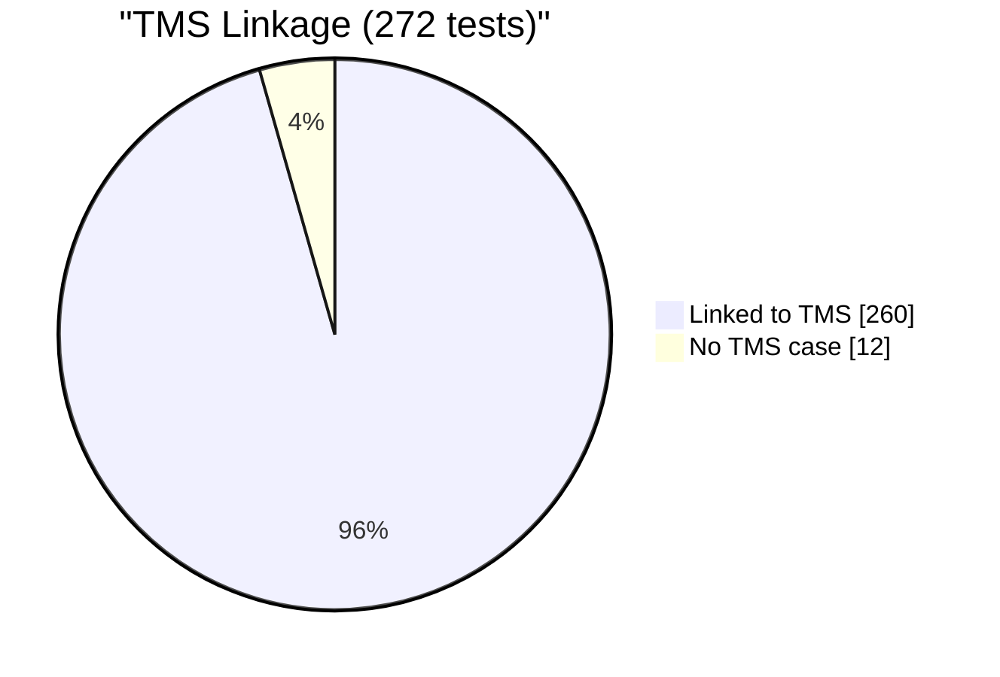

# Test Dashboard

_Generated: 2026-10-21 13:24 UTC_

## Latest Run

**RUN-ELITEA-2026-10-21-307-DEV-CHAT-FAILED**

| Metric | Value |
|--------|-------|
| Total | 39 |
| Passed | 34 |
| Failed | 3 |
| Skipped | 2 |
| Reruns | 8 |
| Pass Rate | 87.2% |

## Trend (Last 10 Runs)

```mermaid
xychart-beta
    title "Pass/Fail Trend"
    x-axis [16-292-DEV-SMOKE, 19-296-DEV-CHAT, 19-297-DEV-CHAT, 19-298-DEV-CHAT, 19-299-DEV-CHAT, 20-302-DEV-CHAT, 20-303-DEV-CHAT, 21-305-DEV-CHAT, 21-306-DEV-AGENT_HUB, 21-307-DEV-CHAT]
    y-axis "Tests" 0 --> 48
    bar "Passed" [2, 25, 26, 24, 24, 22, 43, 0, 14, 34]
    bar "Failed" [0, 2, 0, 0, 1, 22, 21, 0, 8, 3]
```

### Reruns Trend

## Run History

| Run | Total | Passed | Failed | Skipped | Reruns | Rate |
|-----|-------|--------|--------|---------|--------|------|
| ❌ 21-307-DEV-CHAT | 39 | 34 | 3 | 2 | 8 | 87% |
| ❌ 21-306-DEV-AGENT_HUB | 22 | 14 | 8 | 0 | 30 | 64% |
| ✅ 21-305-DEV-CHAT | 0 | 0 | 0 | 0 | 0 | 0% |
| ❌ 20-303-DEV-CHAT | 67 | 43 | 21 | 3 | 120 | 64% |
| ❌ 20-302-DEV-CHAT | 47 | 22 | 22 | 3 | 60 | 47% |
| ❌ 19-299-DEV-CHAT | 27 | 24 | 1 | 2 | 4 | 89% |
| ✅ 19-298-DEV-CHAT | 26 | 24 | 0 | 2 | 2 | 92% |
| ✅ 19-297-DEV-CHAT | 28 | 26 | 0 | 2 | 8 | 93% |
| ❌ 19-296-DEV-CHAT | 29 | 25 | 2 | 2 | 12 | 86% |
| ✅ 16-292-DEV-SMOKE | 2 | 2 | 0 | 0 | 0 | 100% |

---
_Source: `reports/automated/junit-RUN-*.json` (20 reports)_

---

## TMS Coverage Analysis

| Metric | Count |
|--------|-------|
| Tests in automation | 272 |
| Tests linked to TMS cases | 260 |
| Tests without TMS case | 12 |
| Orphan TMS refs (test missing) | 0 |
| **TMS Coverage** | **95.6%** |

### Automation Coverage by Suite

| Suite | Automated | Total |
|-------|-----------|-------|
| admin | 3 | 3 |
| agent_hub | 12 | 21 |
| agents | 26 | 61 |
| artifacts | 24 | 80 |
| chat | 28 | 240 |
| credentials | 1 | 24 |
| evaluation-run-analytics | 0 | 5 |
| help_center | 1 | 12 |
| indexing | 0 | 18 |
| mcp | 3 | 50 |
| onboarding | 0 | 11 |
| per-run-analytics | 0 | 6 |
| pipelines | 89 | 96 |
| settings | 10 | 195 |
| skills | 18 | 66 |
| social-folders | 0 | 13 |
| support-assistant | 14 | 24 |
| toolkit | 0 | 7 |
| toolkits_UI | 6 | 19 |
| **All suites** | **235** | **951** |

### Tests Without TMS Case

_Tests that exist in automation but have no linked TMS case._

Show 12 unlinked tests

- `tests.ui.chat.test_chat_export_download.TestChatExportDownload.test_export_button_triggers_download`
- `tests.ui.chat.test_chat_export_menu_option.TestChatExportMenuOption.test_export_option_in_conversation_context_menu`
- `tests.ui.chat.test_chat_export_with_attachments_zip.TestChatExportWithAttachmentsZip.test_export_with_attachments_produces_zip`
- `tests.ui.chat.test_chat_regenerate_last_response_only.TestChatRegenerateLastResponseOnly.test_regenerate_only_on_last_llm_response`
- `tests.ui.chat.test_chat_regenerate_last_response_only.TestChatRegenerateLastResponseOnly.test_regenerate_only_on_last_of_three_responses`
- `tests.ui.chat.test_chat_regenerate_new_response.TestChatRegenerateNewResponse.test_regenerate_creates_new_response_same_user_input`
- `tests.ui.chat.test_chat_stop_button_cancels_generation.TestChatStopButtonCancelsGeneration.test_send_new_message_after_stop_works`
- `tests.ui.chat.test_chat_stop_button_cancels_generation.TestChatStopButtonCancelsGeneration.test_stop_cancels_generation_and_restores_input`
- `tests.ui.settings.test_project_context_ai_generation_char_limit.TestProjectContextAIGenerationCharLimit.test_build_with_ai_short_prompt_under_limit`
- `tests.ui.settings.test_project_context_ai_generation_char_limit.TestProjectContextAIGenerationCharLimit.test_build_with_ai_verbose_prompt_exceeds_limit`
- `tests.ui.settings.test_project_context_ai_generation_char_limit.TestProjectContextAIGenerationCharLimit.test_chat_project_context_builder_under_limit`
- `tests.ui.settings.test_project_context_ai_generation_char_limit.TestProjectContextAIGenerationCharLimit.test_edit_with_ai_expand_content_under_limit`

---
_Compared `automation/index.json` (272 tests) with `index_automated.json` (260 refs)_
