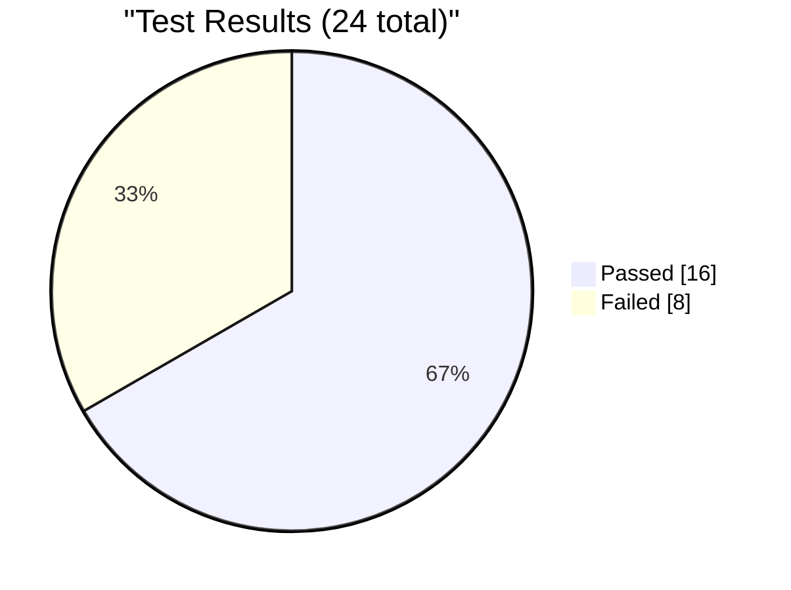
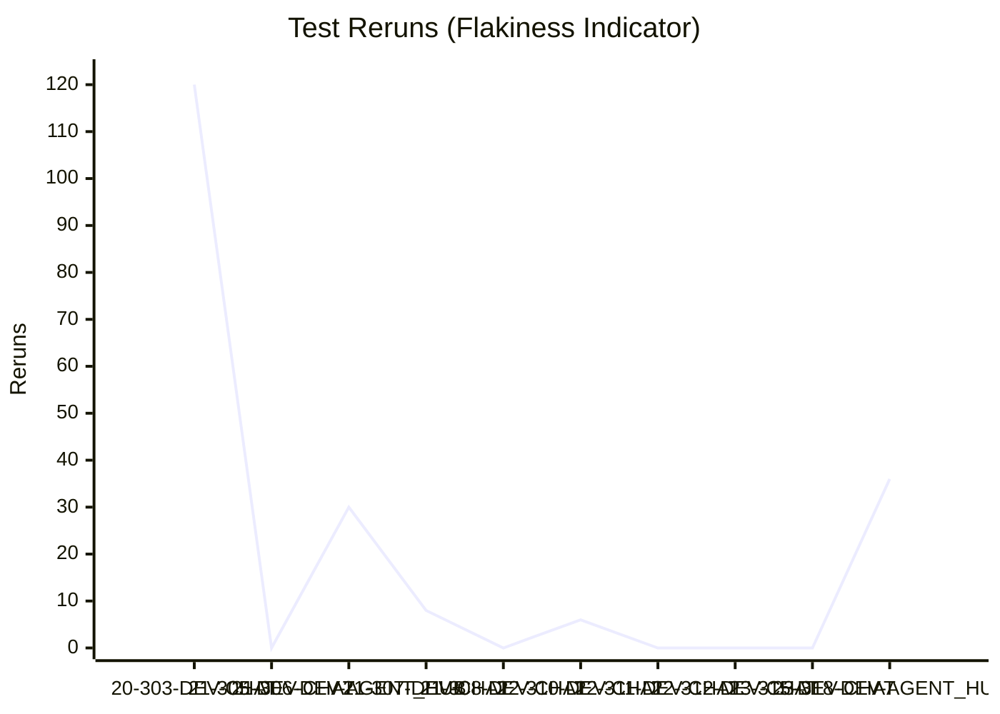
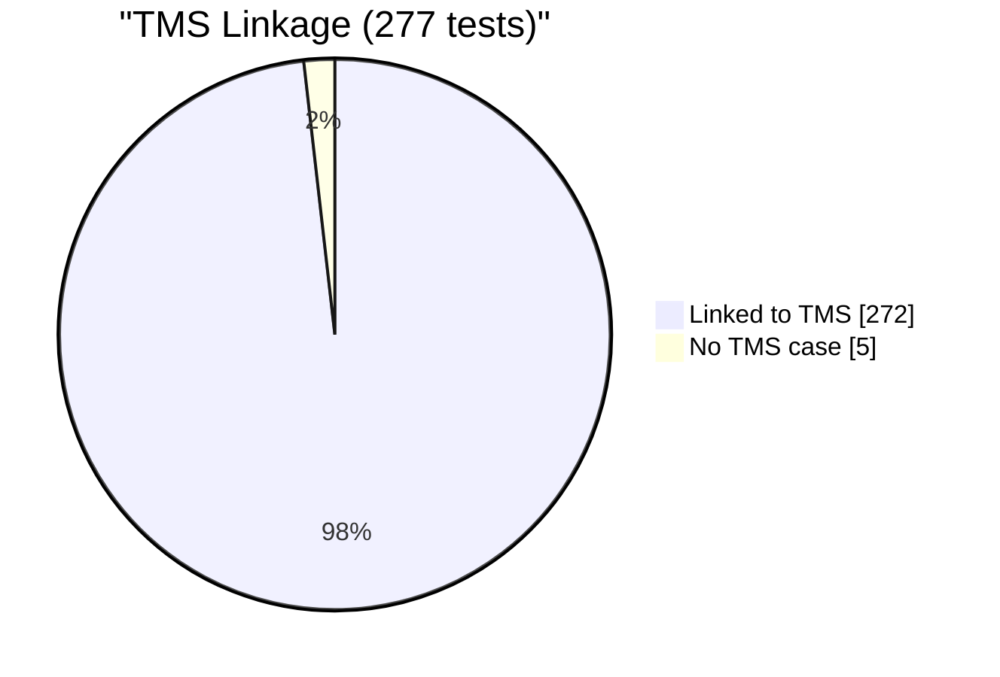
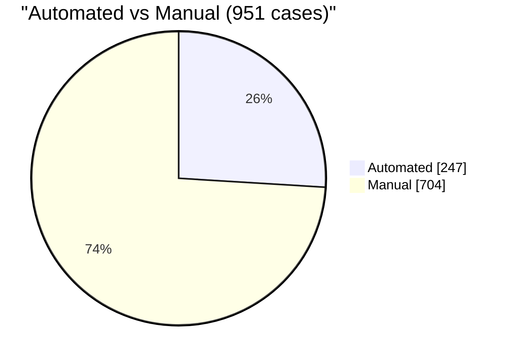
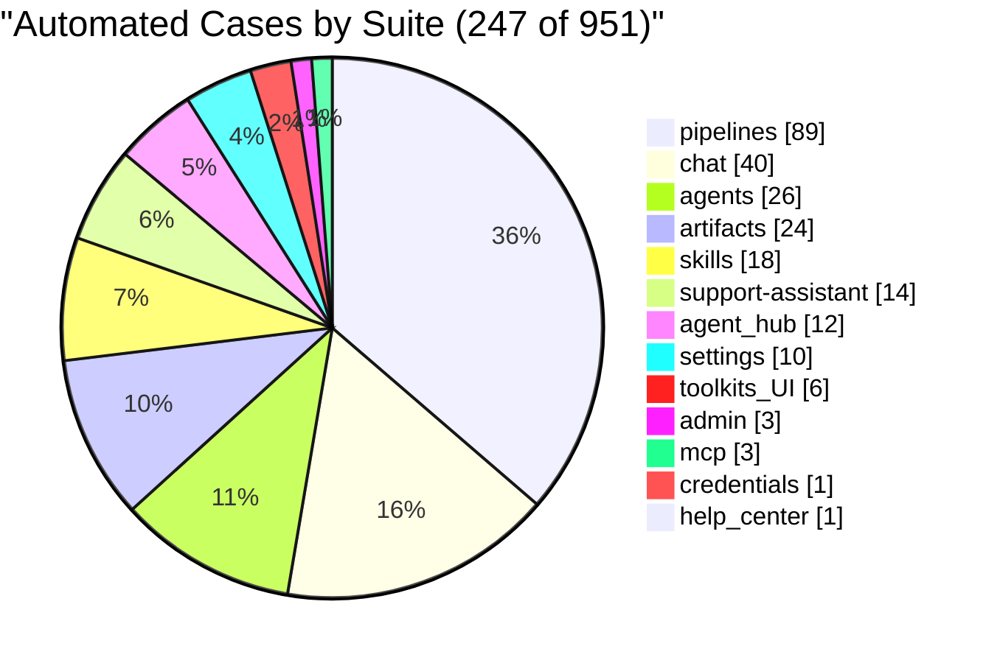

# Test Dashboard

_Generated: 2026-10-23 12:18 UTC_

## Latest Run

**RUN-ELITEA-2026-10-23-318-DEV-AGENT_HUB-FAILED**

| Metric | Value |
|--------|-------|
| Total | 24 |
| Passed | 16 |
| Failed | 8 |
| Skipped | 0 |
| Reruns | 36 |
| Pass Rate | 66.7% |

## Trend (Last 10 Runs)

```mermaid
xychart-beta
    title "Pass/Fail Trend"
    x-axis [20-303-DEV-CHAT, 21-305-DEV-CHAT, 21-306-DEV-AGENT_HUB, 21-307-DEV-CHAT, 21-308-DEV-CHAT, 22-310-DEV-CHAT, 22-311-DEV-CHAT, 22-312-DEV-CHAT, 23-315-DEV-CHAT, 23-318-DEV-AGENT_HUB]
    y-axis "Tests" 0 --> 48
    bar "Passed" [43, 0, 14, 34, 31, 31, 0, 35, 0, 16]
    bar "Failed" [21, 0, 8, 3, 3, 7, 0, 2, 0, 8]
```

### Reruns Trend

## Run History

| Run | Total | Passed | Failed | Skipped | Reruns | Rate |
|-----|-------|--------|--------|---------|--------|------|
| ❌ 23-318-DEV-AGENT_HUB | 24 | 16 | 8 | 0 | 36 | 67% |
| ✅ 23-315-DEV-CHAT | 0 | 0 | 0 | 0 | 0 | 0% |
| ❌ 22-312-DEV-CHAT | 39 | 35 | 2 | 2 | 0 | 90% |
| ✅ 22-311-DEV-CHAT | 0 | 0 | 0 | 0 | 0 | 0% |
| ❌ 22-310-DEV-CHAT | 40 | 31 | 7 | 2 | 6 | 78% |
| ❌ 21-308-DEV-CHAT | 36 | 31 | 3 | 2 | 0 | 86% |
| ❌ 21-307-DEV-CHAT | 39 | 34 | 3 | 2 | 8 | 87% |
| ❌ 21-306-DEV-AGENT_HUB | 22 | 14 | 8 | 0 | 30 | 64% |
| ✅ 21-305-DEV-CHAT | 0 | 0 | 0 | 0 | 0 | 0% |
| ❌ 20-303-DEV-CHAT | 67 | 43 | 21 | 3 | 120 | 64% |

---
_Source: `reports/automated/junit-RUN-*.json` (20 reports)_

---

## TMS Coverage Analysis

| Metric | Count |
|--------|-------|
| Tests in automation | 277 |
| Tests linked to TMS cases | 272 |
| Tests without TMS case | 5 |
| Orphan TMS refs (test missing) | 0 |
| **TMS Coverage** | **98.2%** |

### Automation Coverage by Suite

| Suite | Automated | Total |
|-------|-----------|-------|
| admin | 3 | 3 |
| agent_hub | 12 | 21 |
| agents | 26 | 61 |
| artifacts | 24 | 80 |
| chat | 40 | 240 |
| credentials | 1 | 24 |
| evaluation-run-analytics | 0 | 5 |
| help_center | 1 | 12 |
| indexing | 0 | 18 |
| mcp | 3 | 50 |
| onboarding | 0 | 11 |
| per-run-analytics | 0 | 6 |
| pipelines | 89 | 96 |
| settings | 10 | 195 |
| skills | 18 | 66 |
| social-folders | 0 | 13 |
| support-assistant | 14 | 24 |
| toolkit | 0 | 7 |
| toolkits_UI | 6 | 19 |
| **All suites** | **247** | **951** |

### Tests Without TMS Case

_Tests that exist in automation but have no linked TMS case._

Show 5 unlinked tests

- `tests.ui.chat.test_chat_create_conversation_from_folder_context_menu.TestChatCreateConversationFromFolderMenu.test_create_conversation_from_folder_context_menu`
- `tests.ui.chat.test_chat_export_download.TestChatExportDownload.test_export_chat_with_messages_without_attachments`
- `tests.ui.chat.test_chat_export_json_message_order.TestChatExportJsonMessageOrder.test_export_contains_all_messages_in_order`
- `tests.ui.chat.test_chat_send_button_visibility_toggle.TestChatSendButtonVisibilityToggle.test_send_button_visibility_toggle_and_clear_on_send`
- `tests.ui.chat.test_chat_streaming_response.TestStreamingResponse.test_streaming_response_displayed_progressively`

---
_Compared `automation/index.json` (277 tests) with `index_automated.json` (272 refs)_
