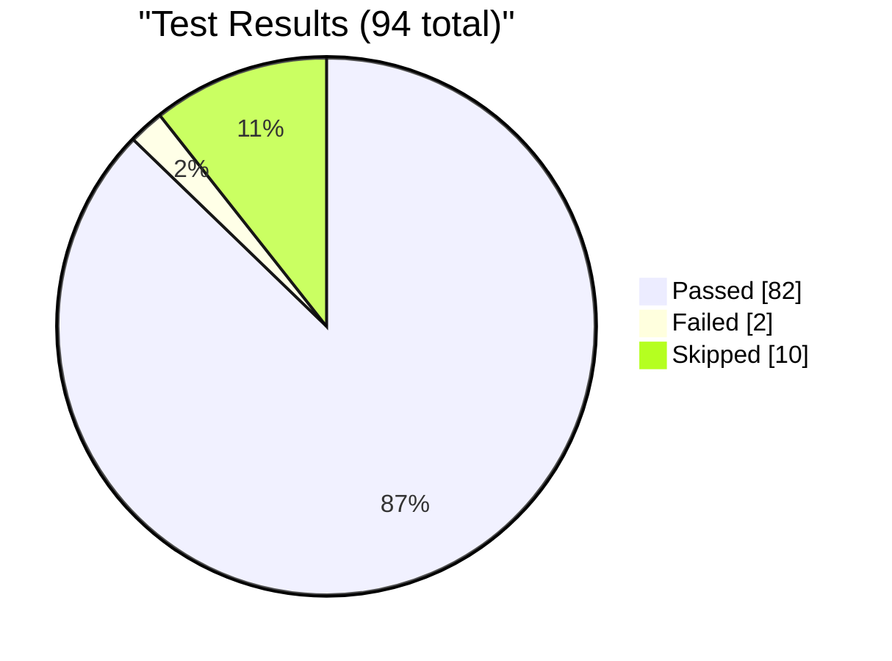
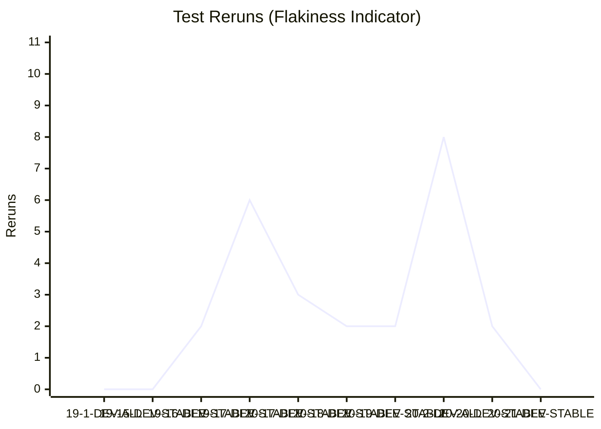

# Test Dashboard

_Generated: 2026-08-20 08:11 UTC_

## Latest Run

**RUN-ELITEA-2026-08-20-21-DEV-STABLE-ALL-FAILED**

| Metric | Value |
|--------|-------|
| Total | 94 |
| Passed | 82 |
| Failed | 2 |
| Skipped | 10 |
| Reruns | 0 |
| Pass Rate | 87.2% |

## Trend (Last 10 Runs)

```mermaid
xychart-beta
    title "Pass/Fail Trend"
    x-axis [19-1-DEV-ALL, 19-15-DEV-STABLE, 19-16-DEV-STABLE, 19-17-DEV-STABLE, 20-17-DEV-STABLE, 20-18-DEV-STABLE, 20-19-DEV-STABLE, 20-2-DEV-ALL, 20-20-DEV-STABLE, 20-21-DEV-STABLE]
    y-axis "Tests" 0 --> 88
    bar "Passed" [46, 7, 7, 80, 83, 7, 7, 46, 7, 82]
    bar "Failed" [6, 1, 1, 5, 2, 1, 1, 6, 1, 2]
```

### Reruns Trend

## Run History

| Run | Total | Passed | Failed | Skipped | Reruns | Rate |
|-----|-------|--------|--------|---------|--------|------|
| ❌ 20-21-DEV-STABLE | 94 | 82 | 2 | 10 | 0 | 87% |
| ❌ 20-20-DEV-STABLE | 8 | 7 | 1 | 0 | 2 | 88% |
| ❌ 20-2-DEV-ALL | 52 | 46 | 6 | 0 | 8 | 88% |
| ❌ 20-19-DEV-STABLE | 8 | 7 | 1 | 0 | 2 | 88% |
| ❌ 20-18-DEV-STABLE | 8 | 7 | 1 | 0 | 2 | 88% |
| ❌ 20-17-DEV-STABLE | 95 | 83 | 2 | 10 | 3 | 87% |
| ❌ 19-17-DEV-STABLE | 95 | 80 | 5 | 10 | 6 | 84% |
| ❌ 19-16-DEV-STABLE | 8 | 7 | 1 | 0 | 2 | 88% |
| ❌ 19-15-DEV-STABLE | 8 | 7 | 1 | 0 | 0 | 88% |
| ❌ 19-1-DEV-ALL | 52 | 46 | 6 | 0 | 0 | 88% |

---
_Source: `reports/automated/junit-RUN-*.json` (19 reports)_
