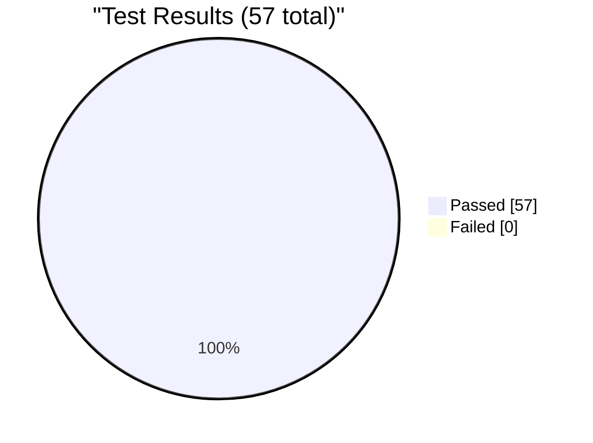
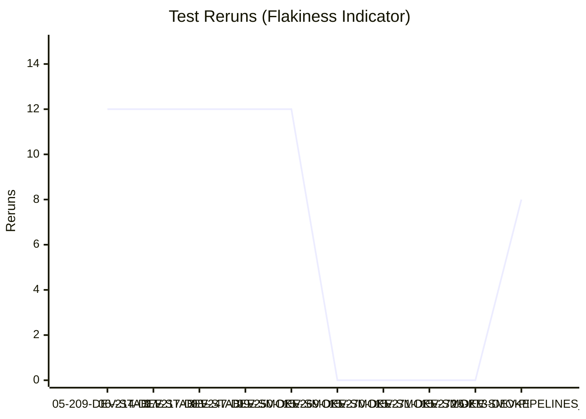
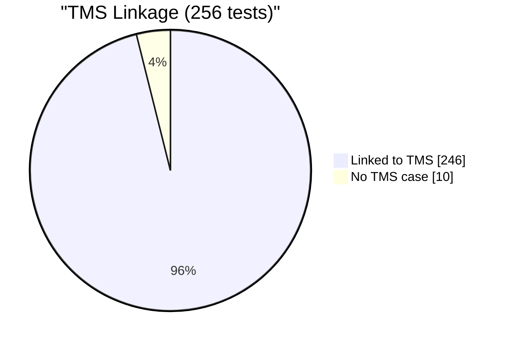

# Test Dashboard

_Generated: 2026-10-15 14:16 UTC_

## Latest Run

**RUN-ELITEA-2026-10-15-273-DEV-PIPELINES_2-PASSED**

| Metric | Value |
|--------|-------|
| Total | 57 |
| Passed | 57 |
| Failed | 0 |
| Skipped | 0 |
| Reruns | 8 |
| Pass Rate | 100.0% |

## Trend (Last 10 Runs)

```mermaid
xychart-beta
    title "Pass/Fail Trend"
    x-axis [05-209-DEV-STABLE, 06-214-DEV-STABLE, 07-217-DEV-STABLE, 08-247-DEV-SMOKE, 09-250-DEV-SMOKE, 15-269-DEV-SMOKE, 15-270-DEV-SMOKE, 15-271-DEV-SMOKE, 15-272-DEV-SMOKE, 15-273-DEV-PIPELINES_2]
    y-axis "Tests" 0 --> 62
    bar "Passed" [26, 26, 26, 29, 29, 2, 2, 2, 2, 57]
    bar "Failed" [2, 2, 2, 2, 2, 0, 0, 0, 0, 0]
```

### Reruns Trend

## Run History

| Run | Total | Passed | Failed | Skipped | Reruns | Rate |
|-----|-------|--------|--------|---------|--------|------|
| ✅ 15-273-DEV-PIPELINES_2 | 57 | 57 | 0 | 0 | 8 | 100% |
| ✅ 15-272-DEV-SMOKE | 2 | 2 | 0 | 0 | 0 | 100% |
| ✅ 15-271-DEV-SMOKE | 2 | 2 | 0 | 0 | 0 | 100% |
| ✅ 15-270-DEV-SMOKE | 2 | 2 | 0 | 0 | 0 | 100% |
| ✅ 15-269-DEV-SMOKE | 2 | 2 | 0 | 0 | 0 | 100% |
| ❌ 09-250-DEV-SMOKE | 31 | 29 | 2 | 0 | 12 | 94% |
| ❌ 08-247-DEV-SMOKE | 31 | 29 | 2 | 0 | 12 | 94% |
| ❌ 07-217-DEV-STABLE | 30 | 26 | 2 | 2 | 12 | 87% |
| ❌ 06-214-DEV-STABLE | 30 | 26 | 2 | 2 | 12 | 87% |
| ❌ 05-209-DEV-STABLE | 30 | 26 | 2 | 2 | 12 | 87% |

---
_Source: `reports/automated/junit-RUN-*.json` (20 reports)_

---

## TMS Coverage Analysis

| Metric | Count |
|--------|-------|
| Tests in automation | 256 |
| Tests linked to TMS cases | 246 |
| Tests without TMS case | 10 |
| Orphan TMS refs (test missing) | 23 |
| **TMS Coverage** | **96.1%** |

### Tests Without TMS Case

_Tests that exist in automation but have no linked TMS case._

Show 10 unlinked tests

- `tests.ui.admin.test_guardrails_live_reload.TestBlockedToolLiveReload.test_blocked_tool_live_reload_case_insensitive`
- `tests.ui.admin.test_guardrails_live_reload.TestBlockedToolkitLiveReload.test_blocked_toolkit_live_reload_case_insensitive`
- `tests.ui.admin.test_guardrails_live_reload.TestSensitiveToolLiveReload.test_sensitive_tool_live_reload_case_insensitive`
- `tests.ui.artifacts.test_artifacts_multi_file.TestArtifactMultiFileDownload.test_agent_creates_files_at_root_and_in_subfolder`
- `tests.ui.chat.test_open_existing_conversation_from_this_week_section.TestOpenExistingConversationFromThisWeekSection.test_open_existing_conversation_from_this_week_section`
- `tests.ui.pipelines.test_pipeline_advanced.TestDiscardChanges.test_save_discard_button_states_toggle_on_edit_and_discard`
- `tests.ui.test_maintenance_handling.test_api_maintenance_error_triggerable`
- `tests.ui.test_maintenance_handling.test_maintenance_banner_dismissed_automatically`
- `tests.ui.test_maintenance_handling.test_maintenance_detection_captures_screenshot`
- `tests.ui.test_maintenance_handling.test_maintenance_state_boolean_check`

### Orphan TMS References

_TMS cases reference tests that don't exist in automation (renamed/deleted?)._

Show 23 orphan refs

- `tests.ui.chat.test_chat_interface.TestContextAndSettings.test_model_settings_menu` (ELITEA-0500)
- `tests.ui.chat.test_chat_interface.TestConversationUIElements.test_attach_files_button_opens_picker` (ELITEA-0500)
- `tests.ui.chat.test_chat_interface.TestConversationUIElements.test_clear_chat_history` (ELITEA-0502)
- `tests.ui.chat.test_chat_interface.TestSendingMessages.test_send_message_with_enter_key` (ELITEA-0503)
- `tests.ui.chat.test_chat_interface.test_chat_message_history_displays` (ELITEA-1142)
- `tests.ui.chat.test_chat_interface.test_chat_page_loads_successfully` (ELITEA-1142)
- `tests.ui.chat.test_chat_interface.test_message_input_is_functional` (ELITEA-1142)
- `tests.ui.help_center.test_help_center_page_loads.TestHelpCenterPageLoads.test_help_center_page_loads_via_sidebar_icon` (ELITEA-2219)
- `tests.ui.pipelines.test_pipeline_advanced.TestAdditionalNodeTypes.test_add_decision_node` (ELITEA-0858)
- `tests.ui.pipelines.test_pipeline_advanced.TestAdditionalNodeTypes.test_add_printer_node` (ELITEA-0858)
- `tests.ui.pipelines.test_pipeline_advanced.TestAdditionalNodeTypes.test_add_router_node` (ELITEA-0858)
- `tests.ui.pipelines.test_pipeline_advanced.TestHistoryTab.test_history_tab_opens` (ELITEA-0858)
- `tests.ui.pipelines.test_pipeline_execution.TestExecutePipeline.test_execute_simple_pipeline` (ELITEA-0862)
- `tests.ui.pipelines.test_pipeline_execution.TestExecutePipeline.test_message_count_after_execution` (ELITEA-0856)
- `tests.ui.pipelines.test_pipeline_execution.TestExecutePipeline.test_rerun_pipeline` (ELITEA-0862)
- `tests.ui.pipelines.test_pipeline_nodes.TestAddNode.test_add_code_node` (ELITEA-0853)
- `tests.ui.pipelines.test_pipeline_nodes.TestAddNode.test_add_llm_node` (ELITEA-0853)
- `tests.ui.pipelines.test_pipeline_nodes.TestConnectNodes.test_connect_node_to_end` (ELITEA-0853)
- `tests.ui.pipelines.test_pipeline_nodes.TestConnectNodes.test_connect_two_custom_nodes` (ELITEA-0853)
- `tests.ui.pipelines.test_pipeline_nodes.TestDeleteNode.test_delete_node_does_not_remove_end` (ELITEA-0853)
- `tests.ui.pipelines.test_pipeline_nodes.TestDeleteNode.test_delete_node_via_menu` (ELITEA-0853)
- `tests.ui.pipelines.test_pipeline_nodes.TestEditNode.test_edit_node_name` (ELITEA-0853)
- `tests.ui.pipelines.test_pipeline_nodes.TestEditNode.test_node_default_name_matches_type` (ELITEA-0853)

---
_Compared `automation/index.json` (256 tests) with `index_automated.json` (269 refs)_
