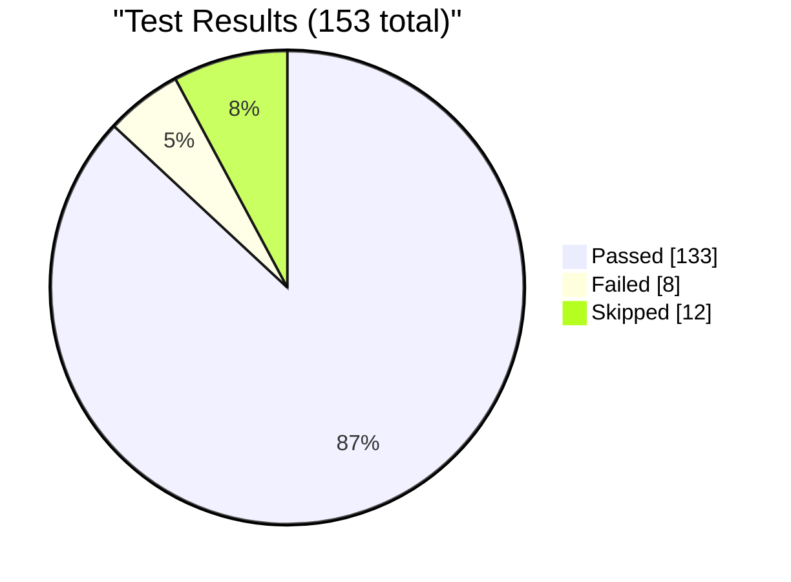
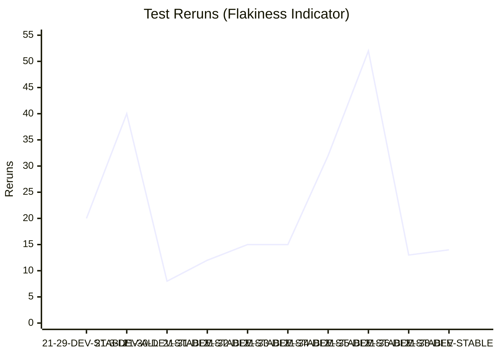
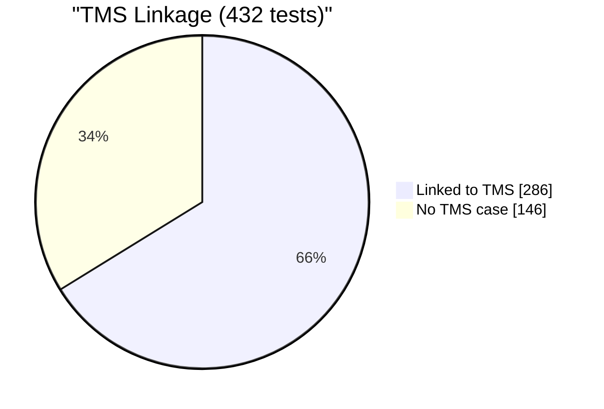

# Test Dashboard

_Generated: 2026-08-21 12:10 UTC_

## Latest Run

**RUN-ELITEA-2026-08-21-38-DEV-STABLE-ALL-FAILED**

| Metric | Value |
|--------|-------|
| Total | 153 |
| Passed | 133 |
| Failed | 8 |
| Skipped | 12 |
| Reruns | 14 |
| Pass Rate | 86.9% |

## Trend (Last 10 Runs)

```mermaid
xychart-beta
    title "Pass/Fail Trend"
    x-axis [21-29-DEV-STABLE, 21-3-DEV-ALL, 21-30-DEV-STABLE, 21-31-DEV-STABLE, 21-32-DEV-STABLE, 21-33-DEV-STABLE, 21-34-DEV-STABLE, 21-35-DEV-STABLE, 21-36-DEV-STABLE, 21-38-DEV-STABLE]
    y-axis "Tests" 0 --> 138
    bar "Passed" [122, 95, 126, 127, 123, 123, 91, 113, 132, 133]
    bar "Failed" [16, 38, 12, 11, 15, 15, 49, 25, 6, 8]
```

### Reruns Trend

## Run History

| Run | Total | Passed | Failed | Skipped | Reruns | Rate |
|-----|-------|--------|--------|---------|--------|------|
| ❌ 21-38-DEV-STABLE | 153 | 133 | 8 | 12 | 14 | 87% |
| ❌ 21-36-DEV-STABLE | 150 | 132 | 6 | 12 | 13 | 88% |
| ❌ 21-35-DEV-STABLE | 150 | 113 | 25 | 12 | 52 | 75% |
| ❌ 21-34-DEV-STABLE | 150 | 91 | 49 | 10 | 32 | 61% |
| ❌ 21-33-DEV-STABLE | 150 | 123 | 15 | 12 | 15 | 82% |
| ❌ 21-32-DEV-STABLE | 150 | 123 | 15 | 12 | 15 | 82% |
| ❌ 21-31-DEV-STABLE | 150 | 127 | 11 | 12 | 12 | 85% |
| ❌ 21-30-DEV-STABLE | 150 | 126 | 12 | 12 | 8 | 84% |
| ❌ 21-3-DEV-ALL | 134 | 95 | 38 | 1 | 40 | 71% |
| ❌ 21-29-DEV-STABLE | 150 | 122 | 16 | 12 | 20 | 81% |

---
_Source: `reports/automated/junit-RUN-*.json` (20 reports)_

---

## TMS Coverage Analysis

| Metric | Count |
|--------|-------|
| Tests in automation | 432 |
| Tests linked to TMS cases | 286 |
| Tests without TMS case | 146 |
| Orphan TMS refs (test missing) | 127 |
| **TMS Coverage** | **66.2%** |

### Tests Without TMS Case

_Tests that exist in automation but have no linked TMS case._

Show 146 unlinked tests

- `admin.test_guardrails_cleanup_only.test_cleanup_after`
- `admin.test_guardrails_cleanup_only.test_cleanup_before`
- `admin.test_guardrails_live_reload.TestBlockedToolLiveReload.test_blocked_tool_live_reload_case_insensitive`
- `admin.test_guardrails_live_reload.TestBlockedToolkitLiveReload.test_blocked_toolkit_live_reload_case_insensitive`
- `admin.test_guardrails_live_reload.TestSensitiveToolLiveReload.test_sensitive_tool_live_reload_case_insensitive`
- `agents.test_agent_character_limits.TestConversationStarterCharacterCounter.test_conversation_starter_counter_turns_red_at_limit`
- `agents.test_agent_character_limits.TestConversationStarterCharacterCounter.test_conversation_starter_counter_visible_and_updates`
- `agents.test_agent_character_limits.TestConversationStarterCharacterCounter.test_conversation_starter_fullscreen_counter_and_warning`
- `agents.test_agent_character_limits.TestConversationStarterCharacterCounter.test_conversation_starter_text_truncated_with_warning`
- `agents.test_agent_character_limits.TestConversationStarterCharacterCounter.test_multiple_conversation_starters_have_counters`
- `agents.test_agent_character_limits.TestWelcomeMessageCharacterCounter.test_welcome_message_counter_turns_red_at_limit`
- `agents.test_agent_character_limits.TestWelcomeMessageCharacterCounter.test_welcome_message_counter_visible_and_updates_realtime`
- `agents.test_agent_character_limits.TestWelcomeMessageCharacterCounter.test_welcome_message_fullscreen_counter_and_warning`
- `agents.test_agent_character_limits.TestWelcomeMessageCharacterCounter.test_welcome_message_text_truncated_with_warning`
- `agents.test_agent_management.TestAgentActions.test_delete_agent_via_api`
- `agents.test_agent_management.TestAgentActions.test_delete_agent_via_ui_menu`
- `agents.test_agent_management.TestAgentActions.test_edit_agent_description`
- `agents.test_agent_management.TestAgentActions.test_edit_agent_name`
- `agents.test_agent_management.TestAgentConfiguration.test_agent_detail_page_loads`
- `agents.test_agent_management.TestAgentConfiguration.test_agent_information_section`
- `agents.test_agent_management.TestAgentConfiguration.test_agent_instructions_field`
- `agents.test_agent_management.TestAgentConfiguration.test_agent_toolkits_section_visible`
- `agents.test_agent_management.TestAgentConfiguration.test_internal_tools_enum_usage`
- `agents.test_agent_management.TestAgentList.test_agent_search`
- `agents.test_agent_management.TestAgentList.test_agent_search_no_results`
- `agents.test_agent_management.TestAgentList.test_agents_dashboard_loads`
- `agents.test_agent_management.TestAgentList.test_view_toggle_table_and_card`
- `agents.test_agent_management.TestCreateAgent.test_create_agent_via_api_visible_in_ui`
- `agents.test_agent_management.TestCreateAgent.test_create_agent_via_ui`
- `agents.test_agent_with_github_toolkit.TestAddToolkitToAgent.test_add_toolkit_to_agent`
- `agents.test_agent_with_github_toolkit.TestChatWithAgentToolkit.test_agent_chat_with_github_toolkit`
- `agents.test_agent_with_github_toolkit.TestRemoveToolkitFromAgent.test_remove_toolkit_from_agent`
- `artifacts.test_artifacts_bucket_name_validation_invalid_formats.TestArtifactBucketNameValidationInvalidFormats.test_bucket_name_validation_rejects_invalid_format[ELITEA-1811-leading-digit]`
- `artifacts.test_artifacts_bucket_name_validation_invalid_formats.TestArtifactBucketNameValidationInvalidFormats.test_bucket_name_validation_rejects_invalid_format[ELITEA-1814-space]`
- `artifacts.test_artifacts_bucket_name_validation_invalid_formats.TestArtifactBucketNameValidationInvalidFormats.test_bucket_name_validation_rejects_invalid_format[ELITEA-1814-special-char]`
- `artifacts.test_artifacts_bucket_name_validation_invalid_formats.TestArtifactBucketNameValidationInvalidFormats.test_bucket_name_validation_rejects_invalid_format[ELITEA-1814-underscore]`
- `artifacts.test_artifacts_multi_file.TestArtifactMultiFileDownload.test_agent_creates_files_at_root_and_in_subfolder`
- `artifacts.test_bucket_permissions_api.TestBucketPermissionsAPI.test_no_access_permission_blocks_all_api_operations`
- `artifacts.test_bucket_permissions_api.TestBucketPermissionsAPI.test_read_only_permission_allows_get_blocks_write_operations`
- `chat.test_agent_with_toolkit_chat.TestAgentWithToolkitInChat.test_agent_with_toolkit_executes_in_chat`
- `chat.test_chat_folder_rename_checkmark_validation.TestChatFolderDeleteApiFallbackRegression.test_delete_folder_via_api_actually_removes_the_folder`
- `chat.test_chat_interface.TestContextAndSettings.test_edit_context_settings`
- `chat.test_chat_interface.TestConversationUIElements.test_attach_files_button_sends_file_with_message`
- `chat.test_chat_interface.TestConversationUIElements.test_internal_tools_panel_shows_all_tools`
- `chat.test_chat_interface.TestConversationUIElements.test_model_selector_opens_menu`
- `chat.test_chat_interface.TestHashSearch.test_add_participant_via_hash_search`
- `chat.test_chat_interface.TestHashSearch.test_hash_search_participants`
- `chat.test_chat_interface.TestMessageActions.test_copy_message_to_clipboard`
- `chat.test_chat_interface.TestMessageActions.test_delete_message`
- `chat.test_chat_interface.TestPageLoadAndRendering.test_chat_page_loads_with_functional_input`
- _... and 96 more_

### Orphan TMS References

_TMS cases reference tests that don't exist in automation (renamed/deleted?)._

Show 127 orphan refs

- `artifacts.test_artifacts_bucket_name_validation_invalid_formats.TestArtifactBucketNameValidationInvalidFormats.test_bucket_name_validation_rejects_invalid_format` (ELITEA-1814)
- `chat.test_agent_hub_create_conversation_via_starter.TestAgentHubCreateConversationViaStarter.test_agent_hub_create_conversation_via_starter` (ELITEA-2093)
- `chat.test_attach_files_10_left_counter.TestAttachFiles10LeftCounter.test_attach_files_menuitem_shows_10_left_counter` (ELITEA-2195)
- `chat.test_attach_files_multiple_chips_display.TestAttachFilesMultipleChipsDisplay.test_attach_files_of_different_types_shows_identical_icon_and_long_filename_truncates` (ELITEA-2199)
- `chat.test_attach_files_multiple_chips_display.TestAttachFilesMultipleChipsDisplay.test_attach_files_then_remove_two_individually_sequentially` (ELITEA-2198)
- `chat.test_attach_files_multiple_chips_display.TestAttachFilesMultipleChipsDisplay.test_attach_multiple_files_displays_chips_above_composer` (ELITEA-2196)
- `chat.test_attach_files_multiple_chips_display.TestAttachFilesMultipleChipsDisplay.test_long_filename_truncates_and_overflow_indicator_click_expands` (ELITEA-2467)
- `chat.test_build_with_ai_cancel_then_generate_echo_agent.TestBuildWithAICancelThenGenerateEchoAgent.test_cancel_then_generate_creates_echo_agent_in_canvas` (ELITEA-2073)
- `chat.test_chat_agent_starters_add_remove.TestChatAddAgentWithStartersAndSendViaStarter.test_add_agent_with_starters_and_send_via_starter` (ELITEA-2465)
- `chat.test_chat_agent_starters_add_remove.TestChatAddAgentWithStartersToConversation.test_add_agent_with_starters_to_conversation` (ELITEA-2177)
- `chat.test_chat_agent_starters_add_remove.TestChatRemoveAgentClearsConversationStarters.test_remove_agent_clears_conversation_starters` (ELITEA-2178)
- `chat.test_chat_canvas_edit_agent.TestChatCanvasEditAgent.test_edit_agent_welcome_message_syncs_to_agents_section` (ELITEA-2089)
- `chat.test_chat_folder_creation_custom_name_and_cancel.TestChatFolderCreationCustomNameAndCancel.test_cancel_folder_creation_discards_folder` (ELITEA-2134)
- `chat.test_chat_folder_creation_custom_name_and_cancel.TestChatFolderCreationCustomNameAndCancel.test_create_folder_with_custom_name` (ELITEA-2457)
- `chat.test_chat_folder_rename_checkmark_validation.TestChatFolderRenameCheckmarkValidation.test_folder_rename_cancel_via_x_icon_discards_changes` (ELITEA-2122)
- `chat.test_chat_folder_rename_checkmark_validation.TestChatFolderRenameCheckmarkValidation.test_folder_rename_no_changes_close_via_x_icon` (ELITEA-2131)
- `chat.test_chat_folder_rename_checkmark_validation.TestChatFolderRenameCheckmarkValidation.test_folder_rename_via_context_menu_edit_option` (ELITEA-2121)
- `chat.test_chat_folder_rename_checkmark_validation.TestChatFolderRenameCheckmarkValidation.test_pinned_folder_rename_retains_pin_state` (ELITEA-2130)
- `chat.test_chat_folder_rename_length_boundaries.TestChatFolderRenameLengthBoundaries.test_rename_folder_length_boundary_50_chars_accepted` (ELITEA-2128)
- `chat.test_chat_folder_rename_length_boundaries.TestChatFolderRenameLengthBoundaries.test_rename_folder_type_and_paste_beyond_max_length_truncates` (ELITEA-2129)
- `chat.test_chat_interface.TestHashSearch.test_add_agent_via_hash_search_joins_participants_and_responds` (ELITEA-2469)
- `chat.test_chat_interface.TestHashSearch.test_add_pipeline_via_hash_search_joins_participants_and_responds` (ELITEA-2470)
- `chat.test_chat_interface.TestHashSearch.test_hash_search_shows_agents_and_pipelines_from_all_sources` (ELITEA-2206)
- `chat.test_chat_search_and_modules_panel.TestChatSearchAndModulesPanel.test_search_cleared_by_x_icon_restores_default_view` (ELITEA-2164)
- `chat.test_chat_search_and_modules_panel.TestChatSearchAndModulesPanel.test_search_input_cleared_by_deleting_text_updates_dynamically` (ELITEA-2165)
- `chat.test_chat_search_and_modules_panel.TestChatSearchAndModulesPanel.test_search_no_results_state` (ELITEA-2163)
- `chat.test_close_toolkit_canvas_without_saving.TestCloseToolkitCanvasWithoutSaving.test_close_toolkit_canvas_without_saving_creates_no_toolkit` (ELITEA-2081)
- `chat.test_context_auto_summarization_disabled.TestContextAutoSummarizationDisabled.test_no_summarization_when_auto_summarization_disabled` (ELITEA-2217)
- `chat.test_context_management_disabled.TestContextManagementDisabledWidgetStaysZero.test_context_management_disabled_widget_stays_at_zero` (ELITEA-2216)
- `chat.test_conversation_deletion_inside_folder.TestConversationDeletionInsideFolder.test_delete_conversation_inside_folder_preserves_folder` (ELITEA-2115)
- `chat.test_conversation_rename_basic_via_edit_option.TestConversationRenameBasicViaEditOption.test_rename_conversation_basic_via_edit_option` (ELITEA-2099)
- `chat.test_conversation_rename_cancel_discards_changes.TestConversationRenameCancelDiscardsChanges.test_rename_conversation_cancel_discards_changes` (ELITEA-2100)
- `chat.test_conversation_rename_checkmark_active_state.TestConversationRenameCheckmarkActiveState.test_rename_checkmark_activates_at_three_characters` (ELITEA-2109)
- `chat.test_conversation_rename_checkmark_active_state.TestConversationRenameCheckmarkActiveState.test_rename_checkmark_inactive_click_has_no_effect[ELITEA-2105-no-changes]` (ELITEA-2105)
- `chat.test_conversation_rename_checkmark_active_state.TestConversationRenameCheckmarkActiveState.test_rename_checkmark_inactive_click_has_no_effect[ELITEA-2106-empty-field]` (ELITEA-2106)
- `chat.test_conversation_rename_checkmark_active_state.TestConversationRenameCheckmarkActiveState.test_rename_checkmark_inactive_click_has_no_effect[ELITEA-2107-1-char]` (ELITEA-2107)
- `chat.test_conversation_rename_checkmark_active_state.TestConversationRenameCheckmarkActiveState.test_rename_checkmark_inactive_click_has_no_effect[ELITEA-2108-2-char]` (ELITEA-2108)
- `chat.test_conversation_rename_invalid_chars_and_recovery.TestConversationRenameInvalidCharsAndRecovery.test_rename_checkmark_inactive_for_invalid_input_shows_tooltip[ELITEA-2110-special-characters]` (ELITEA-2110)
- `chat.test_conversation_rename_invalid_chars_and_recovery.TestConversationRenameInvalidCharsAndRecovery.test_rename_checkmark_inactive_for_invalid_input_shows_tooltip[ELITEA-2111-dollar-percent-at-characters]` (ELITEA-2111)
- `chat.test_conversation_rename_invalid_chars_and_recovery.TestConversationRenameInvalidCharsAndRecovery.test_rename_checkmark_inactive_for_invalid_input_shows_tooltip[ELITEA-2112-leading-space]` (ELITEA-2112)
- `chat.test_conversation_rename_invalid_chars_and_recovery.TestConversationRenameInvalidCharsAndRecovery.test_rename_recovers_and_saves_after_invalid_value_replaced` (ELITEA-2113)
- `chat.test_conversation_rename_length_boundaries.TestConversationRenameLengthBoundaries.test_rename_conversation_length_boundary[ELITEA-2101-49-chars]` (ELITEA-2101)
- `chat.test_conversation_rename_length_boundaries.TestConversationRenameLengthBoundaries.test_rename_conversation_length_boundary[ELITEA-2102-50-chars]` (ELITEA-2102)
- `chat.test_conversation_rename_length_boundaries.TestConversationRenameLengthBoundaries.test_rename_conversation_paste_beyond_max_length_truncates` (ELITEA-2104)
- `chat.test_conversation_rename_length_boundaries.TestConversationRenameLengthBoundaries.test_rename_conversation_type_beyond_max_length_truncates` (ELITEA-2103)
- `chat.test_create_mcp_from_conversation_discard_changes.TestCreateMcpFromConversationDiscardChanges.test_create_mcp_from_conversation_discard_changes_creates_no_mcp` (ELITEA-2084)
- `chat.test_create_new_conversation_team_project_attachments_and_llm.TestCreateNewConversationTeamProjectAttachmentsAndLLM.test_create_conversation_team_project_attachments_and_llm` (ELITEA-2091)
- `chat.test_create_toolkit_from_conversation.TestCreateToolkitFromConversation.test_create_toolkit_from_conversation_close_canvas_and_verify_participant` (ELITEA-2083)
- `chat.test_delete_confirmation_modal_ui_validation.TestDeleteConfirmationModalUIValidation.test_delete_confirmation_modal_dismisses_via_escape_and_outside_click` (ELITEA-2116)
- `chat.test_delete_confirmation_modal_ui_validation.TestDeleteConfirmationModalUIValidation.test_delete_confirmation_modal_title_body_and_button_styling` (ELITEA-2116)
- _... and 77 more_

---
_Compared `automation/index.json` (432 tests) with `index_automated.json` (413 refs)_
