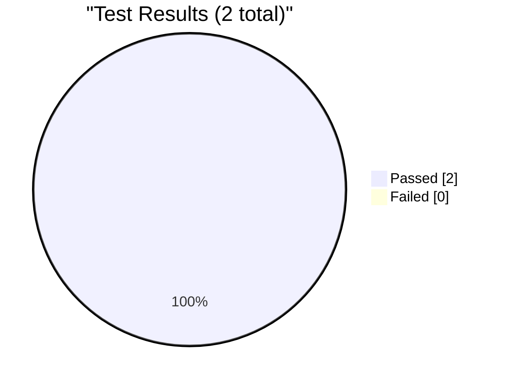
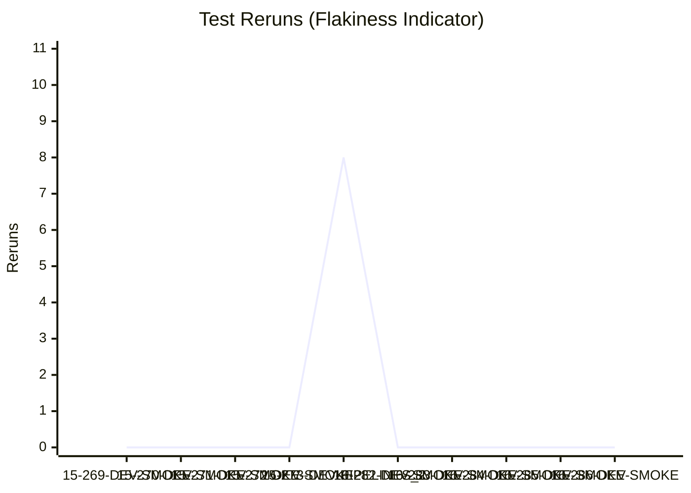
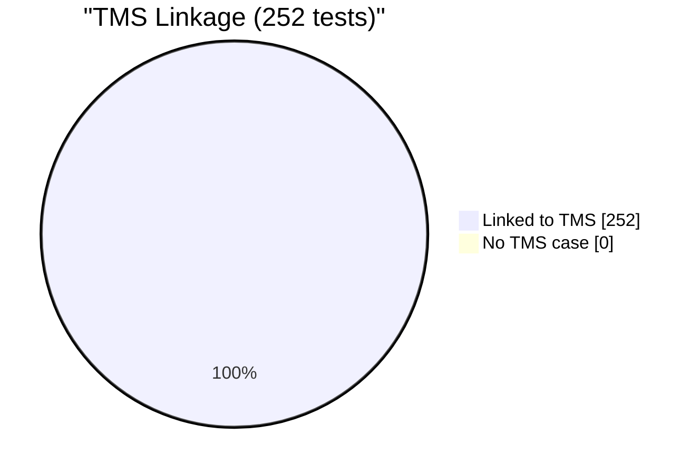
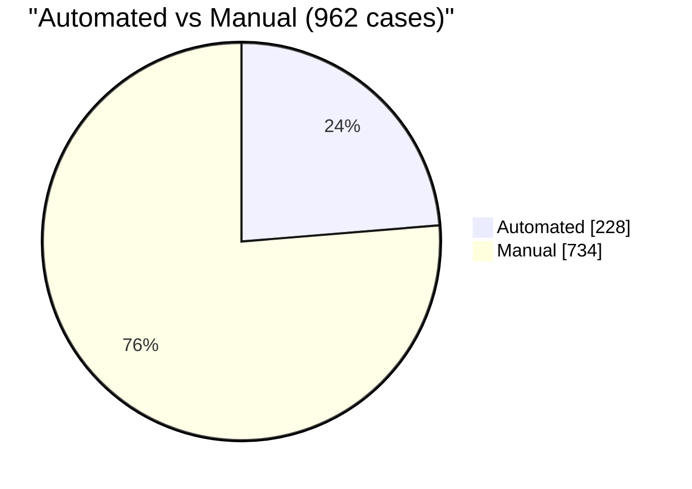

# Test Dashboard

_Generated: 2026-10-16 07:44 UTC_

## Latest Run

**RUN-ELITEA-2026-10-16-286-DEV-SMOKE-PASSED**

| Metric | Value |
|--------|-------|
| Total | 2 |
| Passed | 2 |
| Failed | 0 |
| Skipped | 0 |
| Reruns | 0 |
| Pass Rate | 100.0% |

## Trend (Last 10 Runs)

```mermaid
xychart-beta
    title "Pass/Fail Trend"
    x-axis [15-269-DEV-SMOKE, 15-270-DEV-SMOKE, 15-271-DEV-SMOKE, 15-272-DEV-SMOKE, 15-273-DEV-PIPELINES_2, 16-282-DEV-SMOKE, 16-283-DEV-SMOKE, 16-284-DEV-SMOKE, 16-285-DEV-SMOKE, 16-286-DEV-SMOKE]
    y-axis "Tests" 0 --> 62
    bar "Passed" [2, 2, 2, 2, 57, 2, 2, 2, 2, 2]
    bar "Failed" [0, 0, 0, 0, 0, 0, 0, 0, 0, 0]
```

### Reruns Trend

## Run History

| Run | Total | Passed | Failed | Skipped | Reruns | Rate |
|-----|-------|--------|--------|---------|--------|------|
| ✅ 16-286-DEV-SMOKE | 2 | 2 | 0 | 0 | 0 | 100% |
| ✅ 16-285-DEV-SMOKE | 2 | 2 | 0 | 0 | 0 | 100% |
| ✅ 16-284-DEV-SMOKE | 2 | 2 | 0 | 0 | 0 | 100% |
| ✅ 16-283-DEV-SMOKE | 2 | 2 | 0 | 0 | 0 | 100% |
| ✅ 16-282-DEV-SMOKE | 2 | 2 | 0 | 0 | 0 | 100% |
| ✅ 15-273-DEV-PIPELINES_2 | 57 | 57 | 0 | 0 | 8 | 100% |
| ✅ 15-272-DEV-SMOKE | 2 | 2 | 0 | 0 | 0 | 100% |
| ✅ 15-271-DEV-SMOKE | 2 | 2 | 0 | 0 | 0 | 100% |
| ✅ 15-270-DEV-SMOKE | 2 | 2 | 0 | 0 | 0 | 100% |
| ✅ 15-269-DEV-SMOKE | 2 | 2 | 0 | 0 | 0 | 100% |

---
_Source: `reports/automated/junit-RUN-*.json` (20 reports)_

---

## TMS Coverage Analysis

| Metric | Count |
|--------|-------|
| Tests in automation | 252 |
| Tests linked to TMS cases | 252 |
| Tests without TMS case | 0 |
| Orphan TMS refs (test missing) | 23 |
| **TMS Coverage** | **100.0%** |

### Automation Coverage by Suite

| Suite | Automated | Total |
|-------|-----------|-------|
| admin | 3 | 3 |
| agent_hub | 12 | 21 |
| agents | 26 | 61 |
| artifacts | 24 | 80 |
| chat | 19 | 234 |
| credentials | 1 | 24 |
| evaluation-run-analytics | 0 | 5 |
| help_center | 2 | 12 |
| indexing | 0 | 18 |
| mcp | 3 | 50 |
| onboarding | 0 | 11 |
| per-run-analytics | 0 | 6 |
| pipelines | 89 | 96 |
| settings | 10 | 212 |
| skills | 19 | 66 |
| social-folders | 0 | 13 |
| support-assistant | 14 | 24 |
| toolkit | 0 | 7 |
| toolkits_UI | 6 | 19 |
| **All suites** | **228** | **962** |

### Orphan TMS References

_TMS cases reference tests that don't exist in automation (renamed/deleted?)._

Show 23 orphan refs

- `tests.ui.chat.test_chat_interface.TestContextAndSettings.test_model_settings_menu` (ELITEA-0500)
- `tests.ui.chat.test_chat_interface.TestConversationUIElements.test_attach_files_button_opens_picker` (ELITEA-0500)
- `tests.ui.chat.test_chat_interface.TestConversationUIElements.test_clear_chat_history` (ELITEA-0502)
- `tests.ui.chat.test_chat_interface.TestSendingMessages.test_send_message_with_enter_key` (ELITEA-0503)
- `tests.ui.chat.test_chat_interface.test_chat_message_history_displays` (ELITEA-1142)
- `tests.ui.chat.test_chat_interface.test_chat_page_loads_successfully` (ELITEA-1142)
- `tests.ui.chat.test_chat_interface.test_message_input_is_functional` (ELITEA-1142)
- `tests.ui.help_center.test_help_center_page_loads.TestHelpCenterPageLoads.test_help_center_page_loads_via_sidebar_icon` (ELITEA-2219)
- `tests.ui.pipelines.test_pipeline_advanced.TestAdditionalNodeTypes.test_add_decision_node` (ELITEA-0858)
- `tests.ui.pipelines.test_pipeline_advanced.TestAdditionalNodeTypes.test_add_printer_node` (ELITEA-0858)
- `tests.ui.pipelines.test_pipeline_advanced.TestAdditionalNodeTypes.test_add_router_node` (ELITEA-0858)
- `tests.ui.pipelines.test_pipeline_advanced.TestHistoryTab.test_history_tab_opens` (ELITEA-0858)
- `tests.ui.pipelines.test_pipeline_execution.TestExecutePipeline.test_execute_simple_pipeline` (ELITEA-0862)
- `tests.ui.pipelines.test_pipeline_execution.TestExecutePipeline.test_message_count_after_execution` (ELITEA-0856)
- `tests.ui.pipelines.test_pipeline_execution.TestExecutePipeline.test_rerun_pipeline` (ELITEA-0862)
- `tests.ui.pipelines.test_pipeline_nodes.TestAddNode.test_add_code_node` (ELITEA-0853)
- `tests.ui.pipelines.test_pipeline_nodes.TestAddNode.test_add_llm_node` (ELITEA-0853)
- `tests.ui.pipelines.test_pipeline_nodes.TestConnectNodes.test_connect_node_to_end` (ELITEA-0853)
- `tests.ui.pipelines.test_pipeline_nodes.TestConnectNodes.test_connect_two_custom_nodes` (ELITEA-0853)
- `tests.ui.pipelines.test_pipeline_nodes.TestDeleteNode.test_delete_node_does_not_remove_end` (ELITEA-0853)
- `tests.ui.pipelines.test_pipeline_nodes.TestDeleteNode.test_delete_node_via_menu` (ELITEA-0853)
- `tests.ui.pipelines.test_pipeline_nodes.TestEditNode.test_edit_node_name` (ELITEA-0853)
- `tests.ui.pipelines.test_pipeline_nodes.TestEditNode.test_node_default_name_matches_type` (ELITEA-0853)

---
_Compared `automation/index.json` (252 tests) with `index_automated.json` (275 refs)_
