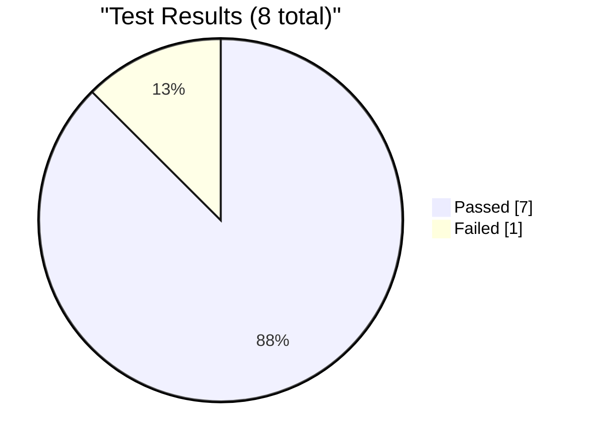
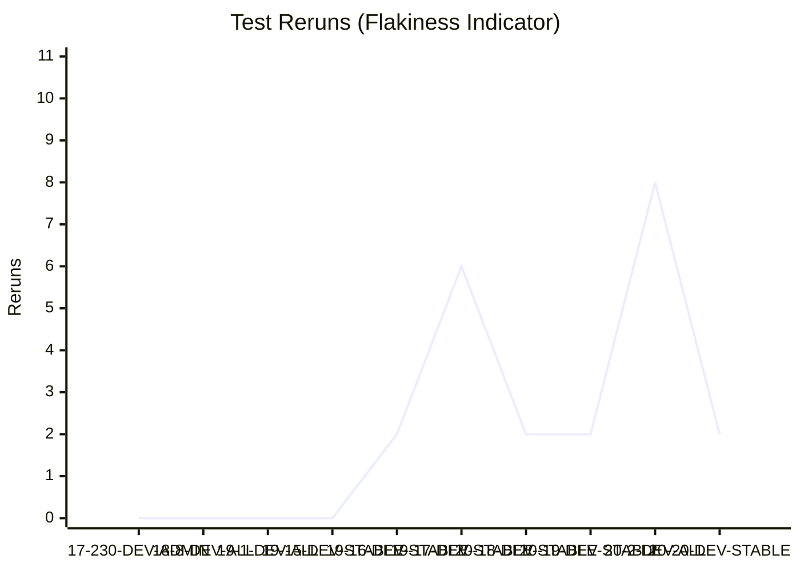

# Test Dashboard

_Generated: 2026-08-20 07:32 UTC_

## Latest Run

**RUN-ELITEA-2026-08-20-20-DEV-STABLE-SETTINGS-SMOKE-FAILED**

| Metric | Value |
|--------|-------|
| Total | 8 |
| Passed | 7 |
| Failed | 1 |
| Skipped | 0 |
| Reruns | 2 |
| Pass Rate | 87.5% |

## Trend (Last 10 Runs)

```mermaid
xychart-beta
    title "Pass/Fail Trend"
    x-axis [17-230-DEV-ADMIN, 18-8-DEV-ALL, 19-1-DEV-ALL, 19-15-DEV-STABLE, 19-16-DEV-STABLE, 19-17-DEV-STABLE, 20-18-DEV-STABLE, 20-19-DEV-STABLE, 20-2-DEV-ALL, 20-20-DEV-STABLE]
    y-axis "Tests" 0 --> 86
    bar "Passed" [64, 81, 46, 7, 7, 80, 7, 7, 46, 7]
    bar "Failed" [2, 4, 6, 1, 1, 5, 1, 1, 6, 1]
```

### Reruns Trend

## Run History

| Run | Total | Passed | Failed | Skipped | Reruns | Rate |
|-----|-------|--------|--------|---------|--------|------|
| ❌ 20-20-DEV-STABLE | 8 | 7 | 1 | 0 | 2 | 88% |
| ❌ 20-2-DEV-ALL | 52 | 46 | 6 | 0 | 8 | 88% |
| ❌ 20-19-DEV-STABLE | 8 | 7 | 1 | 0 | 2 | 88% |
| ❌ 20-18-DEV-STABLE | 8 | 7 | 1 | 0 | 2 | 88% |
| ❌ 19-17-DEV-STABLE | 95 | 80 | 5 | 10 | 6 | 84% |
| ❌ 19-16-DEV-STABLE | 8 | 7 | 1 | 0 | 2 | 88% |
| ❌ 19-15-DEV-STABLE | 8 | 7 | 1 | 0 | 0 | 88% |
| ❌ 19-1-DEV-ALL | 52 | 46 | 6 | 0 | 0 | 88% |
| ❌ 18-8-DEV-ALL | 95 | 81 | 4 | 10 | 0 | 85% |
| ❌ 17-230-DEV-ADMIN | 69 | 64 | 2 | 3 | 0 | 93% |

---
_Source: `reports/automated/junit-RUN-*.json` (19 reports)_
