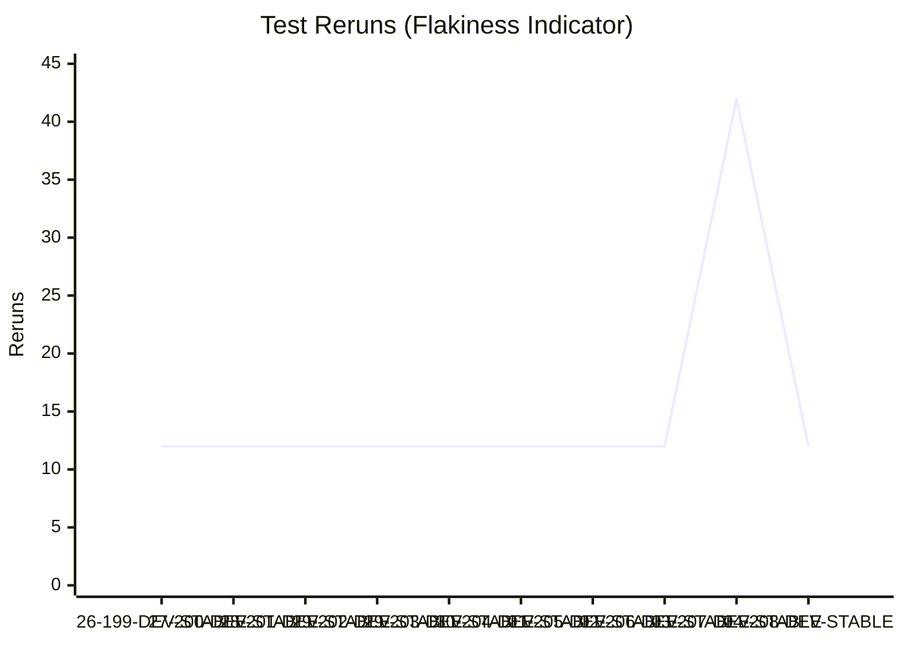
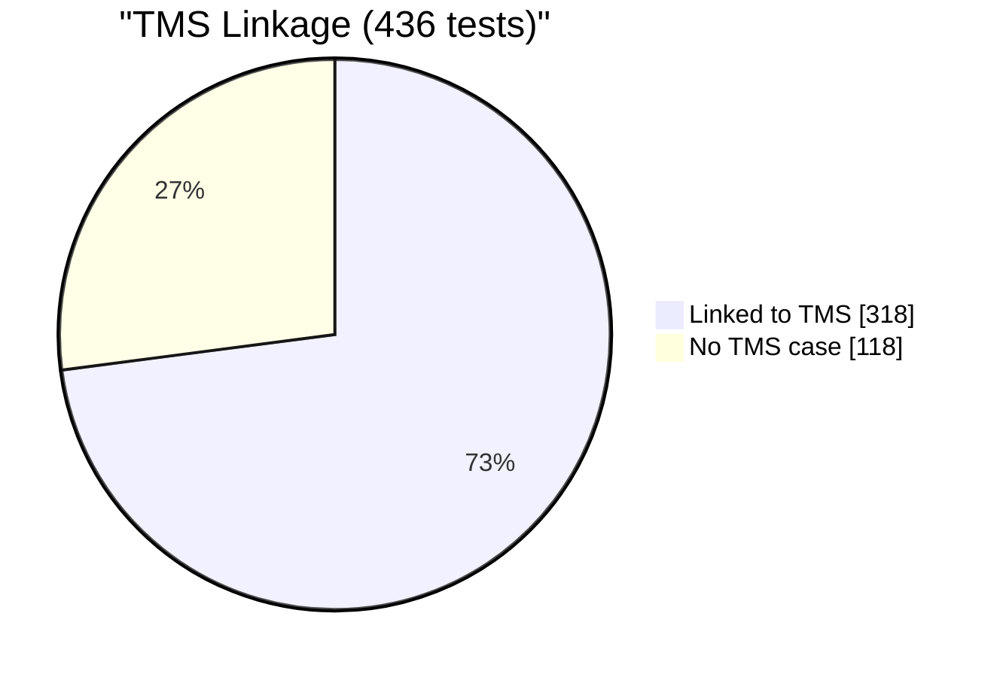

# Test Dashboard

_Generated: 2026-10-04 02:40 UTC_

## Latest Run

**RUN-ELITEA-2026-10-04-208-DEV-STABLE-SMOKE-ARTIFACTS-SCHEDULED-FAILED**

| Metric | Value |
|--------|-------|
| Total | 30 |
| Passed | 26 |
| Failed | 2 |
| Skipped | 2 |
| Reruns | 12 |
| Pass Rate | 86.7% |

## Trend (Last 10 Runs)

```mermaid
xychart-beta
    title "Pass/Fail Trend"
    x-axis [26-199-DEV-STABLE, 27-200-DEV-STABLE, 28-201-DEV-STABLE, 29-202-DEV-STABLE, 29-203-DEV-STABLE, 30-204-DEV-STABLE, 01-205-DEV-STABLE, 02-206-DEV-STABLE, 03-207-DEV-STABLE, 04-208-DEV-STABLE]
    y-axis "Tests" 0 --> 51
    bar "Passed" [26, 26, 26, 26, 26, 26, 26, 26, 46, 26]
    bar "Failed" [2, 2, 2, 2, 2, 2, 2, 2, 24, 2]
```

### Reruns Trend

## Run History

| Run | Total | Passed | Failed | Skipped | Reruns | Rate |
|-----|-------|--------|--------|---------|--------|------|
| ❌ 04-208-DEV-STABLE | 30 | 26 | 2 | 2 | 12 | 87% |
| ❌ 03-207-DEV-STABLE | 72 | 46 | 24 | 2 | 42 | 64% |
| ❌ 02-206-DEV-STABLE | 30 | 26 | 2 | 2 | 12 | 87% |
| ❌ 01-205-DEV-STABLE | 30 | 26 | 2 | 2 | 12 | 87% |
| ❌ 30-204-DEV-STABLE | 30 | 26 | 2 | 2 | 12 | 87% |
| ❌ 29-203-DEV-STABLE | 30 | 26 | 2 | 2 | 12 | 87% |
| ❌ 29-202-DEV-STABLE | 30 | 26 | 2 | 2 | 12 | 87% |
| ❌ 28-201-DEV-STABLE | 30 | 26 | 2 | 2 | 12 | 87% |
| ❌ 27-200-DEV-STABLE | 30 | 26 | 2 | 2 | 12 | 87% |
| ❌ 26-199-DEV-STABLE | 30 | 26 | 2 | 2 | 12 | 87% |

---
_Source: `reports/automated/junit-RUN-*.json` (20 reports)_

---

## TMS Coverage Analysis

| Metric | Count |
|--------|-------|
| Tests in automation | 436 |
| Tests linked to TMS cases | 318 |
| Tests without TMS case | 118 |
| Orphan TMS refs (test missing) | 310 |
| **TMS Coverage** | **72.9%** |

### Tests Without TMS Case

_Tests that exist in automation but have no linked TMS case._

Show 118 unlinked tests

- `tests.ui.admin.test_guardrails_cleanup_only.test_cleanup_after`
- `tests.ui.admin.test_guardrails_cleanup_only.test_cleanup_before`
- `tests.ui.admin.test_guardrails_live_reload.TestBlockedToolLiveReload.test_blocked_tool_live_reload_case_insensitive`
- `tests.ui.admin.test_guardrails_live_reload.TestBlockedToolkitLiveReload.test_blocked_toolkit_live_reload_case_insensitive`
- `tests.ui.admin.test_guardrails_live_reload.TestSensitiveToolLiveReload.test_sensitive_tool_live_reload_case_insensitive`
- `tests.ui.agents.test_agent_character_limits.TestConversationStarterCharacterCounter.test_conversation_starter_counter_turns_red_at_limit`
- `tests.ui.agents.test_agent_character_limits.TestConversationStarterCharacterCounter.test_conversation_starter_counter_visible_and_updates`
- `tests.ui.agents.test_agent_character_limits.TestConversationStarterCharacterCounter.test_conversation_starter_fullscreen_counter_and_warning`
- `tests.ui.agents.test_agent_character_limits.TestConversationStarterCharacterCounter.test_conversation_starter_text_truncated_with_warning`
- `tests.ui.agents.test_agent_character_limits.TestConversationStarterCharacterCounter.test_multiple_conversation_starters_have_counters`
- `tests.ui.agents.test_agent_character_limits.TestWelcomeMessageCharacterCounter.test_welcome_message_counter_turns_red_at_limit`
- `tests.ui.agents.test_agent_character_limits.TestWelcomeMessageCharacterCounter.test_welcome_message_counter_visible_and_updates_realtime`
- `tests.ui.agents.test_agent_character_limits.TestWelcomeMessageCharacterCounter.test_welcome_message_fullscreen_counter_and_warning`
- `tests.ui.agents.test_agent_character_limits.TestWelcomeMessageCharacterCounter.test_welcome_message_text_truncated_with_warning`
- `tests.ui.agents.test_agent_management.TestAgentActions.test_delete_agent_via_api`
- `tests.ui.agents.test_agent_management.TestAgentActions.test_delete_agent_via_ui_menu`
- `tests.ui.agents.test_agent_management.TestAgentActions.test_edit_agent_description`
- `tests.ui.agents.test_agent_management.TestAgentActions.test_edit_agent_name`
- `tests.ui.agents.test_agent_management.TestAgentConfiguration.test_agent_detail_page_loads`
- `tests.ui.agents.test_agent_management.TestAgentConfiguration.test_agent_information_section`
- `tests.ui.agents.test_agent_management.TestAgentConfiguration.test_agent_instructions_field`
- `tests.ui.agents.test_agent_management.TestAgentConfiguration.test_agent_toolkits_section_visible`
- `tests.ui.agents.test_agent_management.TestAgentConfiguration.test_internal_tools_enum_usage`
- `tests.ui.agents.test_agent_management.TestAgentList.test_agent_search`
- `tests.ui.agents.test_agent_management.TestAgentList.test_agent_search_no_results`
- `tests.ui.agents.test_agent_management.TestAgentList.test_agents_dashboard_loads`
- `tests.ui.agents.test_agent_management.TestAgentList.test_view_toggle_table_and_card`
- `tests.ui.agents.test_agent_management.TestCreateAgent.test_create_agent_via_api_visible_in_ui`
- `tests.ui.agents.test_agent_management.TestCreateAgent.test_create_agent_via_ui`
- `tests.ui.agents.test_agent_with_github_toolkit.TestAddToolkitToAgent.test_add_toolkit_to_agent`
- `tests.ui.agents.test_agent_with_github_toolkit.TestChatWithAgentToolkit.test_agent_chat_with_github_toolkit`
- `tests.ui.agents.test_agent_with_github_toolkit.TestRemoveToolkitFromAgent.test_remove_toolkit_from_agent`
- `tests.ui.artifacts.test_artifacts_bucket_name_validation_invalid_formats.TestArtifactBucketNameValidationInvalidFormats.test_bucket_name_validation_rejects_invalid_format[ELITEA-1811-leading-digit]`
- `tests.ui.artifacts.test_artifacts_bucket_name_validation_invalid_formats.TestArtifactBucketNameValidationInvalidFormats.test_bucket_name_validation_rejects_invalid_format[ELITEA-1814-space]`
- `tests.ui.artifacts.test_artifacts_bucket_name_validation_invalid_formats.TestArtifactBucketNameValidationInvalidFormats.test_bucket_name_validation_rejects_invalid_format[ELITEA-1814-special-char]`
- `tests.ui.artifacts.test_artifacts_bucket_name_validation_invalid_formats.TestArtifactBucketNameValidationInvalidFormats.test_bucket_name_validation_rejects_invalid_format[ELITEA-1814-underscore]`
- `tests.ui.artifacts.test_artifacts_multi_file.TestArtifactMultiFileDownload.test_agent_creates_files_at_root_and_in_subfolder`
- `tests.ui.chat.test_agent_with_toolkit_chat.TestAgentWithToolkitInChat.test_agent_with_toolkit_executes_in_chat`
- `tests.ui.chat.test_chat_folder_rename_checkmark_validation.TestChatFolderDeleteApiFallbackRegression.test_delete_folder_via_api_actually_removes_the_folder`
- `tests.ui.chat.test_chat_interface.TestContextAndSettings.test_edit_context_settings`
- `tests.ui.chat.test_chat_interface.TestConversationUIElements.test_attach_files_button_sends_file_with_message`
- `tests.ui.chat.test_chat_interface.TestMessageActions.test_copy_message_to_clipboard`
- `tests.ui.chat.test_chat_interface.TestMessageActions.test_delete_message`
- `tests.ui.chat.test_chat_interface.TestPageLoadAndRendering.test_chat_page_loads_with_functional_input`
- `tests.ui.chat.test_chat_interface.TestSearchAndErrorHandling.test_handle_message_send_failure`
- `tests.ui.chat.test_chat_interface.TestSearchAndErrorHandling.test_search_conversations_dialog`
- `tests.ui.chat.test_chat_interface.TestSendingMessages.test_cannot_send_empty_message`
- `tests.ui.chat.test_chat_interface.TestSendingMessages.test_send_text_message`
- `tests.ui.chat.test_chat_interface.TestSendingMessages.test_shift_enter_adds_new_line`
- `tests.ui.chat.test_chat_interface.TestSidebarNavigation.test_navigate_to_agents_from_sidebar`
- `tests.ui.chat.test_chat_interface.TestSidebarNavigation.test_open_close_sidebar`
- `tests.ui.chat.test_context_management.TestContextManagementSettings.test_context_budget_reflects_profile_max_tokens[10k_tokens]`
- `tests.ui.chat.test_context_management.TestContextManagementSettings.test_context_budget_reflects_profile_max_tokens[32k_tokens]`
- `tests.ui.chat.test_conversation_management.TestConversationActions.test_delete_conversation_cancel`
- `tests.ui.chat.test_conversation_management.TestConversationActions.test_delete_conversation_with_confirmation`
- `tests.ui.chat.test_conversation_management.TestConversationActions.test_multiple_conversations_listed`
- `tests.ui.chat.test_conversation_management.TestConversationActions.test_rename_conversation_via_ui`
- `tests.ui.chat.test_conversation_management.TestConversationIsolation.test_fixture_cleanup_cycle`
- `tests.ui.chat.test_conversation_management.TestConversationIsolation.test_fixture_creates_fresh_conversation`
- `tests.ui.chat.test_conversation_management.TestConversationList.test_click_conversation_to_open`
- `tests.ui.chat.test_conversation_management.TestConversationList.test_search_conversations_button`
- `tests.ui.chat.test_conversation_management.TestConversationNavigation.test_navigate_between_conversations`
- `tests.ui.chat.test_conversation_management.TestConversationNavigation.test_send_message_persists_conversation`
- `tests.ui.chat.test_conversation_management.TestCreateConversation.test_create_conversation_via_api`
- `tests.ui.chat.test_conversation_management.TestCreateConversation.test_new_conversation_default_settings`
- `tests.ui.chat.test_move_conversation_to_folder.TestMoveConversationToNewFolder.test_move_conversation_to_new_folder`
- `tests.ui.chat.test_open_existing_conversation_from_this_week_section.TestOpenExistingConversationFromThisWeekSection.test_open_existing_conversation_from_this_week_section`
- `tests.ui.pipelines.test_pipeline_advanced.TestActionsMenu.test_export_pipeline_if_available`
- `tests.ui.pipelines.test_pipeline_advanced.TestActionsMenu.test_three_dot_menu_lists_items`
- `tests.ui.pipelines.test_pipeline_advanced.TestDiscardChanges.test_save_discard_button_states_toggle_on_edit_and_discard`
- `tests.ui.pipelines.test_pipeline_advanced.TestMakeEntrypoint.test_make_node_entrypoint`
- `tests.ui.pipelines.test_pipeline_advanced.TestMultiNodeTopology.test_save_multi_node_pipeline`
- `tests.ui.pipelines.test_pipeline_advanced.TestMultiNodeTopology.test_three_node_chain`
- `tests.ui.pipelines.test_pipeline_advanced.TestYamlEditor.test_flow_yaml_round_trip`
- `tests.ui.pipelines.test_pipeline_advanced.TestYamlEditor.test_yaml_content_reflects_pipeline`
- `tests.ui.pipelines.test_pipeline_advanced.TestYamlEditor.test_yaml_view_toggle`
- `tests.ui.pipelines.test_pipeline_execution.TestExecutePipeline.test_message_count_starts_at_zero_and_grows`
- `tests.ui.pipelines.test_pipeline_execution.TestExecutePipeline.test_pipeline_response_is_meaningful`
- `tests.ui.pipelines.test_pipeline_execution.TestPipelineChatMessages.test_multiple_executions_accumulate`
- `tests.ui.pipelines.test_pipeline_execution.TestPipelineChatMessages.test_user_message_visible`
- `tests.ui.pipelines.test_pipeline_execution.TestPipelineExecutionEdgeCases.test_empty_pipeline_execution`
- `tests.ui.pipelines.test_pipeline_execution.TestPipelineExecutionEdgeCases.test_navigate_away_and_reexecute`
- `tests.ui.pipelines_2.test_pipeline_management.TestCreatePipeline.test_create_pipeline_required_fields_validation`
- `tests.ui.pipelines_2.test_pipeline_management.TestCreatePipeline.test_create_pipeline_via_ui`
- `tests.ui.pipelines_2.test_pipeline_management.TestDeletePipeline.test_delete_pipeline_via_api`
- `tests.ui.pipelines_2.test_pipeline_management.TestEditPipeline.test_edit_pipeline_description`
- `tests.ui.pipelines_2.test_pipeline_management.TestEditPipeline.test_edit_pipeline_name`
- `tests.ui.pipelines_2.test_pipeline_management.TestEditPipeline.test_pipeline_detail_page_loads`
- `tests.ui.pipelines_2.test_pipeline_management.TestEditPipeline.test_pipeline_has_configuration_and_history_tabs`
- `tests.ui.pipelines_2.test_pipeline_management.TestPipelineDashboard.test_pipeline_created_via_api_visible_in_dashboard`
- `tests.ui.pipelines_2.test_pipeline_management.TestPipelineDashboard.test_pipeline_dashboard_loads`
- `tests.ui.pipelines_2.test_pipeline_management.TestPipelineIsolation.test_fixture_cleanup_cycle`
- `tests.ui.pipelines_2.test_pipeline_management.TestPipelineIsolation.test_fixture_creates_fresh_pipeline`
- `tests.ui.pipelines_2.test_pipeline_management.TestSearchPipeline.test_search_pipeline_by_name`
- `tests.ui.pipelines_2.test_pipeline_management.TestSearchPipeline.test_search_pipeline_no_results`
- `tests.ui.pipelines_2.test_pipeline_nodes.TestAddNode.test_add_human_in_the_loop_node_and_connect_to_end`
- `tests.ui.skills.test_skill_management.TestCreateSkill.test_create_skill_and_verify_execution`
- `tests.ui.smoke.test_ui_smoke.TestHomePage.test_main_content_visible`
- `tests.ui.smoke.test_ui_smoke.TestHomePage.test_page_loads`
- `tests.ui.test_maintenance_handling.test_api_maintenance_error_triggerable`
- `tests.ui.test_maintenance_handling.test_maintenance_banner_dismissed_automatically`
- `tests.ui.test_maintenance_handling.test_maintenance_detection_captures_screenshot`
- `tests.ui.test_maintenance_handling.test_maintenance_state_boolean_check`
- `tests.ui.toolkits.test_toolkit_indicators_for_credentials.TestAgentCredentialIndicators.test_agent_credential_indicators_e2e`
- `tests.ui.toolkits.test_toolkit_indicators_for_credentials.TestPipelineCredentialIndicators.test_pipeline_credential_indicators_e2e`
- `tests.ui.toolkits.test_toolkit_parameterized.TestChatWithToolkit.test_chat_with_toolkit[bitbucket]`
- `tests.ui.toolkits.test_toolkit_parameterized.TestChatWithToolkit.test_chat_with_toolkit[gitlab]`
- `tests.ui.toolkits.test_toolkit_parameterized.TestCreateCredential.test_create_credential[bitbucket]`
- `tests.ui.toolkits.test_toolkit_parameterized.TestCreateCredential.test_create_credential[gitlab]`
- `tests.ui.toolkits.test_toolkit_parameterized.TestCreateToolkit.test_create_toolkit[bitbucket]`
- `tests.ui.toolkits.test_toolkit_parameterized.TestCreateToolkit.test_create_toolkit[gitlab]`
- `tests.ui.toolkits.test_toolkit_parameterized.TestToolkitTestSettings.test_toolkit_test_settings[bitbucket]`
- `tests.ui.toolkits.test_toolkit_parameterized.TestToolkitTestSettings.test_toolkit_test_settings[gitlab]`
- `tests.ui.voice.test_voice_configuration.TestVoiceConfiguration.test_speed_and_volume_controls`
- `tests.ui.voice.test_voice_configuration.TestVoiceConfiguration.test_voice_preview_personalization`
- `tests.ui.voice.test_voice_configuration.TestVoiceConfiguration.test_voice_selection_from_chat`
- `tests.ui.voice.test_voice_configuration.TestVoiceConfiguration.test_voice_settings_not_visible_by_default`
- `tests.ui.voice.test_voice_configuration.TestVoiceConfiguration.test_voice_settings_sync`

### Orphan TMS References

_TMS cases reference tests that don't exist in automation (renamed/deleted?)._

Show 310 orphan refs

- `test_attachment_blocking` (ELITEA-2877)
- `test_interjection_queuing_sequential` (ELITEA-2875)
- `test_message_order_fifo` (ELITEA-2876)
- `test_queue_ui_state` (ELITEA-2879)
- `test_stop_preserves_queue` (ELITEA-2878)
- `tests.ui.admin.test_analytics_bar_chart_tooltip.TestAnalyticsBarChartTooltip.test_bar_chart_hover_tooltip` (ELITEA-2328)
- `tests.ui.admin.test_analytics_date_filter_content_refresh.TestAnalyticsDateFilterRetention.test_date_filter_retained_when_switching_tabs` (ELITEA-2319)
- `tests.ui.admin.test_analytics_date_filter_content_refresh.TestAnalyticsOverviewContentRefresh.test_preset_switch_updates_overview_content` (ELITEA-2317)
- `tests.ui.admin.test_analytics_date_filter_content_refresh.TestAnalyticsTabContentRefresh.test_preset_switch_updates_agents_tools_and_users_tabs` (ELITEA-2318)
- `tests.ui.admin.test_analytics_date_filter_controls.TestAnalyticsCustomDateRange.test_custom_from_to_range_filters_data` (ELITEA-2315)
- `tests.ui.admin.test_analytics_date_filter_controls.TestAnalyticsDatePresets.test_presets_update_pickers_and_refresh_content` (ELITEA-2314)
- `tests.ui.admin.test_analytics_date_filter_controls.TestAnalyticsFromDateConstraint.test_from_date_cannot_be_later_than_to_date` (ELITEA-2316)
- `tests.ui.admin.test_analytics_guide_tab.TestAnalyticsGuideTab.test_guide_tab_metric_documentation` (ELITEA-2325)
- `tests.ui.admin.test_analytics_health_tab.TestAnalyticsHealthTab.test_health_tab_chart_and_event_type_table` (ELITEA-2324)
- `tests.ui.admin.test_analytics_overview_daily_chart_tooltip.TestAnalyticsOverviewDailyChartTooltip.test_overview_daily_chart_hover_tooltip` (ELITEA-2326)
- `tests.ui.admin.test_analytics_overview_kpi_cards.TestAnalyticsOverviewKpiCards.test_overview_tab_kpi_cards` (ELITEA-2311)
- `tests.ui.admin.test_analytics_tools_tab.TestAnalyticsToolsTab.test_tools_tab_chart_and_details_table` (ELITEA-2322)
- `tests.ui.admin.test_hidden_secret_absent_from_ai_provider_dropdown.TestHiddenSecretAbsentFromAIProviderDropdown.test_hidden_secret_absent_from_ai_provider_dropdown` (ELITEA-2346)
- `tests.ui.admin.test_hidden_secret_not_breaking_credentials.TestHiddenSecretNotBreakingCredentials.test_hiding_secret_used_by_credential_does_not_break_it` (ELITEA-2345)
- `tests.ui.admin.test_notification_center_layout.TestNotificationCenterLayout.test_notification_center_page_layout_and_header` (ELITEA-2255)
- `tests.ui.admin.test_notification_center_pagination.TestNotificationCenterPagination.test_notification_center_pagination_controls` (ELITEA-2256)
- `tests.ui.admin.test_notification_link_navigates_to_bucket.TestNotificationBucketRetentionLinkNavigation.test_bucket_retention_link_navigates_to_bucket` (ELITEA-2263)
- `tests.ui.admin.test_notification_link_navigates_to_conversation.TestNotificationChatMentionLinkNavigation.test_chat_mention_link_navigates_to_conversation` (ELITEA-2261)
- `tests.ui.admin.test_notification_search_filter.TestNotificationSearchFilter.test_search_field_filters_notifications_by_text` (ELITEA-2264)
- `tests.ui.admin.test_notification_unread_read_visual_distinction.TestNotificationUnreadReadVisualDistinction.test_unread_notifications_are_visually_distinct_from_read` (ELITEA-2258)
- `tests.ui.admin.test_personal_token_delete.TestPersonalTokenDelete.test_delete_personal_token_removed_from_table` (ELITEA-2281)
- `tests.ui.admin.test_personal_token_duplicate_names.TestPersonalTokenDuplicateNames.test_duplicate_token_names_are_allowed` (ELITEA-2288)
- `tests.ui.admin.test_personal_token_expiration_config.TestPersonalTokenExpirationConfig.test_token_expiration_unit_and_value_can_be_configured` (ELITEA-2282)
- `tests.ui.admin.test_personal_token_ide_config_download.TestPersonalTokenIdeConfigDownload.test_ide_download_icon_generates_config_file` (ELITEA-2290)
- `tests.ui.admin.test_personal_token_never_expiration.TestPersonalTokenNeverExpiration.test_token_created_without_expiration_shows_never` (ELITEA-2283)
- `tests.ui.admin.test_personal_token_settings_preview.TestPersonalTokenSettingsPreview.test_eye_icon_opens_ide_settings_preview_panel` (ELITEA-2291)
- `tests.ui.admin.test_personal_tokens_column_sorting.TestPersonalTokensColumnSorting.test_token_name_and_expiration_columns_are_sortable` (ELITEA-2279)
- `tests.ui.admin.test_personal_tokens_search_filter.TestPersonalTokensSearchFilter.test_search_field_filters_tokens_by_name_in_real_time` (ELITEA-2287)
- `tests.ui.admin.test_project_context_build_with_ai_cancel.TestProjectContextBuildWithAICancel.test_ai_dialog_cancel_leaves_editor_content_unchanged` (ELITEA-2270)
- `tests.ui.admin.test_project_context_build_with_ai_generates.TestProjectContextBuildWithAI.test_build_with_ai_generates_content_and_stays_editable` (ELITEA-2269)
- `tests.ui.admin.test_project_context_discard_reverts.TestProjectContextDiscardReverts.test_discard_reverts_unsaved_changes` (ELITEA-2274)
- `tests.ui.admin.test_project_context_empty_save_toggle_off_on.TestProjectContextEmptySaveToggleOffOn.test_project_context_empty_save_toggle_off_on` (ELITEA-2276)
- `tests.ui.admin.test_project_context_import_markdown_file.TestProjectContextImportMarkdownFile.test_import_markdown_file_into_editor_and_edit_it` (ELITEA-2271)
- `tests.ui.admin.test_project_context_markdown_editor.TestProjectContextMarkdownEditor.test_project_context_markdown_editor_and_preview` (ELITEA-2268)
- `tests.ui.admin.test_project_context_page_layout.TestProjectContextPageLayout.test_project_context_page_layout` (ELITEA-2266)
- `tests.ui.admin.test_project_context_save_discard_dirty_state.TestProjectContextSaveDiscardDirtyState.test_save_and_discard_active_only_with_unsaved_changes` (ELITEA-2275)
- `tests.ui.admin.test_project_context_save_persists.TestProjectContextSavePersists.test_save_persists_project_context_after_reload` (ELITEA-2273)
- `tests.ui.admin.test_project_context_toggle_enable_disable.TestProjectContextToggleEnableDisable.test_project_context_toggle_enable_disable` (ELITEA-2267)
- `tests.ui.admin.test_secrets_error_state_on_network_failure.TestSecretsErrorStateOnNetworkFailure.test_secrets_error_state_on_network_failure_and_recovery` (ELITEA-2349)
- `tests.ui.admin.test_user_delete_cancel_keeps_user.TestUserDeleteCancelKeepsUser.test_cancel_deletion_keeps_user_intact` (ELITEA-2300)
- `tests.ui.admin.test_user_delete_via_row_icon.TestUserDeleteViaRowIcon.test_delete_user_via_row_icon` (ELITEA-2298)
- `tests.ui.admin.test_users_column_sorting.TestUsersColumnSorting.test_users_table_columns_are_sortable` (ELITEA-2293)
- `tests.ui.admin.test_users_invite_dialog_layout.TestUsersInviteDialogLayout.test_invite_users_dialog_opens_with_correct_layout` (ELITEA-2295)
- `tests.ui.admin.test_users_invite_existing_member_error.TestUsersInviteExistingMemberError.test_invite_existing_project_member_shows_error` (ELITEA-2309)
- `tests.ui.admin.test_users_invite_single_and_multiple.TestUsersInviteSingleAndMultiple.test_invite_users_with_role` (ELITEA-2297)
- `tests.ui.admin.test_users_invite_without_role.TestUsersInviteWithoutRole.test_invite_user_without_selecting_a_role` (ELITEA-2308)
- `tests.ui.admin.test_users_roles_in_invite_and_edit_dialogs.TestUsersRolesInInviteAndEditDialogs.test_available_roles_in_invite_and_edit_dialogs` (ELITEA-2305)
- `tests.ui.admin.test_users_row_edit_roles_change.TestUsersRowEditRolesChange.test_change_roles_via_row_edit_dialog` (ELITEA-2303)
- `tests.ui.admin.test_users_row_edit_roles_dialog_layout.TestUsersRowEditRolesDialogLayout.test_row_edit_roles_dialog_layout_and_current_role` (ELITEA-2301)
- `tests.ui.admin.test_users_search_filter.TestUsersSearchFilter.test_users_page_search_filters_the_table_in_real_time` (ELITEA-2294)
- `tests.ui.admin.test_viewer_role_cannot_access_secrets.TestViewerRoleCannotAccessSecrets.test_viewer_role_is_not_offered_the_secrets_section` (ELITEA-2348)
- `tests.ui.artifacts.test_artifacts_bucket_cancel_with_valid_values.TestArtifactBucketCancelWithValidValues.test_cancel_with_valid_values_creates_no_bucket` (ELITEA-1815)
- `tests.ui.artifacts.test_artifacts_bucket_empty_name_validation.TestArtifactBucketEmptyNameValidation.test_empty_bucket_name_disables_save_and_cancel_creates_nothing` (ELITEA-1813)
- `tests.ui.artifacts.test_artifacts_bucket_hover_highlight.TestArtifactsBucketHoverHighlight.test_bucket_highlights_on_mouse_hover` (ELITEA-1823)
- `tests.ui.artifacts.test_artifacts_bucket_list_scrolling.TestArtifactsBucketListScrolling.test_scroll_bucket_list_with_20_or_more_buckets` (ELITEA-1822)
- `tests.ui.artifacts.test_artifacts_bucket_name_lowercase.TestArtifactBucketNameLowercase.test_uppercase_bucket_name_is_stored_and_displayed_lowercase` (ELITEA-1812)
- `tests.ui.artifacts.test_artifacts_bucket_name_max_length_rejection.TestArtifactBucketNameMaxLengthRejection.test_bucket_name_field_rejects_more_than_56_characters` (ELITEA-1819)
- `tests.ui.artifacts.test_artifacts_bucket_name_readonly_in_edit_mode.TestArtifactBucketNameReadOnlyInEditMode.test_bucket_name_readonly_in_edit_mode_and_stored_lowercase` (ELITEA-1816)
- `tests.ui.artifacts.test_artifacts_bucket_name_validation_invalid_formats.TestArtifactBucketNameValidationInvalidFormats.test_bucket_name_validation_rejects_invalid_format` (ELITEA-1814)
- `tests.ui.artifacts.test_artifacts_bucket_pin_unpin.TestArtifactsBucketPinUnpin.test_pin_bucket_to_top` (ELITEA-1820)
- `tests.ui.artifacts.test_artifacts_bucket_pin_unpin.TestArtifactsBucketPinUnpin.test_unpin_bucket_from_top` (ELITEA-1821)
- `tests.ui.artifacts.test_artifacts_delete_all_and_dismissal.TestArtifactDeleteAllAndDismissal.test_cancel_delete_all_keeps_items_intact` (ELITEA-1849)
- `tests.ui.artifacts.test_artifacts_delete_all_and_dismissal.TestArtifactDeleteAllAndDismissal.test_close_x_on_delete_confirmation_keeps_items_intact` (ELITEA-1850)
- `tests.ui.artifacts.test_artifacts_delete_all_and_dismissal.TestArtifactDeleteAllAndDismissal.test_delete_all_files_via_select_all` (ELITEA-1848)
- `tests.ui.artifacts.test_artifacts_delete_single_file_dropdown.TestArtifactDeleteSingleFileDropdown.test_delete_single_file_via_dropdown` (ELITEA-1844)
- `tests.ui.artifacts.test_artifacts_delete_single_file_dropdown.TestArtifactDeleteSingleFileDropdownCancel.test_cancel_delete_keeps_file_intact` (ELITEA-1845)
- `tests.ui.artifacts.test_artifacts_download_cancel_zip_progress.TestArtifactDownloadCancelZipProgress.test_cancel_in_progress_zip_download` (ELITEA-1843)
- `tests.ui.artifacts.test_artifacts_file_preview_close_x_unsaved.TestArtifactFilePreviewCloseXUnsaved.test_close_editor_via_x_does_not_persist_changes` (ELITEA-1855)
- `tests.ui.artifacts.test_artifacts_file_preview_discard_warning.TestArtifactFilePreviewDiscardWarning.test_discard_warning_modal_exit_paths` (ELITEA-1854)
- `tests.ui.artifacts.test_artifacts_file_preview_markdown_raw_discard.TestArtifactFilePreviewMarkdownRawDiscard.test_markdown_raw_discard_warning_exit_paths` (ELITEA-1860)
- `tests.ui.artifacts.test_artifacts_file_preview_markdown_tab_switching.TestArtifactFilePreviewMarkdownTabSwitching.test_switching_between_preview_and_raw_tabs` (ELITEA-1861)
- `tests.ui.artifacts.test_artifacts_file_preview_unsupported_xlsx.TestArtifactFilePreviewUnsupportedXlsx.test_unsupported_xlsx_shows_preview_not_available` (ELITEA-1863)
- `tests.ui.artifacts.test_artifacts_file_preview_unsupported_zip_row_actions.TestArtifactFilePreviewUnsupportedZipRowActions.test_unsupported_zip_row_has_no_preview_and_two_actions` (ELITEA-1864)
- `tests.ui.artifacts.test_artifacts_landing_page_collapse_expand_panels.TestArtifactsLandingPageCollapseExpandPanels.test_collapse_and_expand_panels_independently` (ELITEA-1807)
- `tests.ui.artifacts.test_artifacts_landing_page_ui.TestArtifactsLandingPageUI.test_landing_page_bucket_with_files` (ELITEA-1803)
- `tests.ui.artifacts.test_artifacts_landing_page_ui.TestArtifactsLandingPageUI.test_landing_page_empty_bucket` (ELITEA-1805)
- `tests.ui.artifacts.test_artifacts_landing_page_ui.TestArtifactsLandingPageUI.test_landing_page_pagination_more_than_ten_files` (ELITEA-1804)
- `tests.ui.artifacts.test_artifacts_tree_breadcrumb_navigation.TestArtifactsTreeBreadcrumbNavigation.test_breadcrumb_and_url_update_on_navigation` (ELITEA-1837)
- `tests.ui.artifacts.test_artifacts_tree_subfolder_expand_collapse.TestArtifactsTreeSubfolderExpandCollapse.test_subfolder_expands_and_collapses_on_click` (ELITEA-1836)
- `tests.ui.artifacts.test_artifacts_tree_switch_between_buckets.TestArtifactsTreeSwitchBetweenBuckets.test_switching_buckets_updates_tree_and_main_panel` (ELITEA-1838)
- `tests.ui.artifacts.test_artifacts_upload_duplicate_close_x.TestArtifactUploadDuplicateCloseX.test_close_x_dismisses_duplicate_dialog_without_uploading` (ELITEA-1833)
- `tests.ui.artifacts.test_artifacts_upload_duplicate_replace.TestArtifactUploadDuplicateReplace.test_replace_overwrites_existing_file` (ELITEA-1830)
- `tests.ui.artifacts.test_artifacts_upload_path_cancel.TestArtifactsUploadPathCancel.test_cancel_upload_modal_discards_file_selection` (ELITEA-1825)
- `tests.ui.artifacts.test_artifacts_upload_to_selected_subfolder.TestArtifactUploadToSelectedSubfolder.test_upload_via_bucket_actions_lands_in_selected_subfolder` (ELITEA-1834)
- `tests.ui.chat.test_agent_hub_create_conversation_via_starter.TestAgentHubCreateConversationViaStarter.test_agent_hub_create_conversation_via_starter` (ELITEA-2093)
- `tests.ui.chat.test_attach_files_10_left_counter.TestAttachFiles10LeftCounter.test_attach_files_menuitem_shows_10_left_counter` (ELITEA-2195)
- `tests.ui.chat.test_attach_files_multiple_chips_display.TestAttachFilesMultipleChipsDisplay.test_attach_files_of_different_types_shows_identical_icon_and_long_filename_truncates` (ELITEA-2199)
- `tests.ui.chat.test_attach_files_multiple_chips_display.TestAttachFilesMultipleChipsDisplay.test_attach_files_then_remove_two_individually_sequentially` (ELITEA-2198)
- `tests.ui.chat.test_attach_files_multiple_chips_display.TestAttachFilesMultipleChipsDisplay.test_attach_multiple_files_displays_chips_above_composer` (ELITEA-2196)
- `tests.ui.chat.test_attach_files_multiple_chips_display.TestAttachFilesMultipleChipsDisplay.test_long_filename_truncates_and_overflow_indicator_click_expands` (ELITEA-2467)
- `tests.ui.chat.test_build_with_ai_cancel_then_generate_echo_agent.TestBuildWithAICancelThenGenerateEchoAgent.test_cancel_then_generate_creates_echo_agent_in_canvas` (ELITEA-2073)
- `tests.ui.chat.test_chat_agent_starters_add_remove.TestChatAddAgentWithStartersAndSendViaStarter.test_add_agent_with_starters_and_send_via_starter` (ELITEA-2465)
- `tests.ui.chat.test_chat_agent_starters_add_remove.TestChatAddAgentWithStartersToConversation.test_add_agent_with_starters_to_conversation` (ELITEA-2177)
- `tests.ui.chat.test_chat_agent_starters_add_remove.TestChatRemoveAgentClearsConversationStarters.test_remove_agent_clears_conversation_starters` (ELITEA-2178)
- `tests.ui.chat.test_chat_canvas_edit_agent.TestChatCanvasEditAgent.test_edit_agent_welcome_message_syncs_to_agents_section` (ELITEA-2089)
- `tests.ui.chat.test_chat_folder_creation_custom_name_and_cancel.TestChatFolderCreationCustomNameAndCancel.test_cancel_folder_creation_discards_folder` (ELITEA-2134)
- `tests.ui.chat.test_chat_folder_creation_custom_name_and_cancel.TestChatFolderCreationCustomNameAndCancel.test_create_folder_with_custom_name` (ELITEA-2457)
- `tests.ui.chat.test_chat_folder_rename_checkmark_validation.TestChatFolderRenameCheckmarkValidation.test_folder_rename_cancel_via_x_icon_discards_changes` (ELITEA-2122)
- `tests.ui.chat.test_chat_folder_rename_checkmark_validation.TestChatFolderRenameCheckmarkValidation.test_folder_rename_no_changes_close_via_x_icon` (ELITEA-2131)
- `tests.ui.chat.test_chat_folder_rename_checkmark_validation.TestChatFolderRenameCheckmarkValidation.test_folder_rename_via_context_menu_edit_option` (ELITEA-2121)
- `tests.ui.chat.test_chat_folder_rename_checkmark_validation.TestChatFolderRenameCheckmarkValidation.test_pinned_folder_rename_retains_pin_state` (ELITEA-2130)
- `tests.ui.chat.test_chat_folder_rename_length_boundaries.TestChatFolderRenameLengthBoundaries.test_rename_folder_length_boundary_50_chars_accepted` (ELITEA-2128)
- `tests.ui.chat.test_chat_folder_rename_length_boundaries.TestChatFolderRenameLengthBoundaries.test_rename_folder_type_and_paste_beyond_max_length_truncates` (ELITEA-2129)
- `tests.ui.chat.test_chat_interface.TestConversationUIElements.test_internal_tools_toggle` (ELITEA-0501)
- `tests.ui.chat.test_chat_interface.TestConversationUIElements.test_model_selector_functional` (ELITEA-0501)
- `tests.ui.chat.test_chat_interface.TestHashSearch.test_add_agent_via_hash_search_joins_participants_and_responds` (ELITEA-2469)
- `tests.ui.chat.test_chat_interface.TestHashSearch.test_add_pipeline_via_hash_search_joins_participants_and_responds` (ELITEA-2470)
- `tests.ui.chat.test_chat_interface.TestHashSearch.test_hash_search_shows_agents_and_pipelines_from_all_sources` (ELITEA-2206)
- `tests.ui.chat.test_chat_search_and_modules_panel.TestChatSearchAndModulesPanel.test_search_cleared_by_x_icon_restores_default_view` (ELITEA-2164)
- `tests.ui.chat.test_chat_search_and_modules_panel.TestChatSearchAndModulesPanel.test_search_input_cleared_by_deleting_text_updates_dynamically` (ELITEA-2165)
- `tests.ui.chat.test_chat_search_and_modules_panel.TestChatSearchAndModulesPanel.test_search_no_results_state` (ELITEA-2163)
- `tests.ui.chat.test_close_toolkit_canvas_without_saving.TestCloseToolkitCanvasWithoutSaving.test_close_toolkit_canvas_without_saving_creates_no_toolkit` (ELITEA-2081)
- `tests.ui.chat.test_context_auto_summarization_disabled.TestContextAutoSummarizationDisabled.test_no_summarization_when_auto_summarization_disabled` (ELITEA-2217)
- `tests.ui.chat.test_context_management_disabled.TestContextManagementDisabledWidgetStaysZero.test_context_management_disabled_widget_stays_at_zero` (ELITEA-2216)
- `tests.ui.chat.test_conversation_deletion_inside_folder.TestConversationDeletionInsideFolder.test_delete_conversation_inside_folder_preserves_folder` (ELITEA-2115)
- `tests.ui.chat.test_conversation_rename_basic_via_edit_option.TestConversationRenameBasicViaEditOption.test_rename_conversation_basic_via_edit_option` (ELITEA-2099)
- `tests.ui.chat.test_conversation_rename_cancel_discards_changes.TestConversationRenameCancelDiscardsChanges.test_rename_conversation_cancel_discards_changes` (ELITEA-2100)
- `tests.ui.chat.test_conversation_rename_checkmark_active_state.TestConversationRenameCheckmarkActiveState.test_rename_checkmark_activates_at_three_characters` (ELITEA-2109)
- `tests.ui.chat.test_conversation_rename_checkmark_active_state.TestConversationRenameCheckmarkActiveState.test_rename_checkmark_inactive_click_has_no_effect[ELITEA-2105-no-changes]` (ELITEA-2105)
- `tests.ui.chat.test_conversation_rename_checkmark_active_state.TestConversationRenameCheckmarkActiveState.test_rename_checkmark_inactive_click_has_no_effect[ELITEA-2106-empty-field]` (ELITEA-2106)
- `tests.ui.chat.test_conversation_rename_checkmark_active_state.TestConversationRenameCheckmarkActiveState.test_rename_checkmark_inactive_click_has_no_effect[ELITEA-2107-1-char]` (ELITEA-2107)
- `tests.ui.chat.test_conversation_rename_checkmark_active_state.TestConversationRenameCheckmarkActiveState.test_rename_checkmark_inactive_click_has_no_effect[ELITEA-2108-2-char]` (ELITEA-2108)
- `tests.ui.chat.test_conversation_rename_invalid_chars_and_recovery.TestConversationRenameInvalidCharsAndRecovery.test_rename_checkmark_inactive_for_invalid_input_shows_tooltip[ELITEA-2110-special-characters]` (ELITEA-2110)
- `tests.ui.chat.test_conversation_rename_invalid_chars_and_recovery.TestConversationRenameInvalidCharsAndRecovery.test_rename_checkmark_inactive_for_invalid_input_shows_tooltip[ELITEA-2111-dollar-percent-at-characters]` (ELITEA-2111)
- `tests.ui.chat.test_conversation_rename_invalid_chars_and_recovery.TestConversationRenameInvalidCharsAndRecovery.test_rename_checkmark_inactive_for_invalid_input_shows_tooltip[ELITEA-2112-leading-space]` (ELITEA-2112)
- `tests.ui.chat.test_conversation_rename_invalid_chars_and_recovery.TestConversationRenameInvalidCharsAndRecovery.test_rename_recovers_and_saves_after_invalid_value_replaced` (ELITEA-2113)
- `tests.ui.chat.test_conversation_rename_length_boundaries.TestConversationRenameLengthBoundaries.test_rename_conversation_length_boundary[ELITEA-2101-49-chars]` (ELITEA-2101)
- `tests.ui.chat.test_conversation_rename_length_boundaries.TestConversationRenameLengthBoundaries.test_rename_conversation_length_boundary[ELITEA-2102-50-chars]` (ELITEA-2102)
- `tests.ui.chat.test_conversation_rename_length_boundaries.TestConversationRenameLengthBoundaries.test_rename_conversation_paste_beyond_max_length_truncates` (ELITEA-2104)
- `tests.ui.chat.test_conversation_rename_length_boundaries.TestConversationRenameLengthBoundaries.test_rename_conversation_type_beyond_max_length_truncates` (ELITEA-2103)
- `tests.ui.chat.test_create_mcp_from_conversation_discard_changes.TestCreateMcpFromConversationDiscardChanges.test_create_mcp_from_conversation_discard_changes_creates_no_mcp` (ELITEA-2084)
- `tests.ui.chat.test_create_new_conversation_team_project_attachments_and_llm.TestCreateNewConversationTeamProjectAttachmentsAndLLM.test_create_conversation_team_project_attachments_and_llm` (ELITEA-2091)
- `tests.ui.chat.test_create_toolkit_from_conversation.TestCreateToolkitFromConversation.test_create_toolkit_from_conversation_close_canvas_and_verify_participant` (ELITEA-2083)
- `tests.ui.chat.test_delete_confirmation_modal_ui_validation.TestDeleteConfirmationModalUIValidation.test_delete_confirmation_modal_dismisses_via_escape_and_outside_click` (ELITEA-2116)
- `tests.ui.chat.test_delete_confirmation_modal_ui_validation.TestDeleteConfirmationModalUIValidation.test_delete_confirmation_modal_title_body_and_button_styling` (ELITEA-2116)
- `tests.ui.chat.test_drag_drop_conversation_folder.TestDragDropConversationBackToGeneralList.test_drag_drop_conversation_back_to_general_list` (ELITEA-2145)
- `tests.ui.chat.test_drag_drop_conversation_folder.TestDragDropConversationToFolder.test_drag_drop_conversation_to_folder` (ELITEA-2142)
- `tests.ui.chat.test_drag_drop_conversation_folder.TestDragDropHighlightsTargetFolderOnHover.test_drag_drop_highlights_target_folder_on_hover` (ELITEA-2143)
- `tests.ui.chat.test_folder_creation.TestChatFolderCreation.test_create_folder_default_name_checkmark_active` (ELITEA-2118)
- `tests.ui.chat.test_folder_list_scrollability_and_expand_states.TestFolderDisplaysConversationsOrEmptyState.test_folder_displays_conversations_or_empty_state` (ELITEA-2460)
- `tests.ui.chat.test_folder_list_scrollability_and_expand_states.TestFolderListScrollableWhenManyFoldersExist.test_folder_list_scrollable_when_many_folders_exist` (ELITEA-2146)
- `tests.ui.chat.test_folder_list_scrollability_and_expand_states.TestMoveToSubmenuFolderListScrollable.test_move_to_submenu_folder_list_scrollable` (ELITEA-2147)
- `tests.ui.chat.test_generated_echo_agent_save_close_and_starters.TestGeneratedEchoAgentSaveCloseAndStarters.test_save_close_and_use_generated_starters` (ELITEA-2074)
- `tests.ui.chat.test_invite_users_add_cancel_close.TestCancelAddUsersModalAfterPreselectingUsers.test_cancel_after_preselecting_two_users_adds_no_one` (ELITEA-2176)
- `tests.ui.chat.test_invite_users_add_cancel_close.TestRemovePreselectedUserViaChipX.test_remove_preselected_user_via_chip_x` (ELITEA-2175)
- `tests.ui.chat.test_last_remaining_conversation_deletion.TestLastRemainingConversationDeletion.test_delete_last_remaining_conversation_shows_welcome_state` (ELITEA-2117)
- `tests.ui.chat.test_move_conversation_to_folder.TestMoveConversationBackToList.test_move_conversation_back_to_list` (ELITEA-2140)
- `tests.ui.chat.test_move_conversation_to_folder.TestMoveConversationBetweenTwoFolders.test_move_conversation_between_two_folders` (ELITEA-2141)
- `tests.ui.chat.test_move_conversation_to_folder.TestMoveConversationToExistingFolder.test_move_conversation_to_new_folder` (ELITEA-2137)
- `tests.ui.chat.test_move_conversation_to_folder.TestMoveConversationToNewFolder.test_move_conversation_to_new_folder_with_custom_name` (ELITEA-2138)
- `tests.ui.chat.test_open_conversation_from_folder.TestOpenExistingConversationFromFolder.test_open_existing_conversation_from_folder` (ELITEA-2098)
- `tests.ui.chat.test_owner_has_no_remove_control_in_users_dropdown.TestOwnerHasNoRemoveControlInUsersDropdown.test_owner_has_no_remove_control_in_users_dropdown` (ELITEA-2192)
- `tests.ui.chat.test_participants_dropdown_click_name_inserts_mention.TestParticipantsDropdownClickNameInsertsMention.test_click_participant_name_inserts_mention[ELITEA-2173-single-mention]` (ELITEA-2173)
- `tests.ui.chat.test_participants_dropdown_click_name_inserts_mention.TestParticipantsDropdownClickNameInsertsMention.test_click_participant_name_inserts_mention[ELITEA-2174-two-mentions]` (ELITEA-2174)
- `tests.ui.chat.test_pin_conversation.TestChatPanelOrderingPinnedFoldersAndConversations.test_pinned_folder_and_conversation_render_above_unpinned_panel_order` (ELITEA-2461)
- `tests.ui.chat.test_pin_conversation.TestMultipleConversationsPinnedIndependently.test_pin_two_conversations_independently` (ELITEA-2160)
- `tests.ui.chat.test_pin_conversation.TestPinDisabledInFolderThenMovedAndPinned.test_pin_disabled_in_folder_then_moved_and_pinned` (ELITEA-2158)
- `tests.ui.chat.test_pin_conversation.TestUnpinConversationViaContextMenu.test_unpin_conversation_via_context_menu` (ELITEA-2150)
- `tests.ui.chat.test_pin_folder.TestMultipleFoldersPinnedIndependently.test_pin_two_folders_independently` (ELITEA-2161)
- `tests.ui.chat.test_pin_folder.TestPinFolderViaPinOnTop.test_pin_empty_folder_retains_empty_state` (ELITEA-2155)
- `tests.ui.chat.test_pin_folder.TestPinFolderViaPinOnTop.test_pin_folder_via_pin_on_top` (ELITEA-2462)
- `tests.ui.chat.test_pin_folder.TestPinFolderViaPinOnTop.test_pin_folder_with_multiple_conversations_retains_all` (ELITEA-2154)
- `tests.ui.chat.test_pin_folder.TestUnpinFolderViaContextMenu.test_unpin_empty_folder_retains_empty_state` (ELITEA-2156)
- `tests.ui.chat.test_pin_folder.TestUnpinFolderViaContextMenu.test_unpin_folder_via_context_menu` (ELITEA-2153)
- `tests.ui.chat.test_pipeline_create_save_basic_configuration.TestPipelineCreateSaveBasicConfiguration.test_create_pipeline_save_basic_configuration` (ELITEA-2077)
- `tests.ui.chat.test_pipeline_discard_changes_clears_canvas.TestPipelineDiscardChangesClearsCanvas.test_discard_clears_canvas_and_creates_no_pipeline` (ELITEA-2076)
- `tests.ui.chat.test_pipeline_flow_editor_discard_llm_node.TestPipelineFlowEditorDiscardLlmNode.test_add_llm_node_discard_changes_removes_node` (ELITEA-2078)
- `tests.ui.chat.test_public_conversation_green_icon.TestPublicConversationGreenIcon.test_public_conversation_shows_green_icon_in_chat_list` (ELITEA-2188)
- `tests.ui.chat.test_regenerate_response.TestRegenerateResponse.test_regenerate_only_on_last_and_click_triggers_new_generation` (ELITEA-2187)
- `tests.ui.chat.test_regenerate_response.TestRegenerateResponse.test_regenerate_replaces_response_with_new_generation` (ELITEA-2185)
- `tests.ui.chat.test_regenerate_response.TestRegenerateResponse.test_regenerate_visible_only_on_last_response` (ELITEA-2184)
- `tests.ui.chat.test_send_message_with_attachments_verify_included.TestSendMessageWithAttachmentsVerifyIncluded.test_send_message_with_attachments_verify_included` (ELITEA-2201)
- `tests.ui.chat.test_slash_mention_mcp_selection_and_available_tools.TestSlashMentionMcpSelectionAndAvailableTools.test_select_mcp_from_slash_mention_no_tools_shows_empty_panel` (ELITEA-2468)
- `tests.ui.chat.test_slash_mention_mcp_selection_and_available_tools.TestSlashMentionMcpSelectionAndAvailableTools.test_select_mcp_from_slash_mention_shows_its_tools` (ELITEA-2468)
- `tests.ui.chat.test_streaming_response.TestStreamingResponse.test_composer_send_button_toggles_with_empty_input_and_waveform_reappears` (ELITEA-2466)
- `tests.ui.help_center.test_help_center_page_loads.TestHelpCenterPageLoads.test_help_center_page_loads_via_sidebar_icon` (ELITEA-2219)
- `tests.ui.help_center.test_help_center_resource_links.TestHelpCenterResourceLinks.test_resource_card_link_redirects_to_external_page[ELITEA-2220-documentation-getting-started]` (ELITEA-2220)
- `tests.ui.help_center.test_help_center_resource_links.TestHelpCenterResourceLinks.test_resource_card_link_redirects_to_external_page[ELITEA-2221-release-notes-latest]` (ELITEA-2221)
- `tests.ui.help_center.test_help_center_resource_links.TestHelpCenterResourceLinks.test_resource_card_link_redirects_to_external_page[ELITEA-2222-tutorials-how-to-create-an-agent]` (ELITEA-2222)
- `tests.ui.help_center.test_help_center_resource_links.TestHelpCenterResourceLinks.test_resource_card_link_redirects_to_external_page[ELITEA-2224-tutorials-more]` (ELITEA-2224)
- `tests.ui.help_center.test_help_center_resource_links.TestHelpCenterResourceLinks.test_video_library_more_redirects_to_external_portal` (ELITEA-2223)
- `tests.ui.help_center.test_help_center_sidebar_tour.TestHelpCenterSidebarTourExtras.test_sidebar_interactive_tour_back_returns_to_step_one` (ELITEA-2230)
- `tests.ui.help_center.test_help_center_sidebar_tour.TestHelpCenterSidebarTourExtras.test_sidebar_interactive_tour_restarts_after_completion` (ELITEA-2228)
- `tests.ui.help_center.test_help_center_sidebar_tour.TestHelpCenterSidebarTourExtras.test_sidebar_interactive_tour_skip_terminates` (ELITEA-2229)
- `tests.ui.help_center.test_help_center_sidebar_tour.TestHelpCenterSidebarTourExtras.test_sidebar_interactive_tour_starts_on_link_click` (ELITEA-2226)
- `tests.ui.help_center.test_help_center_version_info.TestHelpCenterVersionInfo.test_version_info_tooltip_displays_and_copies` (ELITEA-2225)
- `tests.ui.onboarding.test_onboarding_jump_in.TestOnboardingJumpIn.test_jump_in_now_closes_onboarding_and_shows_default_project_page` (ELITEA-2241)
- `tests.ui.onboarding.test_onboarding_provisioning.TestOnboardingProvisioning.test_get_started_starts_provisioning_poll_and_shows_tips_with_progress_footer` (ELITEA-2240)
- `tests.ui.onboarding.test_onboarding_tips_card.TestOnboardingTipsCard.test_tips_card_displayed_at_slide_1_of_48` (ELITEA-2235)
- `tests.ui.onboarding.test_onboarding_tips_fullscreen.TestOnboardingTipsFullscreen.test_tips_card_expand_fullscreen_and_collapse` (ELITEA-2236)
- `tests.ui.onboarding.test_onboarding_tips_navigation.TestOnboardingTipsArrowBoundaries.test_arrows_inactive_at_first_and_last_slide` (ELITEA-2238)
- `tests.ui.onboarding.test_onboarding_tips_navigation.TestOnboardingTipsForwardNavigation.test_next_arrow_advances_slides` (ELITEA-2237)
- `tests.ui.onboarding.test_onboarding_tips_navigation.TestOnboardingTipsFullscreenNavigation.test_navigate_forward_and_backward_in_fullscreen` (ELITEA-2239)
- `tests.ui.onboarding.test_onboarding_welcome.TestOnboardingWelcomePage.test_welcome_page_displayed_on_first_login` (ELITEA-2231)
- `tests.ui.onboarding.test_sidebar_notification_badge.TestSidebarNotificationBadge.test_bell_shows_red_badge_and_notifications_popover` (ELITEA-2234)
- `tests.ui.onboarding.test_sidebar_socket_status_indicator.TestSidebarSocketStatusIndicator.test_logo_shows_green_connected_dot` (ELITEA-2233)
- `tests.ui.pipelines.test_pipeline_mcp_node_fresh_attach.test_mcp_node_executes_selected_tool` (ELITEA-1952)
- `tests.ui.pipelines.test_pipeline_mcp_node_fresh_attach.test_mcp_node_input_mapping_type_and_toggles_persist` (ELITEA-1953)
- `tests.ui.settings.test_admin_role_project_sections_access.TestAdminRoleProjectSectionsAccess.test_admin_role_has_access_to_all_project_settings_sections` (ELITEA-2245)
- `tests.ui.settings.test_ai_configuration_metadata_fields.TestAIConfigurationMetadataFields.test_ai_configuration_metadata_fields` (ELITEA-2394)
- `tests.ui.settings.test_ai_configuration_openai_template_tab.TestAIConfigurationOpenAITemplateTab.test_openai_template_tab_loads_code_template` (ELITEA-2393)
- `tests.ui.settings.test_ai_credential_test_connection.test_ai_credential_test_connection_error_then_success` (ELITEA-2415)
- `tests.ui.settings.test_ai_provider_section_cards_and_default_selector.TestAiProviderSectionCardsAndDefaultSelector.test_section_shows_model_cards_and_default_selector[ELITEA-2402-image-generation]` (ELITEA-2402)
- `tests.ui.settings.test_ai_provider_section_cards_and_default_selector.TestAiProviderSectionCardsAndDefaultSelector.test_section_shows_model_cards_and_default_selector[ELITEA-2404-asr]` (ELITEA-2404)
- `tests.ui.settings.test_ai_provider_section_cards_and_default_selector.TestAiProviderSectionCardsAndDefaultSelector.test_section_shows_model_cards_and_default_selector[ELITEA-2406-tts]` (ELITEA-2406)
- `tests.ui.settings.test_ai_providers_sections_loading_state.TestAIProvidersSectionsLoadingState.test_ai_providers_sections_loading_state` (ELITEA-2251)
- `tests.ui.settings.test_all_roles_access_personal_sections.TestAllRolesAccessPersonalSections.test_all_roles_can_access_personal_settings_sections[admin]` (ELITEA-2247)
- `tests.ui.settings.test_all_roles_access_personal_sections.TestAllRolesAccessPersonalSections.test_all_roles_can_access_personal_settings_sections[editor]` (ELITEA-2247)
- `tests.ui.settings.test_all_roles_access_personal_sections.TestAllRolesAccessPersonalSections.test_all_roles_can_access_personal_settings_sections[viewer]` (ELITEA-2247)
- `tests.ui.settings.test_change_default_tts_model.TestChangeDefaultTtsModel.test_change_default_tts_model` (ELITEA-2407)
- `tests.ui.settings.test_change_section_default_model.TestChangeSectionDefaultModel.test_change_section_default_model[ELITEA-2403-image-generation]` (ELITEA-2403)
- `tests.ui.settings.test_change_section_default_model.TestChangeSectionDefaultModel.test_change_section_default_model[ELITEA-2405-asr]` (ELITEA-2405)
- `tests.ui.settings.test_context_management_toggle.TestContextManagementToggle.test_disabling_context_management_deactivates_summarization` (ELITEA-2375)
- `tests.ui.settings.test_context_management_values_persist.TestContextManagementValuesPersist.test_context_management_values_persist_after_reload` (ELITEA-2379)
- `tests.ui.settings.test_context_settings_new_conversations_only.TestContextSettingsApplyToNewConversationsOnly.test_context_settings_apply_to_new_conversations_only` (ELITEA-2390)
- `tests.ui.settings.test_default_personality_options.TestDefaultPersonalityOptions.test_default_personality_dropdown_options` (ELITEA-2381)
- `tests.ui.settings.test_default_user_instructions_persist.TestDefaultUserInstructionsPersist.test_default_user_instructions_persist_after_reload` (ELITEA-2382)
- `tests.ui.settings.test_embedding_model_create.TestCreateEmbeddingModelConfiguration.test_create_embedding_model_configuration` (ELITEA-2398)
- `tests.ui.settings.test_llm_model_create.TestCreateLlmModelConfiguration.test_create_llm_model_and_set_as_default` (ELITEA-2412)
- `tests.ui.settings.test_llm_model_edit.TestEditLlmModelConfiguration.test_edit_llm_model_display_name` (ELITEA-2413)
- `tests.ui.settings.test_llm_model_id_autopopulated.TestLlmModelIdAutoPopulated.test_id_is_auto_populated_and_read_only` (ELITEA-2409)
- `tests.ui.settings.test_personality_independent_of_context_management.TestPersonalityIndependentOfContextManagement.test_personality_settings_independent_of_context_management` (ELITEA-2383)
- `tests.ui.settings.test_personalization_autosave_no_save_button.TestPersonalizationAutosaveNoSaveButton.test_personalization_autosave_no_save_button` (ELITEA-2387)
- `tests.ui.settings.test_personalization_new_conversations_only.TestPersonalizationAppliesToNewConversationsOnly.test_personalization_applies_to_new_conversations_only` (ELITEA-2389)
- `tests.ui.settings.test_settings_default_landing_tab_restored.TestSettingsDefaultLandingTabRestored.test_settings_default_landing_tab_restored` (ELITEA-2244)
- `tests.ui.settings.test_settings_drawer_notifications_entry.TestSettingsDrawerNotificationsEntry.test_settings_drawer_notifications_entry_visible_without_scrolling` (ELITEA-2260)
- `tests.ui.settings.test_settings_page_sections_and_default_tab.TestSettingsPageSectionsAndDefaultTab.test_settings_page_sections_and_default_tab` (ELITEA-2242)
- `tests.ui.settings.test_settings_profile_identity.TestSettingsProfileIdentity.test_settings_profile_avatar_name_email` (ELITEA-2373)
- `tests.ui.settings.test_settings_profile_logout_button_visible.TestSettingsProfileLogoutButtonVisible.test_settings_profile_logout_button_visible` (ELITEA-2252)
- `tests.ui.settings.test_settings_sections_collapse_expand.TestSettingsSectionsCollapseExpand.test_settings_sections_collapse_expand` (ELITEA-2372)
- `tests.ui.settings.test_settings_sidebar_item_navigation.TestSettingsSidebarItemNavigation.test_settings_sidebar_item_navigation` (ELITEA-2243)
- `tests.ui.settings.test_sound_notifications_controls.TestSoundNotificationsControls.test_sound_notifications_toggle_and_volume_are_interactive` (ELITEA-2386)
- `tests.ui.settings.test_vector_storage_create.TestCreateVectorStorageConfiguration.test_create_pgvector_configuration` (ELITEA-2399)
- `tests.ui.settings.test_vector_storage_edit.TestEditVectorStorageConfiguration.test_edit_pgvector_display_name` (ELITEA-2400)
- `tests.ui.skills.test_agent_skills_validation_attribution_and_token_invalidation.TestAgentSkillsValidationAttributionAndTokenInvalidation.test_agent_skills_validation_attribution_and_token_invalidation` (ELITEA-2601)
- `tests.ui.skills.test_agent_with_skills_publishing_flow.TestAgentWithSkillsPublishingFlow.test_agent_with_skills_publishing_flow` (ELITEA-2600)
- `tests.ui.skills.test_published_agent_version_cannot_be_modified.TestPublishedAgentVersionCannotBeModified.test_published_agent_version_cannot_be_modified` (ELITEA-2614)
- `tests.ui.skills.test_skill_agent_interaction.TestInteractWithSkillsFromAgent.test_skill_autonomous_invocation_thought_process_and_security` (ELITEA-2607)
- `tests.ui.skills.test_skill_agent_interaction.TestInteractWithSkillsFromAgent.test_skill_explicit_and_autonomous_invocation_coexistence` (ELITEA-2609)
- `tests.ui.skills.test_skill_agent_version_selection_behavior.TestSkillAgentVersionSelectionBehavior.test_skill_version_selection_drives_agent_chat_behavior` (ELITEA-2610)
- `tests.ui.skills.test_skill_build_with_ai.TestSkillBuildWithAIBackToPromptFromReviewStep.test_back_to_prompt_returns_to_input_step_and_preserves_prompt_text` (ELITEA-1996)
- `tests.ui.skills.test_skill_build_with_ai.TestSkillBuildWithAICancelFromPromptStep.test_cancel_from_prompt_step_closes_modal_without_creating_skill` (ELITEA-1997)
- `tests.ui.skills.test_skill_build_with_ai.TestSkillBuildWithAICancelFromReviewStep.test_cancel_from_review_step_does_not_create_skill` (ELITEA-1998)
- `tests.ui.skills.test_skill_build_with_ai.TestSkillBuildWithAICreationFailureRecovery.test_creation_failure_stays_on_review_step_and_retry_succeeds` (ELITEA-2000)
- `tests.ui.skills.test_skill_build_with_ai.TestSkillBuildWithAIGeneratedNameNamingRules.test_generated_skill_name_adheres_to_naming_rules` (ELITEA-1992)
- `tests.ui.skills.test_skill_build_with_ai.TestSkillBuildWithAIReviewFormCharacterLimits.test_review_form_field_character_limit_is_enforced[ELITEA-1994-description` (ELITEA-1994)
- `tests.ui.skills.test_skill_build_with_ai.TestSkillBuildWithAIReviewFormCharacterLimits.test_review_form_field_character_limit_is_enforced[ELITEA-1995-instructions` (ELITEA-1995)
- `tests.ui.skills.test_skill_build_with_ai_role_visibility.TestSkillBuildWithAIButtonRoleVisibility.test_build_with_ai_button_visible_for_admin_role` (ELITEA-1986)
- `tests.ui.skills.test_skill_edit_with_ai_happy_path.TestSkillEditWithAIHappyPath.test_edit_with_ai_happy_path` (ELITEA-2611)
- `tests.ui.skills.test_skill_edit_with_ai_navigation_error_handling.TestSkillEditWithAINavigationErrorHandling.test_edit_with_ai_navigation_and_error_handling` (ELITEA-2612)
- `tests.ui.skills.test_skill_edit_with_ai_role_visibility.TestSkillEditWithAICharacterLimit.test_edit_with_ai_summary_instructions_truncates_at_character_limit` (ELITEA-2613)
- `tests.ui.skills.test_skill_edit_with_ai_role_visibility.TestSkillEditWithAIRoleVisibility.test_edit_with_ai_button_visible_for_admin_role` (ELITEA-2613)
- `tests.ui.skills.test_skill_publish_ai_validation_blockers.TestSkillPublishAiValidationBlockers.test_short_content_placeholder_and_secrets_block_publish` (ELITEA-2596)
- `tests.ui.skills.test_skill_publish_token_invalidation_and_ttl.TestSkillPublishTokenInvalidationAndTTL.test_publish_token_expires_after_ttl` (ELITEA-2597)
- `tests.ui.skills.test_skill_publish_token_invalidation_and_ttl.TestSkillPublishTokenInvalidationAndTTL.test_publish_token_invalidated_by_modification` (ELITEA-2597)
- `tests.ui.skills.test_skill_publish_warn_status_allows_publishing.TestSkillPublishWarnStatusAllowsPublishing.test_warn_status_does_not_block_publish` (ELITEA-2598)
- `tests.ui.skills.test_skill_publish_wizard_happy_path.TestSkillPublishWizardHappyPath.test_publish_skill_happy_path` (ELITEA-2595)
- `tests.ui.skills.test_skill_unpublish_republish_lifecycle.TestSkillUnpublishRepublishLifecycle.test_unpublish_republish_lifecycle` (ELITEA-2599)
- `tests.ui.skills.test_subagent_skills_isolation.TestSubagentSkillsIsolation.test_subagent_uses_only_its_own_attached_skill` (ELITEA-2608)
- `tests.ui.social_folders.test_closing_empty_folder_returns_complete_list.TestClosingEmptyFolderReturnsCompleteList.test_closing_empty_folder_returns_complete_list` (ELITEA-3208)
- `tests.ui.social_folders.test_deleting_open_folder_returns_complete_list.TestDeletingOpenFolderReturnsCompleteList.test_deleting_open_folder_returns_complete_list` (ELITEA-3209)
- `tests.ui.social_folders.test_folder_count_accurate_after_entity_deletion.TestFolderCountAccurateAfterEntityDeletion.test_folder_count_accurate_after_entity_deletion` (ELITEA-3210)
- `tests.ui.support_assistant.test_support_assistant_attachment_send.TestSupportAssistantAttachmentSend.test_send_message_with_attached_file` (ELITEA-2421)
- `tests.ui.support_assistant.test_support_assistant_copy_response.TestSupportAssistantCopyResponse.test_copy_assistant_response_to_clipboard` (ELITEA-2419)
- `tests.ui.support_assistant.test_support_assistant_drag_drop_attachment.TestSupportAssistantDragDropAttachment.test_drag_and_drop_file_attachment` (ELITEA-2420)
- `tests.ui.support_assistant.test_support_assistant_empty_message.TestSupportAssistantEmptyMessage.test_empty_message_cannot_be_sent` (ELITEA-2418)
- `tests.ui.support_assistant.test_support_assistant_expand_during_streaming.TestSupportAssistantExpandDuringStreaming.test_expand_during_generation_does_not_restart_response` (ELITEA-2426)
- `tests.ui.support_assistant.test_support_assistant_history_after_refresh.TestSupportAssistantHistoryAfterRefresh.test_history_loads_correctly_after_page_refresh` (ELITEA-2423)
- `tests.ui.support_assistant.test_support_assistant_history_title_preview.TestSupportAssistantHistoryTitleAndPreview.test_history_entry_shows_title_timestamp_and_preview` (ELITEA-2427)
- `tests.ui.support_assistant.test_support_assistant_navigation_persistence.TestSupportAssistantNavigationPersistence.test_widget_state_preserved_after_in_app_navigation` (ELITEA-2422)
- `tests.ui.support_assistant.test_support_assistant_page_context.TestSupportAssistantPageContext.test_assistant_receives_current_page_context` (ELITEA-2425)
- `tests.ui.support_assistant.test_support_assistant_project_context.TestSupportAssistantProjectContext.test_assistant_uses_current_project_context` (ELITEA-2424)
- `tests.ui.toolkits.test_credential_create_project_from_toolkit_dropdown.TestCredentialCreateProjectFromToolkitDropdown.test_create_project_credential_from_toolkit_dropdown` (ELITEA-1977)
- `tests.ui.toolkits.test_credential_delete.TestCredentialDelete.test_delete_credential_via_three_dot_menu` (ELITEA-1964)
- `tests.ui.toolkits.test_credential_error_states.test_credential_error_states` (ELITEA-1980)
- `tests.ui.toolkits.test_credential_filter_by_type.TestCredentialFilterByType.test_filter_credentials_by_type` (ELITEA-1966)
- `tests.ui.toolkits.test_credential_oauth_authorization_modal.TestCredentialOAuthAuthorizationModal.test_oauth_authorization_modal_invocation` (ELITEA-1982)
- `tests.ui.toolkits.test_credential_oauth_delegated_flow.TestCredentialOAuthDelegatedFlow.test_sharepoint_delegated_credential_oauth_flow` (ELITEA-1981)
- `tests.ui.toolkits.test_credential_secret_password_toggle.TestCredentialSecretPasswordToggle.test_create_new_project_secret_from_secret_toggle` (ELITEA-1969)
- `tests.ui.toolkits.test_credential_secret_password_toggle.TestCredentialSecretPasswordToggle.test_secret_password_storage_toggle` (ELITEA-1968)
- `tests.ui.toolkits.test_credential_test_connection.test_credential_test_connection` (ELITEA-1970)
- `tests.ui.toolkits.test_credential_type_specific_form_fields.TestCredentialTypeSpecificFormFields.test_type_specific_form_fields` (ELITEA-1967)
- `tests.ui.toolkits.test_credential_view_toggle.TestCredentialViewToggle.test_credential_dashboard_view_toggle_table_card` (ELITEA-1973)
- `tests.ui.toolkits.test_mcp_back_navigation.test_mcp_back_navigation_detail_to_list` (ELITEA-1961)
- `tests.ui.toolkits.test_mcp_cancel_during_creation.TestMcpCancelDuringCreation.test_cancel_during_creation_creates_nothing` (ELITEA-1960)
- `tests.ui.toolkits.test_mcp_connection_status_indicator.test_mcp_connection_status_indicator` (ELITEA-1936)
- `tests.ui.toolkits.test_mcp_copy_link_from_menu.test_remote_mcp_copy_link_from_three_dot_menu` (ELITEA-1959)
- `tests.ui.toolkits.test_mcp_create_validation.test_create_remote_mcp_validation_on_missing_required_field[ELITEA-1923]` (ELITEA-1923)
- `tests.ui.toolkits.test_mcp_edit_client_secret_toggle.test_mcp_edit_client_secret_secret_password_toggle` (ELITEA-1932)
- `tests.ui.toolkits.test_mcp_edit_discard_changes.test_mcp_edit_discard_changes` (ELITEA-1928)
- `tests.ui.toolkits.test_mcp_edit_headers_json.test_mcp_edit_headers_json` (ELITEA-1931)
- `tests.ui.toolkits.test_mcp_edit_name.test_mcp_edit_change_name` (ELITEA-1925)
- `tests.ui.toolkits.test_mcp_edit_timeout_cache_ttl.test_mcp_edit_timeout_cache_ttl[ELITEA-1956]` (ELITEA-1956)
- `tests.ui.toolkits.test_mcp_edit_timeout_cache_ttl.test_mcp_edit_timeout_cache_ttl[ELITEA-1957]` (ELITEA-1957)
- `tests.ui.toolkits.test_mcp_edit_toggle_ssl_verify.test_mcp_edit_toggle_ssl_verify` (ELITEA-1930)
- `tests.ui.toolkits.test_mcp_edit_url.test_mcp_edit_change_url` (ELITEA-1926)
- `tests.ui.toolkits.test_mcp_form_raw_json_view_sync.TestMcpFormRawJsonViewSync.test_form_raw_json_view_sync_and_discard` (ELITEA-1948)
- `tests.ui.toolkits.test_mcp_pin_unpin.test_mcp_dashboard_pin_unpin` (ELITEA-1945)
- `tests.ui.toolkits.test_mcp_test_settings_view_run_history.test_mcp_view_run_history_and_entry_details` (ELITEA-1940)
- `tests.ui.toolkits.test_mcp_three_dot_menu_actions.test_mcp_detail_three_dot_menu_actions` (ELITEA-1946)
- `tests.ui.toolkits.test_mcp_toggle_selected_tools.test_mcp_toggle_selected_tools_via_raw_json` (ELITEA-1935)
- `tests.ui.toolkits.test_mcp_type_filter.test_mcp_dashboard_filter_by_type_remote` (ELITEA-1942)
- `tests.ui.toolkits.test_mcp_type_picker_local_vs_remote.TestMcpTypePickerLocalVsRemote.test_type_picker_sections_documentation_link_and_filters` (ELITEA-1949)
- `tests.ui.toolkits.test_toolkit_indicators_for_credentials.TestToolkitCredentialIndicators.test_agent_credential_indicators_e2e` (ELITEA-1182)
- `tests.ui.toolkits.test_toolkit_indicators_for_credentials.TestToolkitCredentialIndicators.test_pipeline_credential_indicators_e2e` (ELITEA-1182)

---
_Compared `automation/index.json` (436 tests) with `index_automated.json` (628 refs)_
