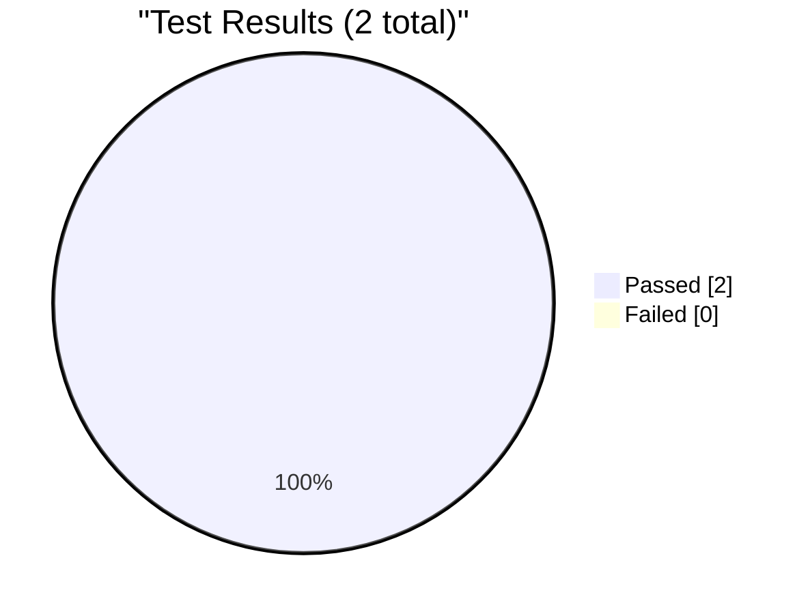
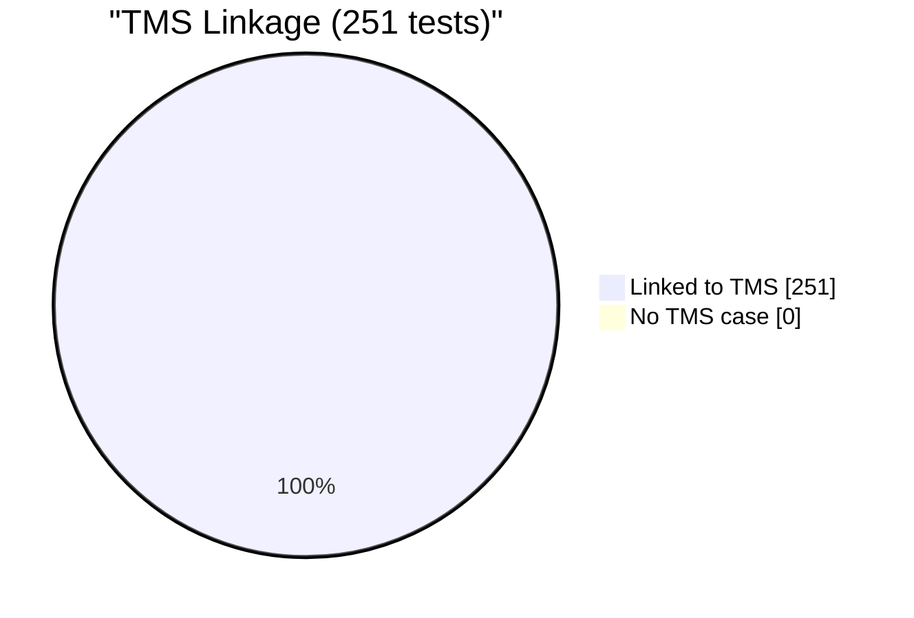
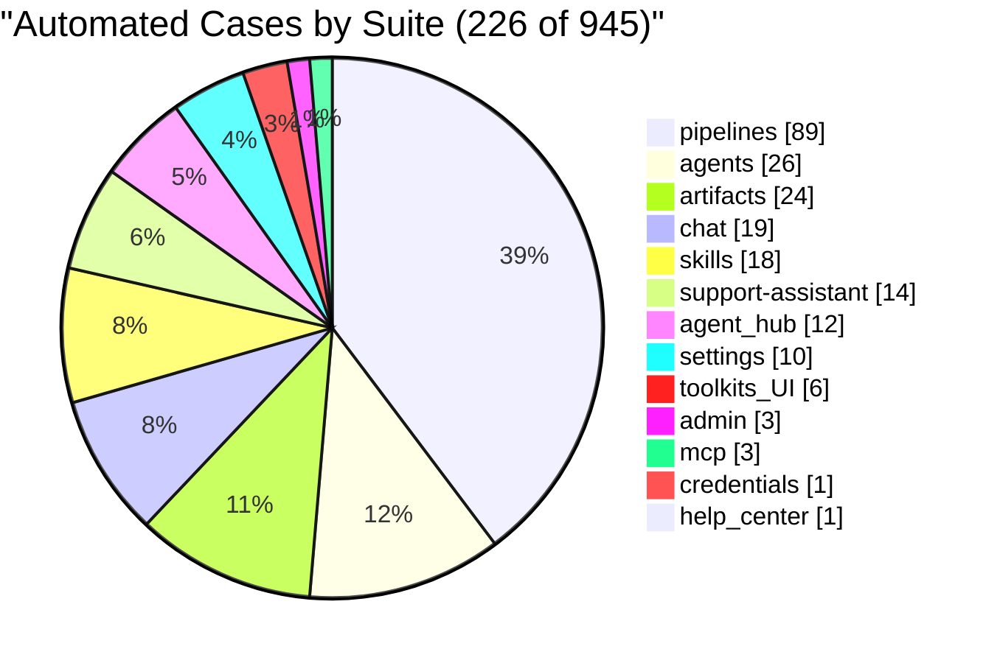

# Test Dashboard

_Generated: 2026-10-16 15:24 UTC_

## Latest Run

**RUN-ELITEA-2026-10-16-292-DEV-SMOKE-PASSED**

| Metric | Value |
|--------|-------|
| Total | 2 |
| Passed | 2 |
| Failed | 0 |
| Skipped | 0 |
| Reruns | 0 |
| Pass Rate | 100.0% |

## Trend (Last 10 Runs)

```mermaid
xychart-beta
    title "Pass/Fail Trend"
    x-axis [16-282-DEV-SMOKE, 16-283-DEV-SMOKE, 16-284-DEV-SMOKE, 16-285-DEV-SMOKE, 16-286-DEV-SMOKE, 16-288-DEV-SMOKE, 16-289-DEV-SMOKE, 16-290-DEV-SMOKE, 16-291-DEV-SMOKE, 16-292-DEV-SMOKE]
    y-axis "Tests" 0 --> 15
    bar "Passed" [2, 2, 2, 2, 2, 2, 2, 2, 2, 2]
    bar "Failed" [0, 0, 0, 0, 0, 0, 0, 0, 0, 0]
```

## Run History

| Run | Total | Passed | Failed | Skipped | Reruns | Rate |
|-----|-------|--------|--------|---------|--------|------|
| ✅ 16-292-DEV-SMOKE | 2 | 2 | 0 | 0 | 0 | 100% |
| ✅ 16-291-DEV-SMOKE | 2 | 2 | 0 | 0 | 0 | 100% |
| ✅ 16-290-DEV-SMOKE | 2 | 2 | 0 | 0 | 0 | 100% |
| ✅ 16-289-DEV-SMOKE | 2 | 2 | 0 | 0 | 0 | 100% |
| ✅ 16-288-DEV-SMOKE | 2 | 2 | 0 | 0 | 0 | 100% |
| ✅ 16-286-DEV-SMOKE | 2 | 2 | 0 | 0 | 0 | 100% |
| ✅ 16-285-DEV-SMOKE | 2 | 2 | 0 | 0 | 0 | 100% |
| ✅ 16-284-DEV-SMOKE | 2 | 2 | 0 | 0 | 0 | 100% |
| ✅ 16-283-DEV-SMOKE | 2 | 2 | 0 | 0 | 0 | 100% |
| ✅ 16-282-DEV-SMOKE | 2 | 2 | 0 | 0 | 0 | 100% |

---
_Source: `reports/automated/junit-RUN-*.json` (20 reports)_

---

## TMS Coverage Analysis

| Metric | Count |
|--------|-------|
| Tests in automation | 251 |
| Tests linked to TMS cases | 251 |
| Tests without TMS case | 0 |
| Orphan TMS refs (test missing) | 0 |
| **TMS Coverage** | **100.0%** |

### Automation Coverage by Suite

| Suite | Automated | Total |
|-------|-----------|-------|
| admin | 3 | 3 |
| agent_hub | 12 | 21 |
| agents | 26 | 61 |
| artifacts | 24 | 80 |
| chat | 19 | 234 |
| credentials | 1 | 24 |
| evaluation-run-analytics | 0 | 5 |
| help_center | 1 | 12 |
| indexing | 0 | 18 |
| mcp | 3 | 50 |
| onboarding | 0 | 11 |
| per-run-analytics | 0 | 6 |
| pipelines | 89 | 96 |
| settings | 10 | 195 |
| skills | 18 | 66 |
| social-folders | 0 | 13 |
| support-assistant | 14 | 24 |
| toolkit | 0 | 7 |
| toolkits_UI | 6 | 19 |
| **All suites** | **226** | **945** |

---
_Compared `automation/index.json` (251 tests) with `index_automated.json` (251 refs)_
