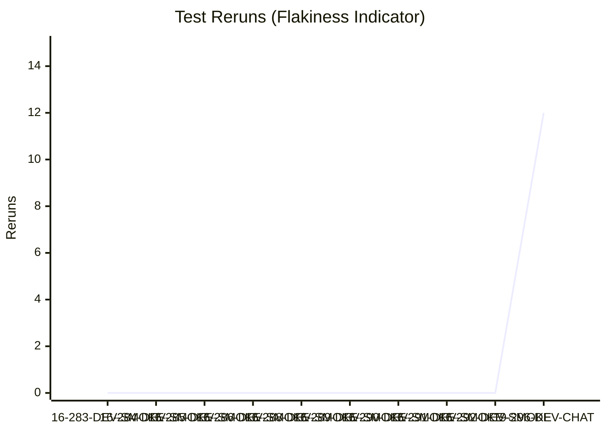
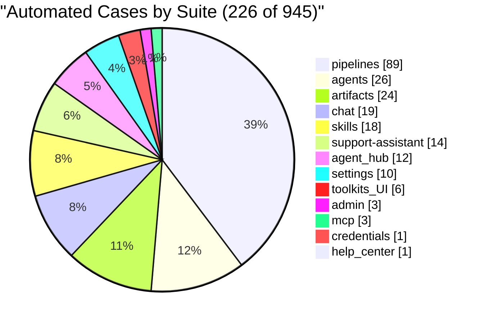

# Test Dashboard

_Generated: 2026-10-19 08:24 UTC_

## Latest Run

**RUN-ELITEA-2026-10-19-296-DEV-CHAT-FAILED**

| Metric | Value |
|--------|-------|
| Total | 29 |
| Passed | 25 |
| Failed | 2 |
| Skipped | 2 |
| Reruns | 12 |
| Pass Rate | 86.2% |

## Trend (Last 10 Runs)

```mermaid
xychart-beta
    title "Pass/Fail Trend"
    x-axis [16-283-DEV-SMOKE, 16-284-DEV-SMOKE, 16-285-DEV-SMOKE, 16-286-DEV-SMOKE, 16-288-DEV-SMOKE, 16-289-DEV-SMOKE, 16-290-DEV-SMOKE, 16-291-DEV-SMOKE, 16-292-DEV-SMOKE, 19-296-DEV-CHAT]
    y-axis "Tests" 0 --> 30
    bar "Passed" [2, 2, 2, 2, 2, 2, 2, 2, 2, 25]
    bar "Failed" [0, 0, 0, 0, 0, 0, 0, 0, 0, 2]
```

### Reruns Trend

## Run History

| Run | Total | Passed | Failed | Skipped | Reruns | Rate |
|-----|-------|--------|--------|---------|--------|------|
| ❌ 19-296-DEV-CHAT | 29 | 25 | 2 | 2 | 12 | 86% |
| ✅ 16-292-DEV-SMOKE | 2 | 2 | 0 | 0 | 0 | 100% |
| ✅ 16-291-DEV-SMOKE | 2 | 2 | 0 | 0 | 0 | 100% |
| ✅ 16-290-DEV-SMOKE | 2 | 2 | 0 | 0 | 0 | 100% |
| ✅ 16-289-DEV-SMOKE | 2 | 2 | 0 | 0 | 0 | 100% |
| ✅ 16-288-DEV-SMOKE | 2 | 2 | 0 | 0 | 0 | 100% |
| ✅ 16-286-DEV-SMOKE | 2 | 2 | 0 | 0 | 0 | 100% |
| ✅ 16-285-DEV-SMOKE | 2 | 2 | 0 | 0 | 0 | 100% |
| ✅ 16-284-DEV-SMOKE | 2 | 2 | 0 | 0 | 0 | 100% |
| ✅ 16-283-DEV-SMOKE | 2 | 2 | 0 | 0 | 0 | 100% |

---
_Source: `reports/automated/junit-RUN-*.json` (20 reports)_

---

## TMS Coverage Analysis

| Metric | Count |
|--------|-------|
| Tests in automation | 259 |
| Tests linked to TMS cases | 251 |
| Tests without TMS case | 8 |
| Orphan TMS refs (test missing) | 0 |
| **TMS Coverage** | **96.9%** |

### Automation Coverage by Suite

| Suite | Automated | Total |
|-------|-----------|-------|
| admin | 3 | 3 |
| agent_hub | 12 | 21 |
| agents | 26 | 61 |
| artifacts | 24 | 80 |
| chat | 19 | 234 |
| credentials | 1 | 24 |
| evaluation-run-analytics | 0 | 5 |
| help_center | 1 | 12 |
| indexing | 0 | 18 |
| mcp | 3 | 50 |
| onboarding | 0 | 11 |
| per-run-analytics | 0 | 6 |
| pipelines | 89 | 96 |
| settings | 10 | 195 |
| skills | 18 | 66 |
| social-folders | 0 | 13 |
| support-assistant | 14 | 24 |
| toolkit | 0 | 7 |
| toolkits_UI | 6 | 19 |
| **All suites** | **226** | **945** |

### Tests Without TMS Case

_Tests that exist in automation but have no linked TMS case._

Show 8 unlinked tests

- `tests.ui.chat.test_chat_interjection_attachment_blocking.TestInterjectionAttachmentBlockingDuringActiveRun.test_attachment_blocked_during_run_plain_text_interjection_still_queues`
- `tests.ui.chat.test_chat_interjection_fifo_order.TestInterjectionFifoMessageOrderPreservation.test_three_interjections_process_in_fifo_order`
- `tests.ui.chat.test_chat_interjection_queuing.TestInterjectionQueuingSequentialProcessing.test_interjection_queues_and_processes_in_fifo_order`
- `tests.ui.chat.test_chat_interjection_stop_preserves_queue.TestInterjectionStopPreservesQueuedMessages.test_stop_rescues_and_auto_drains_queue_without_loss`
- `tests.ui.settings.test_project_context_ai_generation_char_limit.TestProjectContextAIGenerationCharLimit.test_build_with_ai_short_prompt_under_limit`
- `tests.ui.settings.test_project_context_ai_generation_char_limit.TestProjectContextAIGenerationCharLimit.test_build_with_ai_verbose_prompt_exceeds_limit`
- `tests.ui.settings.test_project_context_ai_generation_char_limit.TestProjectContextAIGenerationCharLimit.test_chat_project_context_builder_under_limit`
- `tests.ui.settings.test_project_context_ai_generation_char_limit.TestProjectContextAIGenerationCharLimit.test_edit_with_ai_expand_content_under_limit`

---
_Compared `automation/index.json` (259 tests) with `index_automated.json` (251 refs)_
