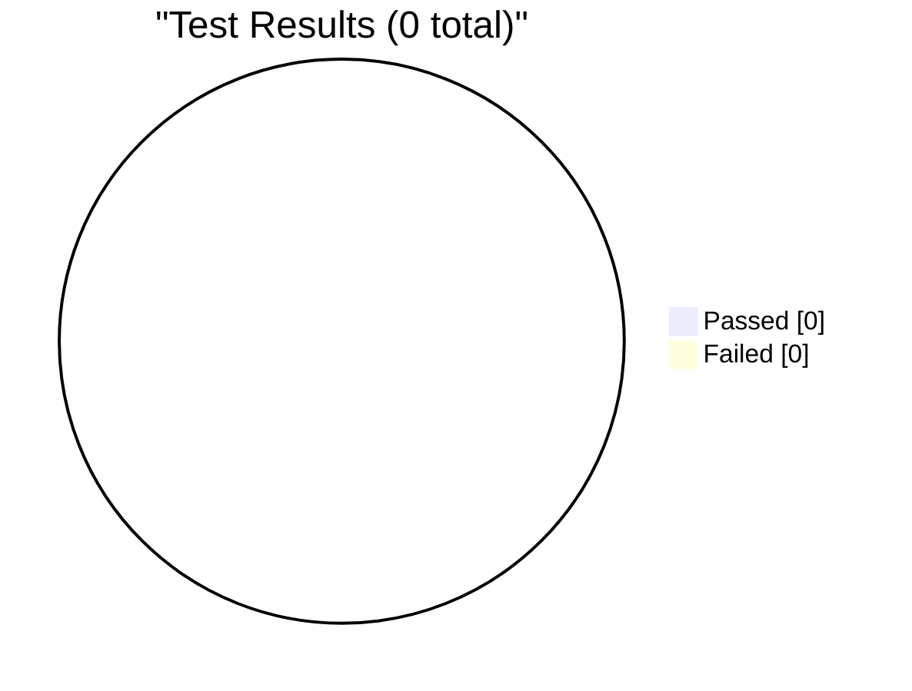
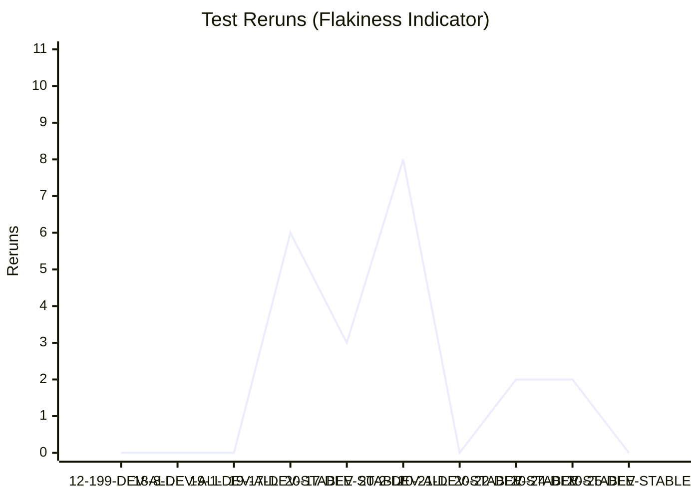

# Test Dashboard

_Generated: 2026-08-20 11:58 UTC_

## Latest Run

**RUN-ELITEA-2026-08-20-25-DEV-STABLE-ALL-PASSED**

| Metric | Value |
|--------|-------|
| Total | 0 |
| Passed | 0 |
| Failed | 0 |
| Skipped | 0 |
| Reruns | 0 |
| Pass Rate | 0.0% |

## Trend (Last 10 Runs)

```mermaid
xychart-beta
    title "Pass/Fail Trend"
    x-axis [12-199-DEV-ALL, 18-8-DEV-ALL, 19-1-DEV-ALL, 19-17-DEV-STABLE, 20-17-DEV-STABLE, 20-2-DEV-ALL, 20-21-DEV-STABLE, 20-22-DEV-STABLE, 20-24-DEV-STABLE, 20-25-DEV-STABLE]
    y-axis "Tests" 0 --> 158
    bar "Passed" [153, 81, 46, 80, 83, 46, 82, 82, 103, 0]
    bar "Failed" [2, 4, 6, 5, 2, 6, 2, 2, 1, 0]
```

### Reruns Trend

## Run History

| Run | Total | Passed | Failed | Skipped | Reruns | Rate |
|-----|-------|--------|--------|---------|--------|------|
| ✅ 20-25-DEV-STABLE | 0 | 0 | 0 | 0 | 0 | 0% |
| ❌ 20-24-DEV-STABLE | 114 | 103 | 1 | 10 | 2 | 90% |
| ❌ 20-22-DEV-STABLE | 94 | 82 | 2 | 10 | 2 | 87% |
| ❌ 20-21-DEV-STABLE | 94 | 82 | 2 | 10 | 0 | 87% |
| ❌ 20-2-DEV-ALL | 52 | 46 | 6 | 0 | 8 | 88% |
| ❌ 20-17-DEV-STABLE | 95 | 83 | 2 | 10 | 3 | 87% |
| ❌ 19-17-DEV-STABLE | 95 | 80 | 5 | 10 | 6 | 84% |
| ❌ 19-1-DEV-ALL | 52 | 46 | 6 | 0 | 0 | 88% |
| ❌ 18-8-DEV-ALL | 95 | 81 | 4 | 10 | 0 | 85% |
| ❌ 12-199-DEV-ALL | 167 | 153 | 2 | 12 | 0 | 92% |

---
_Source: `reports/automated/junit-RUN-*.json` (20 reports)_

---

## TMS Coverage Analysis

_Automation index not found. Run `build-test-index` workflow first._
