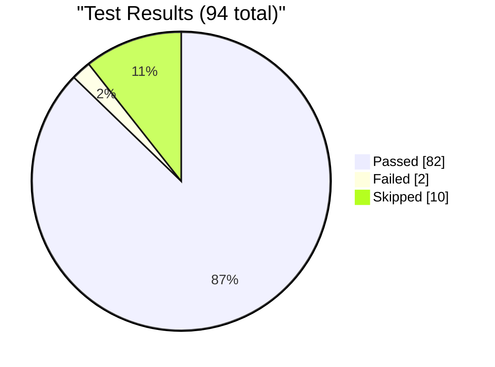
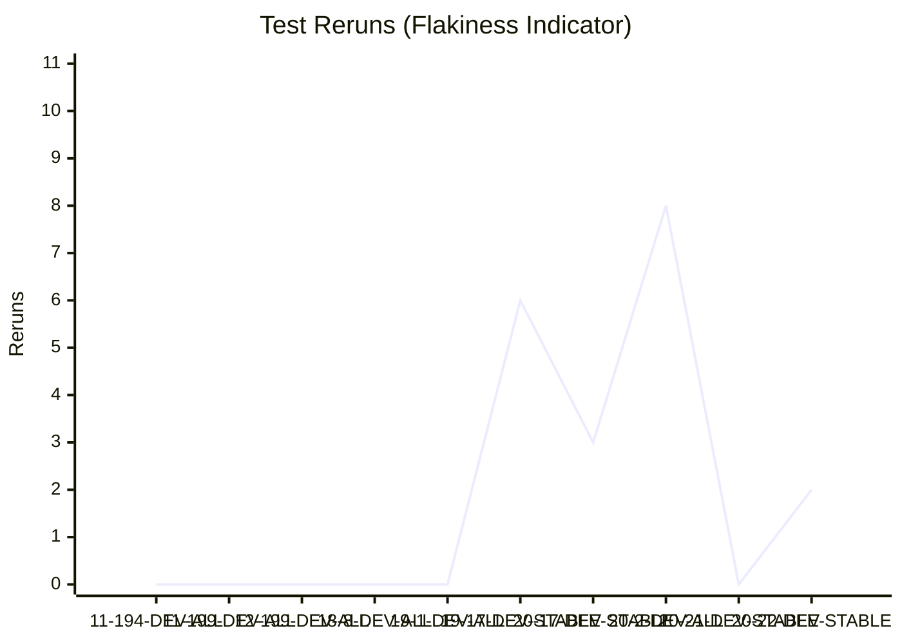

# Test Dashboard

_Generated: 2026-08-20 08:34 UTC_

## Latest Run

**RUN-ELITEA-2026-08-20-22-DEV-STABLE-ALL-FAILED**

| Metric | Value |
|--------|-------|
| Total | 94 |
| Passed | 82 |
| Failed | 2 |
| Skipped | 10 |
| Reruns | 2 |
| Pass Rate | 87.2% |

## Trend (Last 10 Runs)

```mermaid
xychart-beta
    title "Pass/Fail Trend"
    x-axis [11-194-DEV-ALL, 11-199-DEV-ALL, 12-199-DEV-ALL, 18-8-DEV-ALL, 19-1-DEV-ALL, 19-17-DEV-STABLE, 20-17-DEV-STABLE, 20-2-DEV-ALL, 20-21-DEV-STABLE, 20-22-DEV-STABLE]
    y-axis "Tests" 0 --> 158
    bar "Passed" [144, 148, 153, 81, 46, 80, 83, 46, 82, 82]
    bar "Failed" [11, 7, 2, 4, 6, 5, 2, 6, 2, 2]
```

### Reruns Trend

## Run History

| Run | Total | Passed | Failed | Skipped | Reruns | Rate |
|-----|-------|--------|--------|---------|--------|------|
| ❌ 20-22-DEV-STABLE | 94 | 82 | 2 | 10 | 2 | 87% |
| ❌ 20-21-DEV-STABLE | 94 | 82 | 2 | 10 | 0 | 87% |
| ❌ 20-2-DEV-ALL | 52 | 46 | 6 | 0 | 8 | 88% |
| ❌ 20-17-DEV-STABLE | 95 | 83 | 2 | 10 | 3 | 87% |
| ❌ 19-17-DEV-STABLE | 95 | 80 | 5 | 10 | 6 | 84% |
| ❌ 19-1-DEV-ALL | 52 | 46 | 6 | 0 | 0 | 88% |
| ❌ 18-8-DEV-ALL | 95 | 81 | 4 | 10 | 0 | 85% |
| ❌ 12-199-DEV-ALL | 167 | 153 | 2 | 12 | 0 | 92% |
| ❌ 11-199-DEV-ALL | 167 | 148 | 7 | 12 | 0 | 89% |
| ❌ 11-194-DEV-ALL | 167 | 144 | 11 | 12 | 0 | 86% |

---
_Source: `reports/automated/junit-RUN-*.json` (20 reports)_
