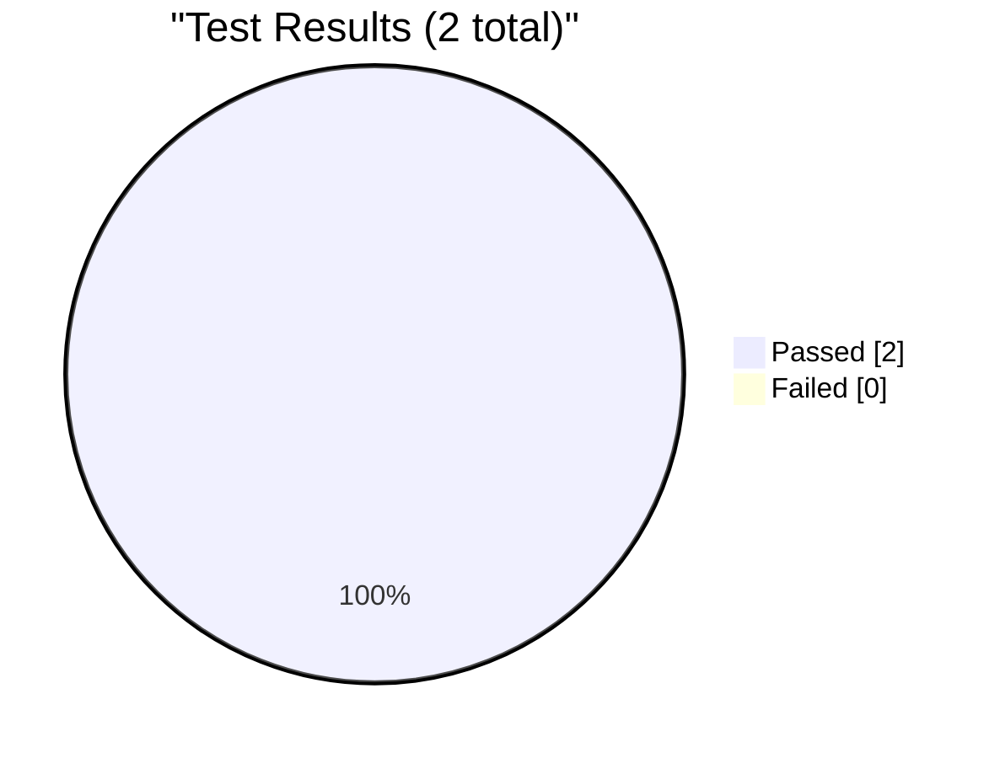
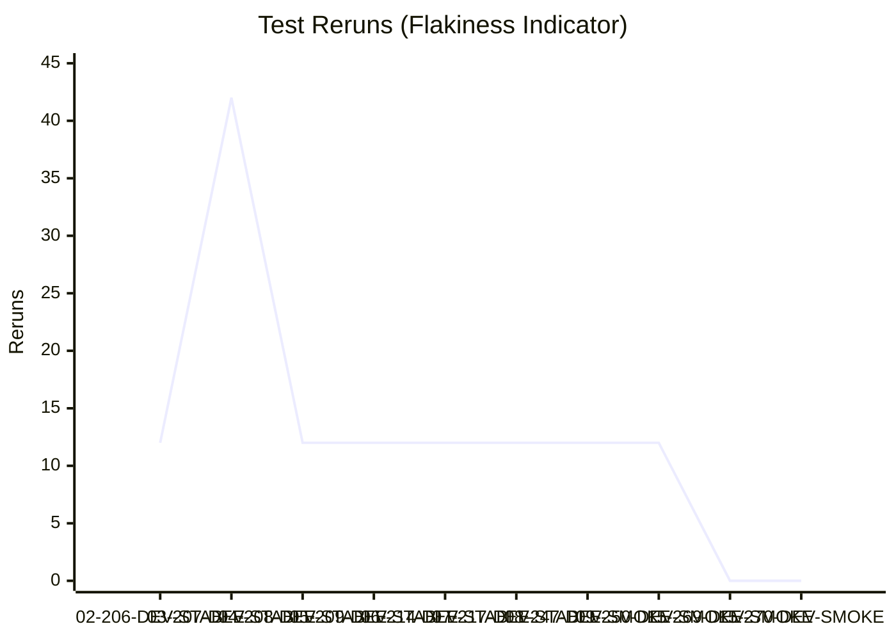
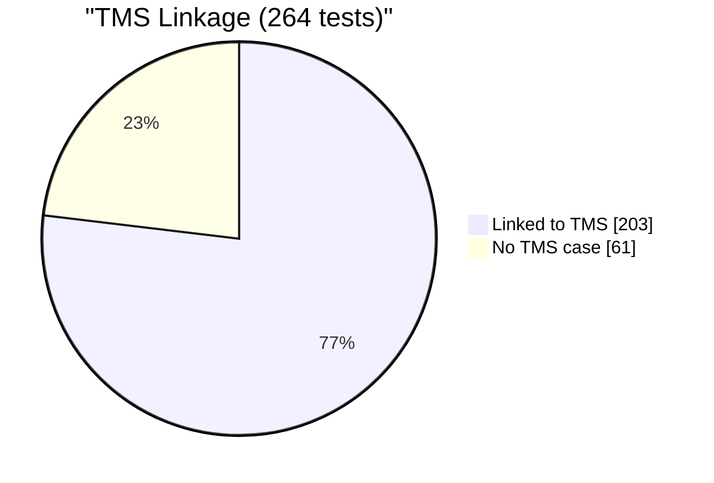

# Test Dashboard

_Generated: 2026-10-15 11:17 UTC_

## Latest Run

**RUN-ELITEA-2026-10-15-270-DEV-SMOKE-PASSED**

| Metric | Value |
|--------|-------|
| Total | 2 |
| Passed | 2 |
| Failed | 0 |
| Skipped | 0 |
| Reruns | 0 |
| Pass Rate | 100.0% |

## Trend (Last 10 Runs)

```mermaid
xychart-beta
    title "Pass/Fail Trend"
    x-axis [02-206-DEV-STABLE, 03-207-DEV-STABLE, 04-208-DEV-STABLE, 05-209-DEV-STABLE, 06-214-DEV-STABLE, 07-217-DEV-STABLE, 08-247-DEV-SMOKE, 09-250-DEV-SMOKE, 15-269-DEV-SMOKE, 15-270-DEV-SMOKE]
    y-axis "Tests" 0 --> 51
    bar "Passed" [26, 46, 26, 26, 26, 26, 29, 29, 2, 2]
    bar "Failed" [2, 24, 2, 2, 2, 2, 2, 2, 0, 0]
```

### Reruns Trend

## Run History

| Run | Total | Passed | Failed | Skipped | Reruns | Rate |
|-----|-------|--------|--------|---------|--------|------|
| ✅ 15-270-DEV-SMOKE | 2 | 2 | 0 | 0 | 0 | 100% |
| ✅ 15-269-DEV-SMOKE | 2 | 2 | 0 | 0 | 0 | 100% |
| ❌ 09-250-DEV-SMOKE | 31 | 29 | 2 | 0 | 12 | 94% |
| ❌ 08-247-DEV-SMOKE | 31 | 29 | 2 | 0 | 12 | 94% |
| ❌ 07-217-DEV-STABLE | 30 | 26 | 2 | 2 | 12 | 87% |
| ❌ 06-214-DEV-STABLE | 30 | 26 | 2 | 2 | 12 | 87% |
| ❌ 05-209-DEV-STABLE | 30 | 26 | 2 | 2 | 12 | 87% |
| ❌ 04-208-DEV-STABLE | 30 | 26 | 2 | 2 | 12 | 87% |
| ❌ 03-207-DEV-STABLE | 72 | 46 | 24 | 2 | 42 | 64% |
| ❌ 02-206-DEV-STABLE | 30 | 26 | 2 | 2 | 12 | 87% |

---
_Source: `reports/automated/junit-RUN-*.json` (20 reports)_

---

## TMS Coverage Analysis

| Metric | Count |
|--------|-------|
| Tests in automation | 264 |
| Tests linked to TMS cases | 203 |
| Tests without TMS case | 61 |
| Orphan TMS refs (test missing) | 13 |
| **TMS Coverage** | **76.9%** |

### Tests Without TMS Case

_Tests that exist in automation but have no linked TMS case._

Show 61 unlinked tests

- `tests.ui.admin.test_guardrails_live_reload.TestBlockedToolLiveReload.test_blocked_tool_live_reload_case_insensitive`
- `tests.ui.admin.test_guardrails_live_reload.TestBlockedToolkitLiveReload.test_blocked_toolkit_live_reload_case_insensitive`
- `tests.ui.admin.test_guardrails_live_reload.TestSensitiveToolLiveReload.test_sensitive_tool_live_reload_case_insensitive`
- `tests.ui.agents.test_agent_character_limits.TestConversationStarterCharacterCounter.test_conversation_starter_counter_turns_red_at_limit`
- `tests.ui.agents.test_agent_character_limits.TestConversationStarterCharacterCounter.test_conversation_starter_counter_visible_and_updates`
- `tests.ui.agents.test_agent_character_limits.TestConversationStarterCharacterCounter.test_conversation_starter_fullscreen_counter_and_warning`
- `tests.ui.agents.test_agent_character_limits.TestConversationStarterCharacterCounter.test_multiple_conversation_starters_have_counters`
- `tests.ui.agents.test_agent_character_limits.TestWelcomeMessageCharacterCounter.test_welcome_message_counter_turns_red_at_limit`
- `tests.ui.agents.test_agent_character_limits.TestWelcomeMessageCharacterCounter.test_welcome_message_counter_visible_and_updates_realtime`
- `tests.ui.agents.test_agent_character_limits.TestWelcomeMessageCharacterCounter.test_welcome_message_fullscreen_counter_and_warning`
- `tests.ui.agents.test_agent_character_limits.TestWelcomeMessageCharacterCounter.test_welcome_message_text_truncated_with_warning`
- `tests.ui.agents.test_agent_with_github_toolkit.TestAddToolkitToAgent.test_add_toolkit_to_agent`
- `tests.ui.agents.test_agent_with_github_toolkit.TestChatWithAgentToolkit.test_agent_chat_with_github_toolkit`
- `tests.ui.agents.test_agent_with_github_toolkit.TestRemoveToolkitFromAgent.test_remove_toolkit_from_agent`
- `tests.ui.artifacts.test_artifacts_multi_file.TestArtifactMultiFileDownload.test_agent_creates_files_at_root_and_in_subfolder`
- `tests.ui.chat.test_agent_with_toolkit_chat.TestAgentWithToolkitInChat.test_agent_with_toolkit_executes_in_chat`
- `tests.ui.chat.test_chat_interface.TestContextAndSettings.test_edit_context_settings`
- `tests.ui.chat.test_chat_interface.TestConversationUIElements.test_attach_files_button_sends_file_with_message`
- `tests.ui.chat.test_chat_interface.TestMessageActions.test_copy_message_to_clipboard`
- `tests.ui.chat.test_chat_interface.TestSearchAndErrorHandling.test_handle_message_send_failure`
- `tests.ui.chat.test_chat_interface.TestSearchAndErrorHandling.test_search_conversations_dialog`
- `tests.ui.chat.test_chat_interface.TestSendingMessages.test_cannot_send_empty_message`
- `tests.ui.chat.test_chat_interface.TestSendingMessages.test_send_text_message`
- `tests.ui.chat.test_chat_interface.TestSidebarNavigation.test_navigate_to_agents_from_sidebar`
- `tests.ui.chat.test_chat_interface.TestSidebarNavigation.test_open_close_sidebar`
- `tests.ui.chat.test_context_management.TestContextManagementSettings.test_context_budget_reflects_profile_max_tokens[10k_tokens]`
- `tests.ui.chat.test_context_management.TestContextManagementSettings.test_context_budget_reflects_profile_max_tokens[32k_tokens]`
- `tests.ui.chat.test_open_existing_conversation_from_this_week_section.TestOpenExistingConversationFromThisWeekSection.test_open_existing_conversation_from_this_week_section`
- `tests.ui.pipelines.test_pipeline_advanced.TestActionsMenu.test_export_pipeline_if_available`
- `tests.ui.pipelines.test_pipeline_advanced.TestActionsMenu.test_three_dot_menu_lists_items`
- `tests.ui.pipelines.test_pipeline_advanced.TestDiscardChanges.test_save_discard_button_states_toggle_on_edit_and_discard`
- `tests.ui.pipelines.test_pipeline_advanced.TestMakeEntrypoint.test_make_node_entrypoint`
- `tests.ui.pipelines.test_pipeline_advanced.TestMultiNodeTopology.test_save_multi_node_pipeline`
- `tests.ui.pipelines.test_pipeline_advanced.TestMultiNodeTopology.test_three_node_chain`
- `tests.ui.pipelines.test_pipeline_advanced.TestYamlEditor.test_flow_yaml_round_trip`
- `tests.ui.pipelines.test_pipeline_advanced.TestYamlEditor.test_yaml_content_reflects_pipeline`
- `tests.ui.pipelines.test_pipeline_advanced.TestYamlEditor.test_yaml_view_toggle`
- `tests.ui.pipelines.test_pipeline_execution.TestExecutePipeline.test_message_count_starts_at_zero_and_grows`
- `tests.ui.pipelines.test_pipeline_execution.TestExecutePipeline.test_pipeline_response_is_meaningful`
- `tests.ui.pipelines.test_pipeline_execution.TestPipelineChatMessages.test_multiple_executions_accumulate`
- `tests.ui.pipelines.test_pipeline_execution.TestPipelineChatMessages.test_user_message_visible`
- `tests.ui.pipelines.test_pipeline_execution.TestPipelineExecutionEdgeCases.test_empty_pipeline_execution`
- `tests.ui.pipelines.test_pipeline_execution.TestPipelineExecutionEdgeCases.test_navigate_away_and_reexecute`
- `tests.ui.smoke.test_ui_smoke.TestHomePage.test_main_content_visible`
- `tests.ui.smoke.test_ui_smoke.TestHomePage.test_page_loads`
- `tests.ui.test_maintenance_handling.test_api_maintenance_error_triggerable`
- `tests.ui.test_maintenance_handling.test_maintenance_banner_dismissed_automatically`
- `tests.ui.test_maintenance_handling.test_maintenance_detection_captures_screenshot`
- `tests.ui.test_maintenance_handling.test_maintenance_state_boolean_check`
- `tests.ui.toolkits.test_toolkit_parameterized.TestChatWithToolkit.test_chat_with_toolkit[bitbucket]`
- `tests.ui.toolkits.test_toolkit_parameterized.TestChatWithToolkit.test_chat_with_toolkit[gitlab]`
- `tests.ui.toolkits.test_toolkit_parameterized.TestCreateCredential.test_create_credential[bitbucket]`
- `tests.ui.toolkits.test_toolkit_parameterized.TestCreateCredential.test_create_credential[gitlab]`
- `tests.ui.toolkits.test_toolkit_parameterized.TestCreateToolkit.test_create_toolkit[bitbucket]`
- `tests.ui.toolkits.test_toolkit_parameterized.TestCreateToolkit.test_create_toolkit[gitlab]`
- `tests.ui.toolkits.test_toolkit_parameterized.TestToolkitTestSettings.test_toolkit_test_settings[bitbucket]`
- `tests.ui.toolkits.test_toolkit_parameterized.TestToolkitTestSettings.test_toolkit_test_settings[gitlab]`
- `tests.ui.voice.test_voice_configuration.TestVoiceConfiguration.test_speed_and_volume_controls`
- `tests.ui.voice.test_voice_configuration.TestVoiceConfiguration.test_voice_preview_personalization`
- `tests.ui.voice.test_voice_configuration.TestVoiceConfiguration.test_voice_selection_from_chat`
- `tests.ui.voice.test_voice_configuration.TestVoiceConfiguration.test_voice_settings_sync`

### Orphan TMS References

_TMS cases reference tests that don't exist in automation (renamed/deleted?)._

Show 13 orphan refs

- `tests.ui.chat.test_chat_interface.test_chat_message_history_displays` (ELITEA-1142)
- `tests.ui.chat.test_chat_interface.test_chat_page_loads_successfully` (ELITEA-1142)
- `tests.ui.chat.test_chat_interface.test_message_input_is_functional` (ELITEA-1142)
- `tests.ui.chat.test_context_management.TestContextManagementSettings.test_context_budget_reflects_profile_max_tokens` (ELITEA-1340)
- `tests.ui.help_center.test_help_center_page_loads.TestHelpCenterPageLoads.test_help_center_page_loads_via_sidebar_icon` (ELITEA-2219)
- `tests.ui.pipelines.test_pipeline_nodes.TestAddNode.test_add_code_node` (ELITEA-0853)
- `tests.ui.pipelines.test_pipeline_nodes.TestAddNode.test_add_llm_node` (ELITEA-0853)
- `tests.ui.pipelines.test_pipeline_nodes.TestConnectNodes.test_connect_node_to_end` (ELITEA-0853)
- `tests.ui.pipelines.test_pipeline_nodes.TestConnectNodes.test_connect_two_custom_nodes` (ELITEA-0853)
- `tests.ui.pipelines.test_pipeline_nodes.TestDeleteNode.test_delete_node_does_not_remove_end` (ELITEA-0853)
- `tests.ui.pipelines.test_pipeline_nodes.TestDeleteNode.test_delete_node_via_menu` (ELITEA-0853)
- `tests.ui.pipelines.test_pipeline_nodes.TestEditNode.test_edit_node_name` (ELITEA-0853)
- `tests.ui.pipelines.test_pipeline_nodes.TestEditNode.test_node_default_name_matches_type` (ELITEA-0853)

---
_Compared `automation/index.json` (264 tests) with `index_automated.json` (216 refs)_
